<p align="center">
  
</p>

<h1 align="center">ClearRead</h1>

<p align="center">
  <b>Lectura asistida para estudiantes con dislexia.</b><br>
  Convierte PDFs y fotos de apuntes en un texto cómodo de leer, que la app lee en voz alta resaltando cada palabra.
</p>

<p align="center">
  Windows 10/11 · Núcleo 100% offline · Asistente de IA opcional · Versión 1.7.0
</p>

<p align="center">
  <a href="https://github.com/SoFzzz/ClearRead/releases/latest"><b>⬇ Descargar ClearRead 1.7.0 para Windows</b></a>
</p>

<p align="center">
  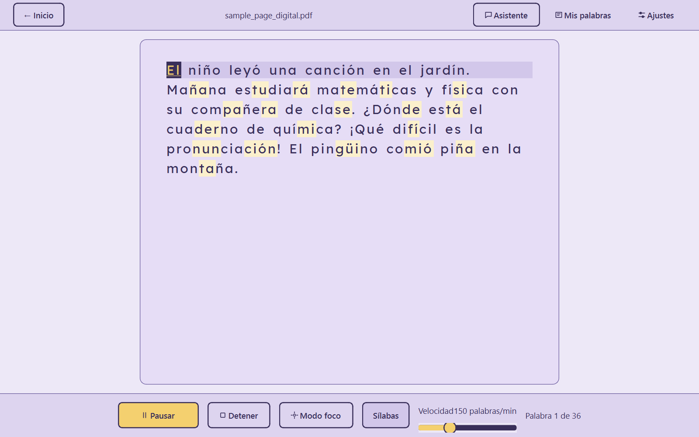
</p>

---

## Contenido

1. [Qué es ClearRead y para quién es](#qué-es-clearread-y-para-quién-es)
2. [El problema que resuelve](#el-problema-que-resuelve)
3. [Recorrido por la app](#recorrido-por-la-app)
4. [Atajos de teclado](#atajos-de-teclado)
5. [Cómo funciona por dentro](#cómo-funciona-por-dentro)
6. [Privacidad](#privacidad)
7. [Accesibilidad](#accesibilidad)
8. [Descarga e instalación](#descarga-e-instalación)
9. [Para desarrolladores](#para-desarrolladores)
10. [Tecnologías y licencias](#tecnologías-y-licencias)
11. [Limitaciones conocidas](#limitaciones-conocidas)
12. [Créditos](#créditos)

---

## Qué es ClearRead y para quién es

ClearRead es una **aplicación de escritorio para Windows** pensada para estudiantes con **dislexia** (una dificultad de aprendizaje que hace que leer cueste más de lo normal, aunque la persona sea muy capaz). También puede servir a cualquiera a quien le cueste leer textos largos o densos.

Le das un **PDF**, una **foto** de tus apuntes o un documento **escaneado**, y ClearRead:

- **Reconoce el texto** de la imagen (a esto se le llama OCR, «reconocimiento óptico de caracteres») sin enviar tu archivo a ningún sitio.
- Lo muestra en una **hoja de lectura limpia**, con letra adaptada y más espacio entre letras, palabras y líneas.
- **Colorea las sílabas** de dos colores alternados para ayudarte a descomponer las palabras largas.
- **Lee en voz alta** y resalta la palabra que suena, con una regleta que marca la línea actual.
- Ofrece un **asistente de IA opcional** que explica una palabra o simplifica un párrafo con lenguaje sencillo.

## El problema que resuelve

Leer una guía fotocopiada, un examen o unos apuntes escaneados exige un esfuerzo extra a quien tiene dislexia: letras apretadas, líneas densas en las que es fácil perderse, palabras largas difíciles de descomponer y poco apoyo para unir lo que se ve con lo que se oye. ClearRead transforma ese material en una superficie de lectura adaptada y añade apoyo auditivo sincronizado.

> Las ayudas de ClearRead (tipografía, sílabas de colores, modo foco) están elegidas a partir de recomendaciones de accesibilidad, pero **todavía no se han probado con lectores con dislexia**. Por eso todo se puede activar, desactivar y ajustar a tu gusto.

---

## Recorrido por la app

### 1. Entrar o crear una cuenta

Al abrir la app hay que **entrar con una cuenta**. Tu cuenta guarda tus ajustes y tus palabras (no tus documentos). Puedes entrar con **correo y contraseña** o con **Google** (si ya vinculaste tu cuenta de Google en Ajustes). Desde esta pantalla también puedes recuperar tu contraseña y leer el aviso de privacidad.

<table>
  <tr>
    <td width="50%">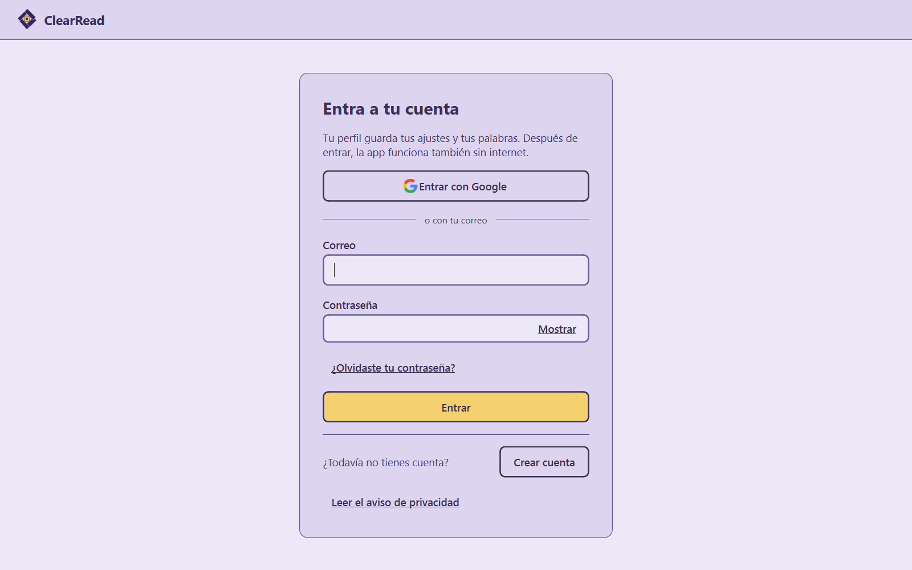</td>
    <td width="50%">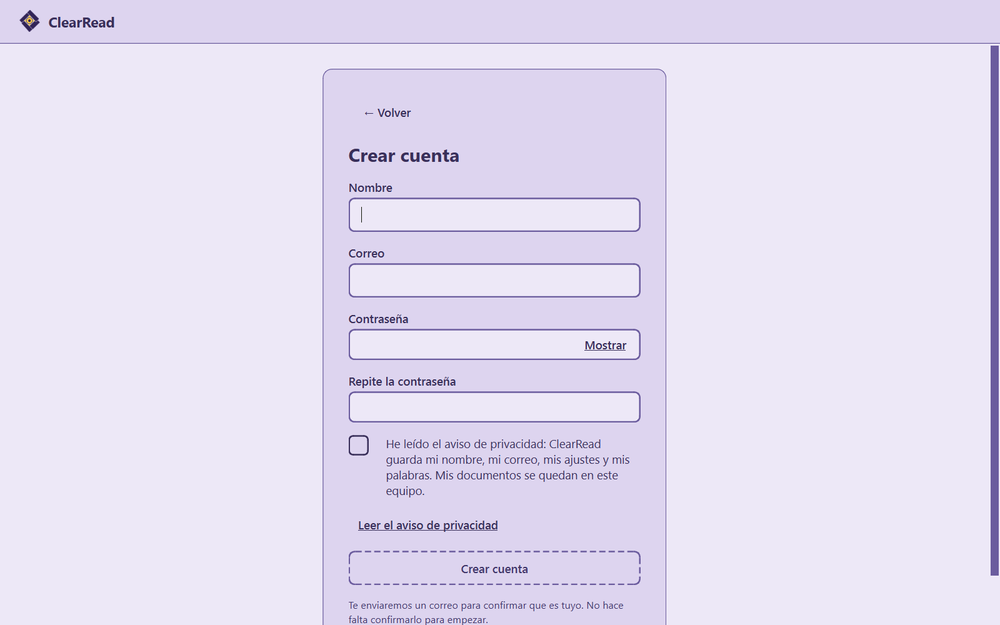</td>
  </tr>
  <tr>
    <td><sub><b>Entrar.</b> Con Google o con tu correo. Solo el <b>primer</b> inicio de sesión en un equipo necesita internet.</sub></td>
    <td><sub><b>Crear cuenta.</b> Nombre, correo y contraseña repetida. Antes de crearla se acepta el aviso de privacidad.</sub></td>
  </tr>
</table>

Después del primer inicio de sesión, la app abre con tu sesión guardada y **funciona completa sin conexión**.

### 2. Inicio: tu espacio de lectura y tu biblioteca

Es la pantalla principal. Aquí puedes:

- **Continuar leyendo** el último documento, con su porcentaje leído.
- **Arrastrar un PDF o una foto** a la zona punteada, o pulsar **Elegir archivo**. Sirven PDF, JPG, PNG, BMP y TIFF.
- Elegir en **«Guardar en:»** la carpeta donde quedará el documento nuevo.
- Pulsar **Probar con un ejemplo** para ver cómo funciona sin subir nada.
- Ver tus cifras (palabras leídas, tiempo de lectura y documentos). Se calculan en tu equipo y no se envían a ningún sitio.
- Ordenar tu **biblioteca** con **carpetas**, buscar por nombre y quitar documentos que ya no necesites (tu archivo original nunca se toca).

<p align="center">
  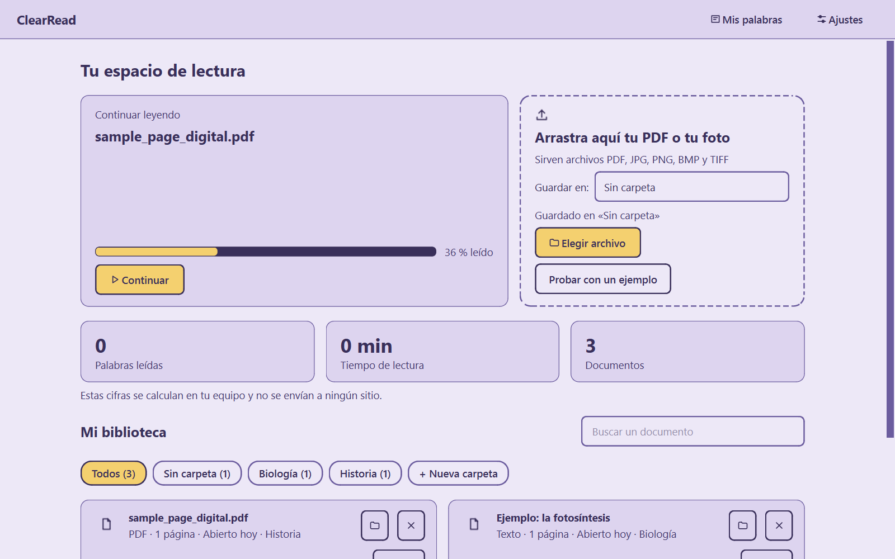
</p>

### 3. Procesando: el OCR corre en tu equipo

Cuando eliges un archivo, ClearRead lo prepara: si es una foto o un PDF escaneado, reconoce el texto con un modelo de inteligencia artificial que **funciona sin internet** y entiende la ñ, las tildes y los signos ¿ ¡. La pantalla avisa de que puede tardar si el documento tiene muchas páginas y de que **tu archivo no sale de este equipo**. Puedes **cancelar** en cualquier momento.

<p align="center">
  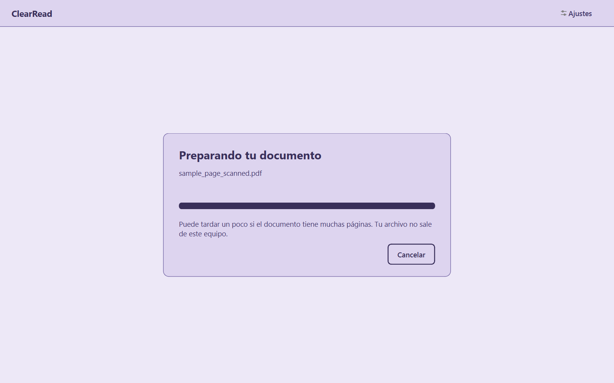
</p>

### 4. Lectura: texto adaptado, sílabas de colores y voz

La **hoja de lectura** muestra el texto con la tipografía que elijas (Lexend por defecto), con espacio extra entre letras, palabras y líneas. Si ya habías empezado el documento, te ofrece **seguir desde donde lo dejaste**.

<p align="center">
  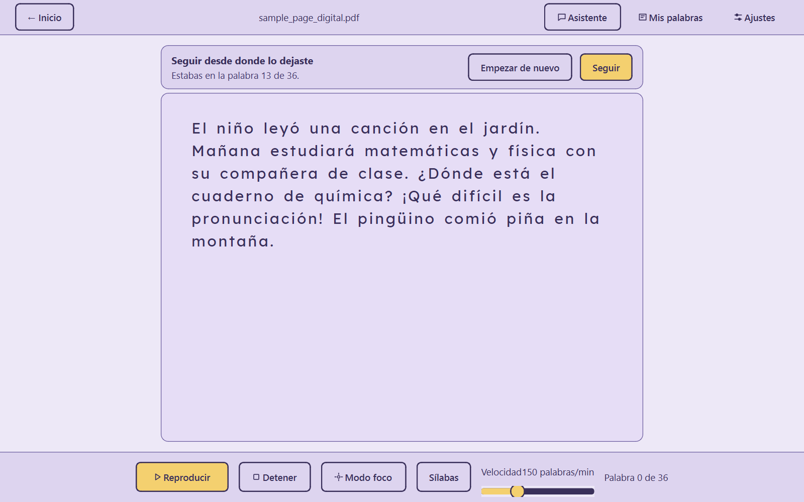
</p>

**Sílabas de colores.** El botón **Sílabas** (o la tecla `S`) colorea las sílabas alternando dos tonos, siguiendo la segmentación silábica del español. También se puede dejar activado desde Ajustes.

<p align="center">
  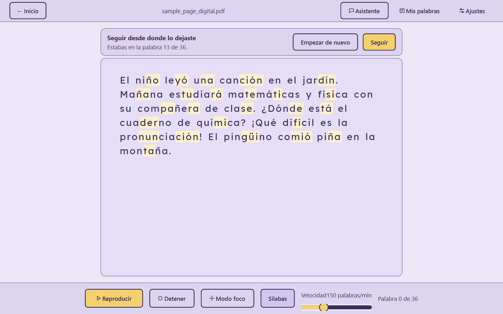
</p>

**Lectura en voz alta con la palabra resaltada.** Pulsa **Reproducir** (o `Espacio`): la voz de Windows lee el texto, la palabra que suena se resalta y una **regleta** marca la línea actual. Puedes **pausar**, **detener** y cambiar la **velocidad** (en palabras por minuto). Tú controlas la voz: un clic en una palabra solo marca desde dónde empezar, sin sonido.

<p align="center">
  
</p>

**Modo foco.** El botón **Modo foco** (o la tecla `F`) atenúa todo menos la línea que se está leyendo, para que no te distraigas con el resto de la página.

**Páginas.** Los documentos conservan sus páginas. Hay una barra con **Anterior**, el número de página y **Siguiente**, y dos formas de ver el documento: **Continua** (todo seguido) o **Por páginas**. Con la voz en marcha, la página pasa sola.

<p align="center">
  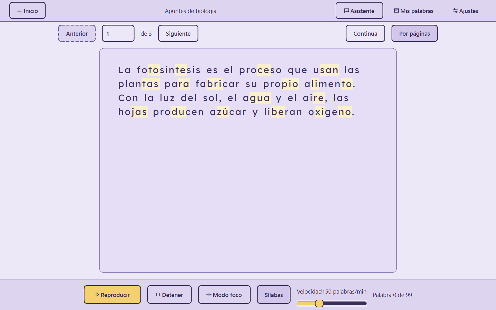
</p>

### 5. Asistente de IA (opcional)

Si te encuentras una palabra difícil, **haz clic derecho** sobre ella (o sobre un párrafo) y elige *Explicar esta palabra* o *Simplificar este párrafo*. También puedes abrir el panel **Asistente** (`Ctrl` + `I`) y usar los botones **Explicar palabra** y **Simplificar párrafo**.

<p align="center">
  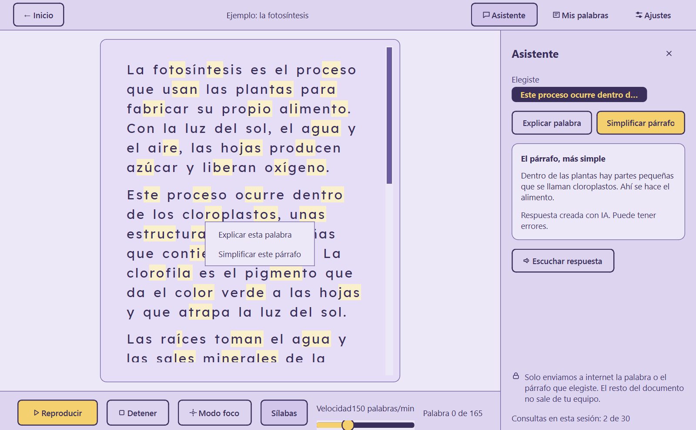
</p>

<table>
  <tr>
    <td width="50%">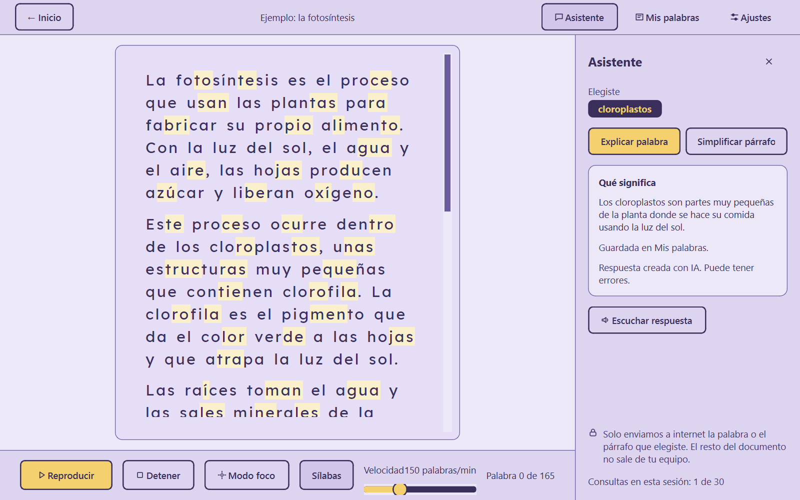</td>
    <td width="50%">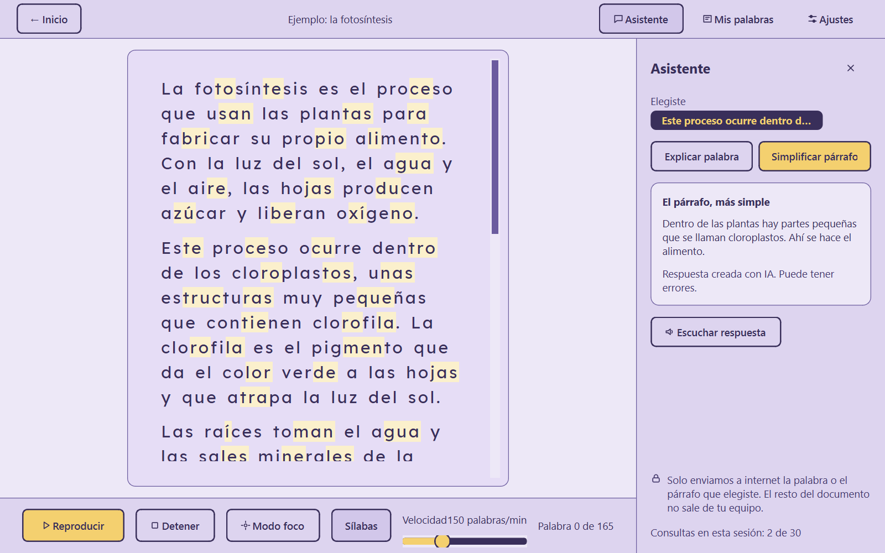</td>
  </tr>
  <tr>
    <td><sub><b>Explicar palabra.</b> Una explicación corta según el contexto. La palabra se guarda sola en <i>Mis palabras</i>.</sub></td>
    <td><sub><b>Simplificar párrafo.</b> El mismo párrafo con palabras más sencillas. El botón <i>Escuchar respuesta</i> la lee en voz alta.</sub></td>
  </tr>
</table>

Cosas que conviene saber del asistente:

- **Solo se envía lo que eliges**: la palabra (con su oración) o el párrafo. El resto del documento no sale de tu equipo. Lo recuerda el panel y, la **primera vez**, un aviso de privacidad te pide permiso.
- Cada respuesta lleva la nota *«Respuesta creada con IA. Puede tener errores.»*
- Hay un **límite de consultas** para cuidar el servicio: el panel muestra *«Consultas en esta sesión: 1 de 30»*. Además, el servidor tiene topes diarios. Si se alcanzan, la app te lo explica con un mensaje claro y el resto de ClearRead sigue funcionando.
- Las respuestas ya pedidas se guardan en tu equipo para no volver a consultar.
- La **primera consulta puede tardar** hasta cerca de un minuto si el servidor gratuito estaba «dormido»; la app muestra *Despertando el asistente…*.

### 6. Mis palabras

Cada palabra que te explica el asistente se guarda en un **glosario personal**, para repasarla después, incluso sin conexión. Puedes **escucharla**, **buscarla**, **borrarla** y ordenarla en **temas** (por ejemplo, uno por asignatura). Tus palabras viajan con tu cuenta.

<p align="center">
  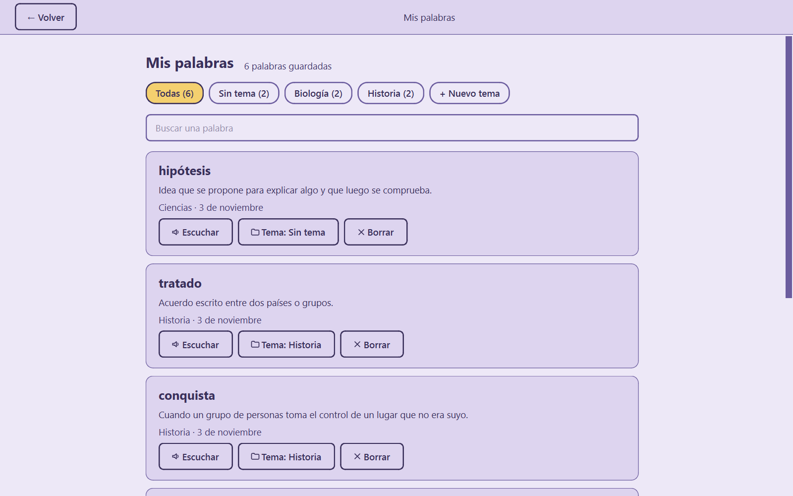
</p>

### 7. Ajustes

Los cambios se **guardan solos y se ven al momento**. Aquí puedes:

- Ver tu **cuenta**: cerrar sesión, **vincular con Google**, borrar tu cuenta y leer el aviso de privacidad.
- Elegir el **tema** Claro u Oscuro.
- Elegir la **fuente de lectura** (Lexend, Atkinson Hyperlegible u OpenDyslexic) y ajustar el tamaño de letra y el espacio entre líneas, letras y palabras, y activar o no las sílabas de colores.
- Ajustar la **voz** (velocidad).
- Comprobar todo en la **vista previa**, que muestra cómo se verá tu lectura: sílabas de dos colores, palabra resaltada y línea actual marcada.
- Usar **Restablecer valores** si te pierdes.
- En **Tu privacidad**, **borrar los documentos recientes** que ClearRead guarda en tu equipo para abrirlos más rápido.

<table>
  <tr>
    <td width="50%">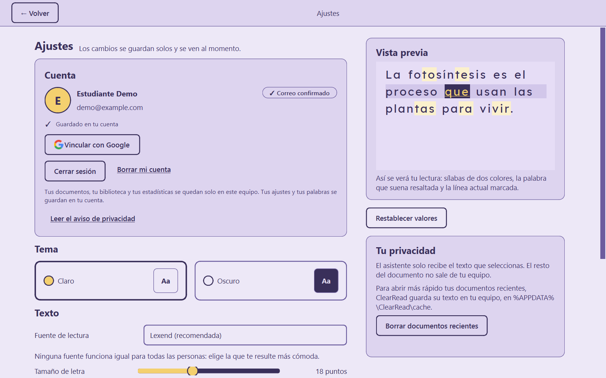</td>
    <td width="50%">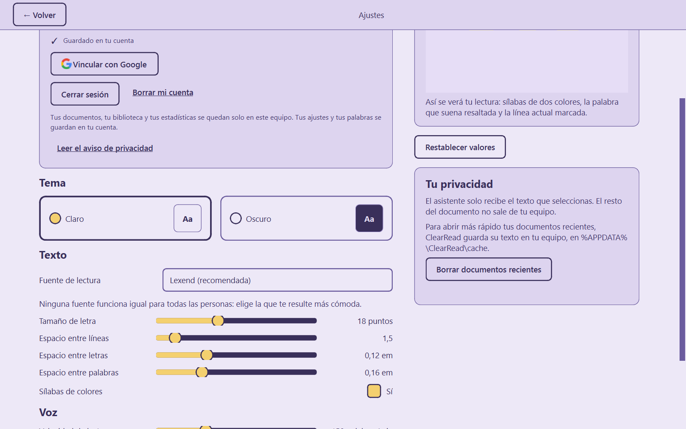</td>
  </tr>
  <tr>
    <td><sub><b>Cuenta, vista previa y tema.</b></sub></td>
    <td><sub><b>Texto.</b> Tamaño y espaciado con deslizadores.</sub></td>
  </tr>
</table>

### 8. Sin internet: todo funciona, salvo el asistente

Sin conexión, la app avisa con una etiqueta **Sin internet** y el panel del asistente muestra *«El asistente está apagado. El asistente necesita internet. Lo demás funciona igual.»* Leer, el OCR, las sílabas, la voz, la biblioteca y *Mis palabras* siguen funcionando.

<p align="center">
  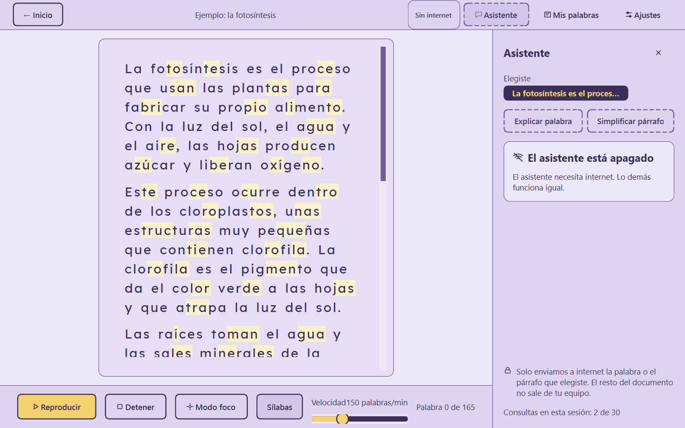
</p>

### 9. Mensajes de error que se entienden

Los errores se explican **sin tecnicismos** y siempre dicen **qué puedes hacer**. Por ejemplo, si una foto no tiene texto legible, ClearRead te sugiere probar con una foto más nítida, con buena luz y sin sombras.

<p align="center">
  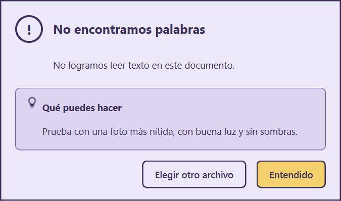
</p>

### 10. Tema oscuro

Además del tema Claro hay un **tema Oscuro** (se cambia en Ajustes), con el mismo cuidado en el contraste.

<table>
  <tr>
    <td width="50%">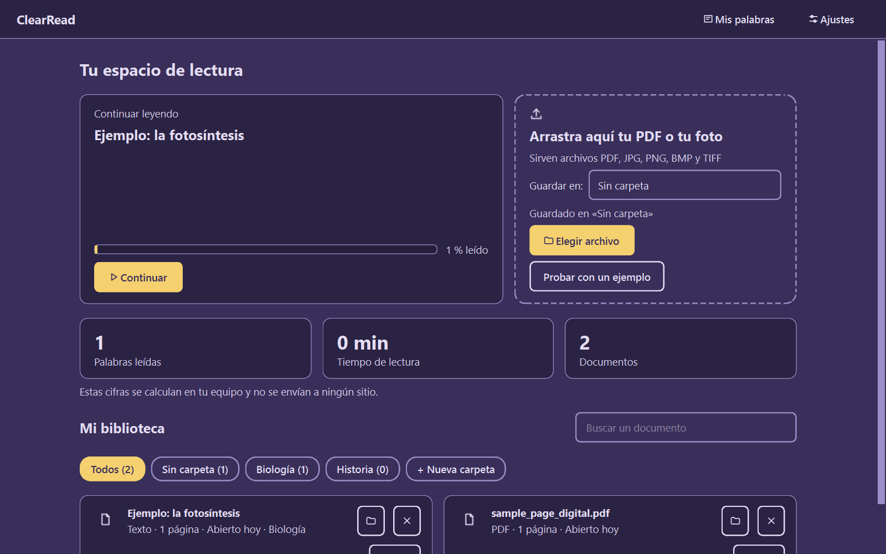</td>
    <td width="50%">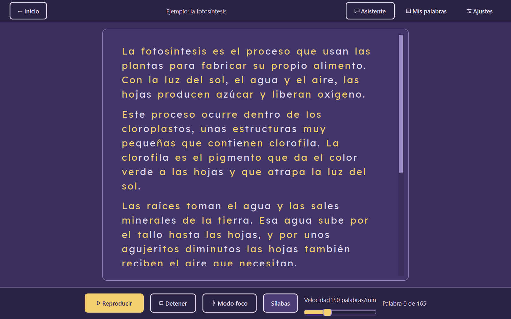</td>
  </tr>
  <tr>
    <td><sub><b>Inicio</b> en tema oscuro.</sub></td>
    <td><sub><b>Lectura</b> con sílabas de colores en tema oscuro.</sub></td>
  </tr>
  <tr>
    <td colspan="2" align="center">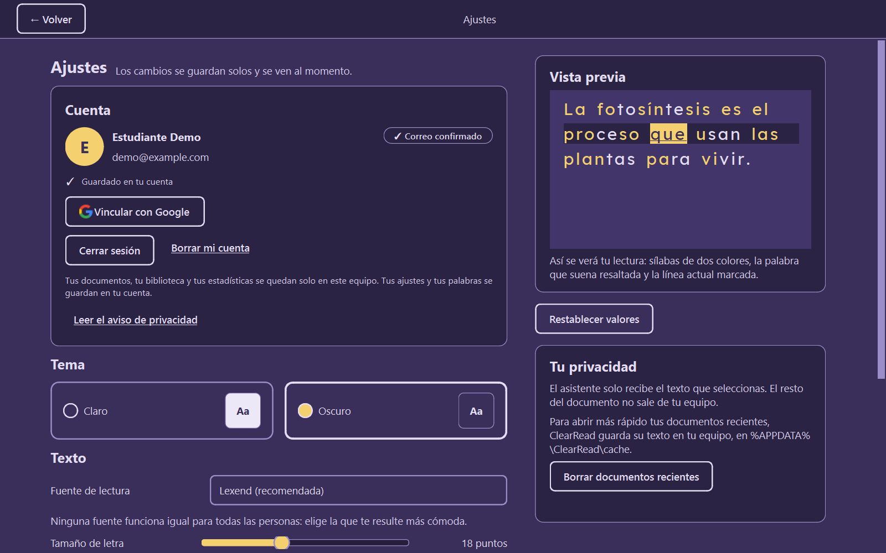<br><sub><b>Ajustes</b> con la opción Oscuro elegida.</sub></td>
  </tr>
</table>

### 11. Interfaz en inglés

La interfaz se puede usar en **español** (por defecto) o en **inglés**. Al cambiar de idioma, ClearRead pide confirmación y se reinicia solo. El idioma cambia la interfaz; el contenido de los documentos se sigue tratando como español. La voz de lectura usa el idioma de la interfaz si tienes una voz de Windows instalada en ese idioma.

<p align="center">
  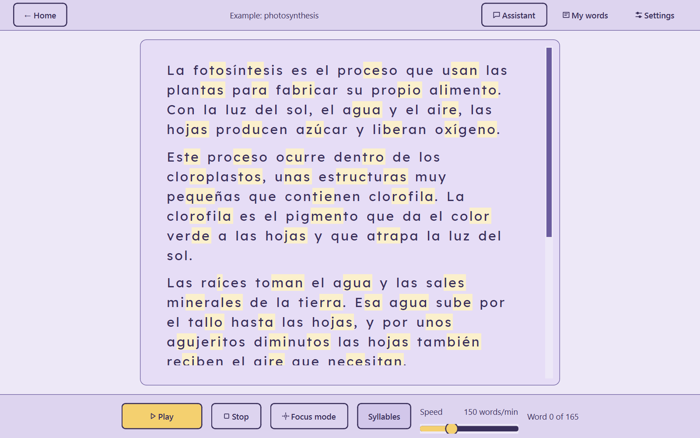
</p>

### Y además

| Función | Descripción |
|:---|:---|
| **Continuar leyendo** | Recuerda dónde quedaste en cada documento; los ya procesados abren al instante. |
| **Biblioteca** | Hasta 200 documentos, con carpetas y búsqueda por nombre. |
| **Zoom** | `Ctrl` + `+` / `-` cambia el tamaño de la letra y `Ctrl` + `0` lo restablece. |
| **Selección de texto** | El texto que seleccionas con el ratón se marca en amarillo y morado, no con el color de Windows. |

---

## Atajos de teclado

| Atajo | Acción |
|:---|:---|
| `Espacio` | Reproducir / pausar |
| `Esc` | Detener la lectura (o cerrar el asistente, el procesado o Ajustes) |
| `F` | Modo foco |
| `S` | Activar / desactivar las sílabas de colores |
| `Av Pág` / `Re Pág` | Bajar / subir una pantalla (en «Por páginas», pasa de página al llegar al borde) |
| `Ctrl` + `←` / `→` | Página anterior / siguiente |
| `Ctrl` + `Inicio` / `Fin` | Primera / última página |
| `Ctrl` + `+` / `-` / `0` | Letra más grande / más pequeña / tamaño por defecto |
| `Ctrl` + `I` | Abrir o cerrar el asistente |
| `Ctrl` + `O` | Elegir archivo (en Inicio) |
| `Ctrl` + `,` | Ajustes |
| `Alt` + `←` | Volver |

---

## Cómo funciona por dentro

ClearRead se compone de tres piezas propias, más dos servicios externos que solo usa el servidor:

```
 ┌───────────────────────────┐        ┌──────────────────────────┐        ┌────────────┐
 │  ClearRead.exe (Windows)  │ HTTPS  │  Backend propio          │        │  DeepSeek  │
 │  Núcleo 100% offline:     │───────►│  FastAPI en Render       │───────►│  (modelo   │
 │  OCR · sílabas · voz ·    │        │  · guarda la clave de IA │        │   de IA)   │
 │  formato · biblioteca     │        │  · limita el uso diario  │        └────────────┘
 └───────────────────────────┘        │  · habla con Firebase ───┼──────► Firebase
                                      └──────────────────────────┘        (cuentas y perfil)
```

- **`ClearRead.exe` (la app).** Hace todo el trabajo de lectura **en tu equipo y sin internet**: abre el PDF o la foto, reconoce el texto (OCR), separa las sílabas, da formato, lee en voz alta con la voz de Windows y guarda tu biblioteca. Los modelos de OCR y las fuentes viajan **dentro del programa**; la app no descarga nada mientras se usa.
- **Backend propio (FastAPI en Render).** Es una pequeña API que la app llama solo cuando pides ayuda de IA o inicias sesión. Guarda la clave de la IA (**nunca está en el `.exe`**), aplica los límites de uso y reenvía tu consulta a DeepSeek.
- **DeepSeek.** El modelo de IA que redacta la explicación o la versión simplificada. Solo lo llama el backend.
- **Cuentas con Firebase.** El correo y la contraseña, y el perfil sincronizado (ajustes, *Mis palabras* y temas), están en Firebase (Authentication y Cloud Firestore). **La app nunca habla con Firebase ni con Google: lo hace solo el backend.** Para vincular o entrar con Google, la app abre el **navegador del sistema** en una página de nuestro backend; es el navegador, no la app, quien habla con Google.

Qué se queda dónde:

| Dato | Dónde vive |
|:---|:---|
| Documentos, biblioteca, carpetas, estadísticas y respuestas guardadas de la IA | **Solo en tu equipo** (`%APPDATA%\ClearRead`, una carpeta por perfil) |
| Ajustes (salvo los propios de cada equipo), *Mis palabras* y temas | En tu cuenta (se sincronizan) |
| Sesión guardada | En tu equipo, cifrada con Windows (DPAPI) |
| Texto que eliges para el asistente | Se envía por HTTPS al backend y de ahí a DeepSeek |

Para que la interfaz no se congele, el OCR corre en un hilo de trabajo aparte, la voz en su propio hilo y las consultas de IA en una cola aparte.

La especificación completa (requisitos, decisiones, sistema de diseño y guías de despliegue) está en [`docs/document.md`](docs/document.md). Las cifras de rendimiento que aparecen allí son **estimaciones, no resultados medidos**.

---

## Privacidad

- Tus documentos **nunca salen de tu equipo**: el OCR, la voz y el formato son locales.
- El asistente de IA solo envía **la palabra o el párrafo que eliges**, y la primera vez te pide permiso con un aviso de privacidad.
- El backend **no registra** los textos que recibe ni las respuestas de la IA.
- La app **no tiene telemetría** ni carga recursos de internet (fuentes, imágenes o estilos remotos).
- Tu cuenta guarda tu nombre, tu correo, tus ajustes y tus palabras. Puedes cerrar sesión o **borrar tu cuenta** desde Ajustes.
- Tu biblioteca y tus estadísticas se guardan solo en tu equipo; los documentos se pueden quitar uno a uno o borrar todos desde Ajustes.
- Puedes leer el **aviso de privacidad** completo dentro de la app (al entrar, al crear la cuenta y en Ajustes).

## Accesibilidad

- **Contraste de texto ≥ 7:1 (WCAG AAA)** en los temas Claro y Oscuro, calculado con la fórmula oficial del W3C (la tabla de resultados está en el Anexo A de [`docs/document.md`](docs/document.md)).
- **Tres fuentes de lectura**, empaquetadas localmente: **Lexend** (por defecto), **Atkinson Hyperlegible** y **OpenDyslexic**. Ninguna funciona igual para todas las personas, así que se elige la que resulte más cómoda.
- Solo **dos colores de marca** (morado y amarillo) y sus tonos, para un entorno visual de bajo estrés.
- Tamaño de letra, interlineado y espaciados ajustables, con vista previa.
- Control total de la voz y atajos de teclado para todo lo importante.
- Mensajes de error sin tecnicismos, que explican qué hacer.

---

## Descarga e instalación

1. Descarga el instalador desde el [**release v1.7.0**](https://github.com/SoFzzz/ClearRead/releases/tag/v1.7.0) ([descarga directa de `ClearRead-Setup-1.7.0.exe`](https://github.com/SoFzzz/ClearRead/releases/download/v1.7.0/ClearRead-Setup-1.7.0.exe)). Las versiones nuevas aparecerán siempre en [**Releases**](https://github.com/SoFzzz/ClearRead/releases/latest).
2. Ábrelo y sigue el asistente: elige la carpeta de instalación y deja marcada la casilla del **icono en el Escritorio** si lo quieres.
3. Si Windows muestra *«Windows protegió su PC»*: **Más información → Ejecutar de todas formas**. Aparece porque el instalador no está firmado digitalmente.
4. Abre ClearRead desde el Escritorio o el menú Inicio. Para quitarlo: *Configuración → Aplicaciones*. Tus documentos y palabras (`%APPDATA%\ClearRead`) no se borran.

SHA256 del instalador (para comprobar la descarga): `d47bfcc5e527bb165a69a86d36bf3af57ed03e5e7ddb730b8c0c013d42e0cce3`.

**Requisitos:** Windows 10/11 de 64 bits. No necesita Python. Hace falta internet para el **primer inicio de sesión** y para el asistente de IA; el resto de la app funciona sin conexión.

---

## Para desarrolladores

Requisitos: Windows y **Python 3.11 x64** (exactamente esa versión).

```powershell
# App (entorno virtual .venv en la raíz)
py -3.11 -m venv .venv
.\.venv\Scripts\python -m pip install -e ".[dev]"
.\.venv\Scripts\python -m clearread                      # ejecutar
.\.venv\Scripts\python -m pytest tests/ -v               # tests
.\.venv\Scripts\python -m ruff check src tests           # lint
.\.venv\Scripts\python -m ruff format --check src tests  # formato

# Backend (proyecto aparte, entorno virtual backend\.venv)
py -3.11 -m venv backend\.venv
.\backend\.venv\Scripts\python -m pip install -e ".\backend[dev]"
.\backend\.venv\Scripts\python -m pytest backend/tests -v
.\backend\.venv\Scripts\python -m ruff check backend

# Compilar el .exe (requiere resources/client_token.local.json, no versionado)
.\.venv\Scripts\python -m PyInstaller clearread.spec --clean --noconfirm

# Instalador (requiere Inno Setup 6)
& "$env:LOCALAPPDATA\Programs\Inno Setup 6\ISCC.exe" installer\clearread.iss
```

La clave de DeepSeek solo existe como variable de entorno del servidor y en `backend/.env` (ignorado por git); nunca va en el código ni en la app. Las guías de despliegue del backend en Render y de publicación de una versión están en [`docs/document.md`](docs/document.md) §6.6.

### Estructura del proyecto

```
src/clearread/
  core/          configuración (incluye la URL por defecto del backend) y rutas
  services/      ingestor, preprocesador, OCR, sílabas, formato, voz, cliente de IA, cuentas
  workers/       procesamiento de documentos y workers de IA
  ui/            textos (strings.py), diálogos y vistas (inicio, lectura, ajustes)
tests/           pruebas automáticas y muestras
resources/       fuentes, modelos ONNX, iconos y documento de ejemplo
backend/         API FastAPI (proyecto independiente)
installer/       script de Inno Setup del instalador
docs/            document.md (especificación y diseño) y capturas de este README
```

Reglas del proyecto: todo el código y los comentarios van en inglés; todo texto que ve la usuaria vive en `src/clearread/ui/strings.py`, en español e inglés. Solo `services/backend_transport.py` usa `httpx` (la red de la app).

## Tecnologías y licencias

| Capa | Tecnología | Licencia |
|:---|:---|:---|
| Interfaz | PySide6 (Qt 6) | LGPL v3 |
| PDF | pypdfium2 | Apache 2.0 / BSD-3 |
| OCR | RapidOCR + ONNX Runtime, modelos PP-OCR | Apache 2.0 |
| Imagen | OpenCV, Pillow | Apache 2.0 / HPND |
| Voz | SAPI5 de Windows vía pyttsx3 (2.98) | MPL 2.0 / PSF |
| Sílabas | silabeador | MIT |
| Cliente HTTP | httpx | BSD-3 |
| Backend | FastAPI, uvicorn (pydantic) | MIT / BSD-3 |
| Cuentas y perfil | Firebase Authentication y Cloud Firestore (servicio externo, solo desde el backend, plan gratuito) | Servicio |
| IA | DeepSeek (servicio externo, solo desde el backend) | Servicio |
| Alojamiento del backend | Render (plan gratuito) | Servicio |
| Fuentes | Lexend, Atkinson Hyperlegible, OpenDyslexic | SIL OFL 1.1 |
| Empaquetado | PyInstaller (`--onedir`) + instalador Inno Setup | — |

Detalles de origen y licencias en [`resources/fonts/README.md`](resources/fonts/README.md) y [`resources/models/README.md`](resources/models/README.md).

## Limitaciones conocidas

- Solo Windows (la voz usa SAPI5).
- El OCR puede tardar unos segundos por página en documentos densos; las fórmulas químicas o matemáticas no se reconocen bien.
- La primera consulta al asistente puede tardar hasta un minuto si el servidor gratuito estaba en reposo.
- El reconocimiento con fotos de móvil reales aún no se ha calibrado con un set propio de fotos.
- La tipografía, las sílabas de colores y el modo foco no se han probado todavía con lectores con dislexia.
- El instalador no está firmado digitalmente, así que Windows puede mostrar un aviso al instalarlo.
- Varias funciones se probaron con tests automáticos y con la app real en pantalla virtual, pero no todas con ratón físico, arrastrando un archivo desde el Explorador ni en una máquina limpia (ver los pendientes en [`docs/document.md`](docs/document.md) §8).
- Las capturas de este README se tomaron con la app real, pero usando una cuenta, una voz y un asistente de IA **simulados** (con textos de ejemplo), para no usar datos personales.

## Créditos

- Autoría: **SoFzzz** (Paula González, <paula.gonzalezz@campusucc.edu.co>).
- Fuentes: [Lexend](https://github.com/googlefonts/lexend), [Atkinson Hyperlegible](https://github.com/googlefonts/atkinson-hyperlegible) y [OpenDyslexic](https://github.com/antijingoist/opendyslexic), bajo licencia SIL Open Font License.
- Modelos OCR: PaddleOCR PP-OCR, distribuidos en ONNX por RapidOCR, bajo licencia Apache 2.0.

---

Proyecto académico de la Universidad Cooperativa de Colombia (UCC), curso de Diseño.
