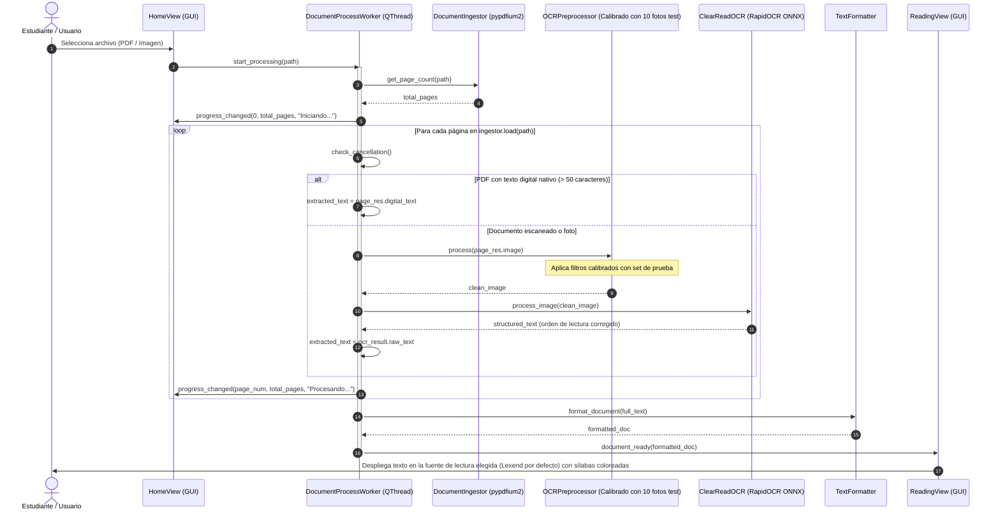
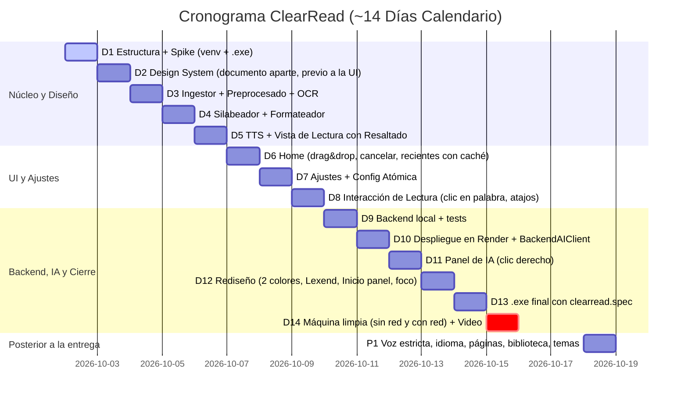
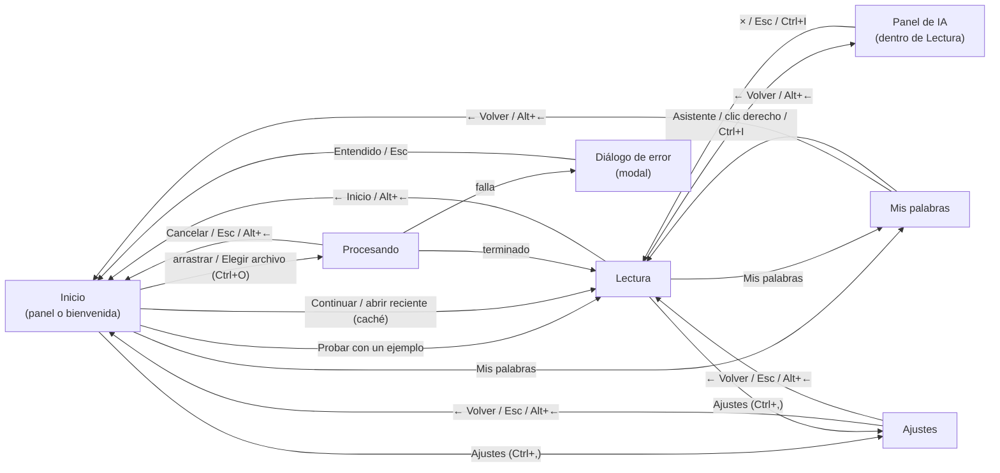

# ClearRead Desktop — Documentación Técnica de Arquitectura, Requisitos y Diseño

> **Versión:** 1.5.0 (Núcleo Offline + Asistente IA vía Backend Propio Desplegado — Entrega Académica / Portafolio)  
> **Fecha de Actualización:** 2026-10-18 (la versión sigue siendo 1.5.0; los cambios de esa fecha están en §4.13)  
> **Estado:** Aprobado para Implementación con Spikes Técnicos  
> **Contexto:** 1 de 5 proyectos en paralelo | Plazo disponible: ~14 días calendario (2026-10-02 → 2026-10-15) | Distribución: `.exe` standalone Windows (`.zip` en GitHub Releases) + backend FastAPI desplegado en Render  
> **Cambios v1.5.0:** la materia exige el proyecto **desplegado**, por lo que el asistente de IA pasa a llamar a un backend propio (§4.11) en lugar de a DeepSeek directamente; la API key sale de la app.  
> **Rediseño del Día 12 (2026-10-07), pedido por la usuaria:** solo dos colores de marca (morado `#392F5A` y amarillo `#F4D06F`) y sus tonos; solo temas Claro y Oscuro (se elimina Alto Contraste); tipografía Lexend por defecto con espaciado moderado; Inicio como panel; ejemplo incluido; posición de lectura, modo foco y "Mis palabras". Requisitos nuevos: HOME-F02, HOME-F03, READ-F01, READ-F02, AI-F05, UI-F04 y UI-F05 (§5.1, §4.12). Detalle visual en el Anexo A (v2.0).  
> **Cambios del 2026-10-18, pedidos por la usuaria (§4.13):** (1) **voz con control estricto**: un clic en una palabra solo mueve el punto de inicio y la voz suena únicamente con Reproducir o `Espacio` (**sustituye UI-F02**); (2) cambiar el idioma pide confirmación y la app **se reinicia sola** (cambia I18N-F01); (3) **páginas** del documento, barra de páginas y modos de vista "Continua" / "Por páginas", con atajos de página y zoom (UI-F06, UI-F07; amplía UI-F03); (4) **biblioteca** con carpetas, búsqueda y hasta 200 documentos (HOME-F04, cambia HOME-F01 y HOME-F02) y **temas** en "Mis palabras" (AI-F06, cambia AI-F05); (5) revisión y refactor del código. **Segunda tanda del mismo día:** (6) **color de la selección de texto** amarillo/morado (antes seguía el color de acento de Windows, que se veía rojo; UI-F05); (7) **la voz sigue el idioma de la interfaz** (modifica I18N-F01, que decía que la voz seguía siendo española); (8) botón **«Sílabas»** (atajo `S`) en la barra de reproducción (UI-F08; amplía UI-F03); (9) selector **«Guardar en:»** en la zona de arrastre de Inicio (actualiza HOME-F04). Requisitos nuevos: UI-F06, UI-F07, UI-F08, HOME-F04, AI-F06. **Comprobado:** suite de tests (app: 1404 passed, 1 skipped, ejecutada el 2026-10-18 en el equipo de desarrollo) y capturas con la app real en pantalla virtual (`offscreen`; por decisión de la usuaria las capturas se retiraron del repositorio). **No comprobado:** pruebas físicas con ratón y arrastre (incluido arrastrar desde el Explorador), escucha de la voz, el amarillo de la selección, el cambio de voz y el botón «Sílabas» en el `.exe` compilado, el reinicio en el `.exe` y la recompilación del `.exe` con los módulos nuevos (§8).  
> **Idioma UI:** Español | **Idioma de Código y Nombres Técnicos:** Inglés  

---

## 1. Resumen Ejecutivo y Alcance del Sistema

### 1.1 Declaración del Problema Neuroeducativo
Los estudiantes con dislexia o dificultades específicas de decodificación fonológica enfrentan una sobrecarga cognitiva severa al interactuar con materiales de estudio impresos o digitalizados (guías fotocopiadas, exámenes o apuntes). Esta sobrecarga se manifiesta en:
- **Efecto de Hacinamiento Visual (*Visual Crowding*):** Dificultad para aislar grafemas debido a espaciados estrechos y fuentes no adaptadas.
- **Ruptura de Tracking Sacádico:** Pérdida recurrente de la línea activa de lectura en bloques densos o diseños multicolumna no lineales.
- **Déficit de Decodificación Fonológica:** Ausencia de apoyos ortográfico-silábicos que guíen la segmentación de palabras complejas en español.
- **Falta de Refuerzo Bimodal:** Ausencia de sincronización audiovisual estricta que ancle el estímulo fonético con el estímulo grafémico simultáneamente.

### 1.2 Propuesta de Solución: ClearRead Desktop
**ClearRead Desktop** es un sistema de tres piezas:

| Pieza | Qué es | Red |
|:---|:---|:---|
| **`ClearRead.exe`** | Aplicación de escritorio Windows (frontend). Ingesta, OCR, silabeo, lectura en voz alta e interfaz. | **Núcleo 100% offline**: los modelos ONNX y las fuentes viajan dentro del `.exe`. |
| **Backend propio** | API FastAPI (`backend/`, §4.11) desplegada en Render (plan gratuito). Guarda la API key, aplica límites de costo y habla con DeepSeek. | Recibe solo el texto que el usuario selecciona, por HTTPS. |
| **DeepSeek** | Modelo de IA generativa externo. | Solo lo llama el backend. |

Sobre el núcleo offline se ofrece un **asistente de IA generativa opcional con conexión** (explicación de palabras y simplificación de párrafos): `ClearRead.exe` → HTTPS → backend propio → DeepSeek. Sin red, el asistente se deshabilita de forma transparente y el resto de la app funciona igual. El sistema transforma documentos escaneados en una superficie de lectura de alta ergonomía cognitiva con:
1. **OCR con Inteligencia Artificial de Visión:** Núcleo de Deep Learning no negociable para extraer texto legible desde imágenes y PDFs sin intervención de servicios de nube.
2. **Segmentación Silábica Fonética Determinista:** Coloración alternada de sílabas conforme a la normativa ortográfica de la Real Academia Española (RAE).
3. **Lectura Aumentada Bimodal Sincronizada:** Síntesis de voz local vinculada a una regleta visual y resaltado por palabra con tolerancia perceptible mínima, incorporando soporte de pausa y reanudación en la oración activa.
4. **Entorno Visual de Bajo Estrés:** Solo dos colores de marca (morado y amarillo) y sus tonos, en temas Claro y Oscuro de contraste validado (≥ 7:1), y tipografía Lexend por defecto (Atkinson Hyperlegible y OpenDyslexic como opciones).
5. **Asistente de IA Opcional vía Backend Propio:** Explicar una palabra en contexto y simplificar un párrafo, a través de nuestro backend desplegado; la app nunca contiene la API key de DeepSeek.

---

## 2. Decisiones Arquitectónicas, Matriz de Tecnologías y Gestión de Riesgos

### 2.1 Justificación del Stack y Viabilidad Operativa
Para un equipo de desarrollo con restricciones severas de tiempo (ver plazo en la cabecera del documento) y múltiples entregas simultáneas, **Python 3.11+ junto a PySide6** constituye la opción de menor costo de desarrollo y mayor integración directa con bibliotecas de IA locales.

> [!IMPORTANT]
> **Honestidad en Estimaciones:** Las cifras de rendimiento (ej. latencia de silabeo $< 0.05\text{ ms}$ por palabra, renderizado a 60 FPS o inferencia de OCR en CPU entre 1.5s y 4s) corresponden a **estimaciones teóricas basadas en benchmarks sintéticos** y deben ser revalidadas empíricamente en el Spike Técnico de la Fase 1.

### 2.2 Stack Tecnológico Oficial y Planes de Contingencia (Plan B)

| Capa / Módulo | Tecnología Principal | Versión | Licencia | Plan B (Contingencia de Riesgo Alto) |
|:---|:---|:---:|:---:|:---|
| **Plataforma Base** | Python | **3.11 x64 (exacto)** | PSF | Versión fija en la app y en el backend por compatibilidad binaria con PyInstaller; venv creado con `py -3.11 -m venv .venv`. |
| **Framework GUI** | PySide6 | ≥ 6.7.0 | LGPL v3 | Si PySide6 presenta problemas de tamaño en el bundle, mantener `--onedir` sin compresión UPX. |
| **Renderizado PDF** | **pypdfium2** | ≥ 4.28.0 | Apache 2.0 / BSD-3 | Renderizado C nativo sin Poppler; libre de riesgos copyleft AGPL. |
| **Visión e IA (OCR Principal)** | **RapidOCR (ONNX Runtime)** | ≥ 1.3.0 | Apache 2.0 | **Plan B IA:** Si la precisión de reconocimiento de RapidOCR es insuficiente en tipografías degradadas del set de calibración, ajustar umbrales de detección (`box_thresh`, `unclip_ratio`) o incorporar preprocesamiento de contraste adaptativo en OpenCV. Mantiene 100% el uso de IA de Deep Learning con inferencia local ágil y huella mínima (~16 MB). |
| **Visión Artificial** | opencv-python + Pillow | (versión que exige rapidocr-onnxruntime) / ≥ 10.0 | Apache 2.0 / HPND | Se usa `opencv-python`, **no** `-headless`: `rapidocr-onnxruntime` exige `opencv-python` y, si se instalan los dos, ambos escriben en la misma carpeta `cv2` y se pisan (comprobado en el Día 1). `opencv-python` no se declara aparte: llega como dependencia de RapidOCR. En el `.exe` se excluye `opencv_videoio_ffmpeg` (~30 MB, sin uso). Calibración empírica con set curado de 10 imágenes reales de smartphones/fotocopias. |
| **Motor TTS** | pyttsx3 + pythoncom (SAPI5) | **== 2.98** | MPL 2.0 / PSF | **Versión fijada:** en el spike del Día 1, pyttsx3 2.99 solo habla en el primer `runAndWait()` de cada motor (la 2.ª frase vuelve en 0.10 s con 1 evento); con 2.98 la 2.ª frase habla completa (9.05 s, 38 eventos). **Plan B Audio:** Si los eventos `started-word` de SAPI5 resultan inestables en ciertas voces de Windows, degradar el resaltado bimodal a nivel de oración completa con temporizador `QTimer` proporcional a las PPM. |
| **Segmentación Fonética** | silabeador | ≥ 1.1.0 | MIT | Algoritmo determinista RAE. Plan B: módulo interno de reglas regex fonológicas. |
| **Tipografía Accesible** | Lexend (por defecto), Atkinson Hyperlegible y OpenDyslexic | Regular (las tres; OpenDyslexic `compiled/opendyslexic.otf`) | SIL OFL 1.1 | Empaquetadas localmente en `resources/fonts` con su licencia y origen (`resources/fonts/README.md`); se elige una en Ajustes. Lexend y Atkinson se descargaron el 2026-10-07 de sus repositorios oficiales (tarea de desarrollo, nunca en tiempo de ejecución). La elección y su evidencia (y lo que **no** está demostrado) están en el Anexo A, A.1.4. |
| **Cliente HTTP IA** | httpx | ≥ 0.27.0 | BSD-3 | En la app, solo importable en `services/ai_client.py`; ningún otro módulo del núcleo offline depende de librerías de red. El backend también lo usa para llamar a DeepSeek. |
| **Backend API** *(solo `backend/`)* | FastAPI (incluye pydantic, MIT) | ≥ 0.115.0 | MIT | Proyecto aparte con su propio `pyproject.toml`; nunca entra en el `.exe`. Genera `/docs` (OpenAPI) automáticamente. |
| **Servidor ASGI** *(solo `backend/`)* | uvicorn | ≥ 0.30.0 | BSD-3 | Arranque en Render con `uvicorn ... --host 0.0.0.0 --port $PORT`. |
| **Hosting del backend** | Render — Web Service, plan **Free** | — | Servicio (no es dependencia) | **Condiciones consultadas el 2026-10-01** en https://render.com/docs/free: se duerme tras 15 min sin tráfico y tarda ~1 min en despertar; 750 h de instancia/mes; sin disco persistente; una sola instancia. **Plan B: Hugging Face Spaces** — a la misma fecha (https://huggingface.co/docs/hub/spaces-overview), los Spaces Docker/Gradio requieren plan de pago para crearse (los gratuitos solo admiten Static o hasta 2 Gradio sobre ZeroGPU), así que el Plan B **no es gratuito** para FastAPI; ver §8. |

> [!NOTE]
> **Alternativa Evaluada y Descartada:** Se evaluó formalmente **PaddleOCR / PPStructure** y se resolvió **descartarlo definitivamente** del proyecto debido al alto riesgo comprobado de empaquetado en Windows mediante PyInstaller (conflictos de DLLs de PaddlePaddle, dependencias de MKL/OneDNN y tamaño de bundle > 1.5 GB). Su sustitución por **RapidOCR sobre ONNX Runtime** erradica el principal punto de falla de despliegue preservando al 100% el núcleo de visión artificial por Deep Learning.

---

## 3. Arquitectura del Sistema y Flujo de Datos

### 3.1 Diagrama de Arquitectura Simplificada
Para minimizar el riesgo de sobreingeniería en un proyecto universitario de ~13 días (§6.5), se elimina el bus global `AppState` complejo en favor de **comunicación directa desacoplada por Señales y Slots de Qt** entre vistas y workers. El diagrama muestra las tres piezas del sistema: la app de escritorio (núcleo offline), el backend propio desplegado y DeepSeek:

```mermaid
graph TB
    subgraph UI_Layer["Capa de Presentación (PySide6 - Hilo Principal)"]
        MW["MainWindow"]
        HV["HomeView (Carga & Estado)"]
        RV["ReadingView (Lector Aumentado)"]
        RW["ReaderWidget (QTextEdit + ExtraSelections)"]
        MSG["Diálogos de Error Accesibles (QMessageBox Estilizado)"]
    end

    subgraph Processing_Worker["Capa de Procesamiento Asíncrono (QThread)"]
        ING["DocumentIngestor (pypdfium2)"]
        PRE["OCRPreprocessor (OpenCV Calibrado)"]
        OCR["ClearReadOCR (RapidOCR / ONNX Runtime)"]
        FMT["TextFormatter (HTML Seguro + Token Map)"]
    end

    subgraph Audio_Worker["Capa de Síntesis de Audio (QThread Dedicado + COM STA)"]
        TTS["TTSWorker (SAPI5 Engine)"]
    end

    subgraph AI_Worker["Capa de IA Opcional (QThreadPool dedicado, maxThreadCount=1)"]
        AIW["ExplainWordWorker / SimplifyParagraphWorker"]
        AIC["BackendAIClient (httpx + caché local)"]
    end

    subgraph Backend["Backend propio (FastAPI en Render, backend/)"]
        API["POST /v1/explain · POST /v1/simplify · GET /health"]
        GUARD["Token de cliente + límites de tamaño + tope diario + caché en memoria"]
    end

    DS["DeepSeek API"]

    HV -->|Solicitar Procesamiento| Processing_Worker
    Processing_Worker -->|Error de Archivo / OCR| MSG
    Processing_Worker -->|Documento Formateado| RV
    RV --> RW
    RV -->|speak(script, start_offset)| TTS
    TTS -->|word_spoken(index)| RV
    RV -->|highlight_token()| RW
    RV -->|clic derecho: explicar / simplificar| AIW
    AIW --> AIC
    AIC -->|HTTPS + X-Client-Token| API
    API --> GUARD
    GUARD -->|HTTPS + API key (variable de entorno)| DS
    AIW -->|finished / failed / waking| RV
```

> La flecha `BackendAIClient → backend` es la **única** salida de red de `ClearRead.exe`, y solo ocurre cuando el usuario pide ayuda de IA. Todo el resto del diagrama funciona sin conexión.

### 3.2 Diagrama de Secuencia y Calibración con Datos Reales



---

## 4. Especificación Técnica de Módulos Críticos

---

### 4.1 Módulo Ingestor (`services/ingestor.py`)
**Propósito:** Cargar y convertir documentos garantizando streaming estricto sin materializar arrays completos en memoria, con soporte de desrotación EXIF, licencia compatible y validación de archivos protegidos por contraseña.

#### Requisitos de Ingeniería
- **ING-F01:** Ingestión de PDFs mediante `pypdfium2` (licencia permisiva Apache 2.0 / BSD-3).
- **ING-F02:** Normalización de orientación EXIF automática en imágenes JPG/PNG provenientes de dispositivos móviles.
- **ING-F03:** Detección de texto digital nativo previo al renderizado: si la página contiene texto extraíble íntegro, debe marcarse para omitir el OCR.
- **ING-F04:** Detección y manejo de PDFs protegidos por contraseña, notificando con claridad a la interfaz. **Medido en el spike del Día 1 (pypdfium2 5.13.0, PDFium 153.0.7999.0):** `pypdfium2.PdfPasswordError` **no existe**; un PDF con contraseña lanza `pypdfium2.PdfiumError` con `err_code == 4` (`pypdfium2.raw.FPDF_ERR_PASSWORD`). Comportamiento fijado en `tests/test_samples.py`.
- **ING-NF01 (Memoria):** Meta de diseño estimada a validar empíricamente: consumo de memoria residente proyectado en $\le 450\text{ MB}$ procesando un PDF estándar de 100 páginas (uso estricto de generadores con cierre asegurado mediante `try...finally`).

#### Contrato de Interfaz y Código

```python
"""Document ingestion service using pypdfium2 and Pillow."""

from dataclasses import dataclass
from enum import Enum
from pathlib import Path
from typing import Generator
import numpy as np
import pypdfium2 as pdfium
import pypdfium2.raw as pdfium_raw
from PIL import Image, ImageOps


class DocumentType(Enum):
    PDF = "pdf"
    IMAGE = "image"


@dataclass
class PageResult:
    page_number: int
    total_pages: int
    image: np.ndarray          # Array RGB (H, W, 3) optimizado
    digital_text: str | None   # Texto nativo si existe, sino None
    source_type: DocumentType


class DocumentIngestor:
    SUPPORTED_IMAGE_EXT = {".jpg", ".jpeg", ".png", ".bmp", ".tiff", ".tif"}
    SUPPORTED_PDF_EXT = {".pdf"}
    DEFAULT_DPI = 300
    DIGITAL_TEXT_THRESHOLD = 50

    def __init__(self, dpi: int = DEFAULT_DPI) -> None:
        self._dpi = dpi

    def get_page_count(self, file_path: str | Path) -> int:
        path = Path(file_path)
        if not path.exists():
            raise FileNotFoundError(f"Documento no encontrado: {path}")
        if path.suffix.lower() in self.SUPPORTED_PDF_EXT:
            try:
                doc = pdfium.PdfDocument(str(path))
            except pdfium.PdfiumError as err:
                if err.err_code == pdfium_raw.FPDF_ERR_PASSWORD:
                    raise PermissionError("El archivo PDF está protegido con contraseña.") from err
                raise
            count = len(doc)
            doc.close()
            return count
        elif path.suffix.lower() in self.SUPPORTED_IMAGE_EXT:
            return 1
        raise ValueError(f"Formato de archivo no soportado: {path.suffix}")

    def load(self, file_path: str | Path) -> Generator[PageResult, None, None]:
        path = Path(file_path)
        if path.suffix.lower() in self.SUPPORTED_PDF_EXT:
            yield from self._load_pdf_streaming(path)
        elif path.suffix.lower() in self.SUPPORTED_IMAGE_EXT:
            yield self._load_single_image(path)
        else:
            raise ValueError(f"Formato no soportado: {path.suffix}")

    def _load_pdf_streaming(self, path: Path) -> Generator[PageResult, None, None]:
        try:
            doc = pdfium.PdfDocument(str(path))
        except pdfium.PdfiumError as err:
            if err.err_code == pdfium_raw.FPDF_ERR_PASSWORD:
                raise PermissionError("El archivo PDF está protegido con contraseña.") from err
            raise

        try:
            total_pages = len(doc)
            scale = self._dpi / 72.0
            for page_idx in range(total_pages):
                page = doc[page_idx]
                textpage = page.get_textpage()
                extracted_text = textpage.get_text_range().strip()
                has_digital = len(extracted_text) >= self.DIGITAL_TEXT_THRESHOLD

                # Renderizado directo a bitmap a través de PDFium C-engine
                bitmap = page.render(scale=scale)
                pil_image = bitmap.to_pil()
                img_rgb = np.array(pil_image.convert("RGB"))

                yield PageResult(
                    page_number=page_idx + 1,
                    total_pages=total_pages,
                    image=img_rgb,
                    digital_text=extracted_text if has_digital else None,
                    source_type=DocumentType.PDF,
                )
                del img_rgb
                del pil_image
                del bitmap
        finally:
            doc.close()

    def _load_single_image(self, path: Path) -> PageResult:
        with Image.open(path) as img:
            img = ImageOps.exif_transpose(img)
            if img.mode in ("RGBA", "LA", "P"):
                rgb_img = Image.new("RGB", img.size, (255, 255, 255))
                rgb_img.paste(img, mask=img.split()[-1] if "A" in img.mode else None)
            else:
                rgb_img = img.convert("RGB")
            return PageResult(
                page_number=1,
                total_pages=1,
                image=np.array(rgb_img),
                digital_text=None,
                source_type=DocumentType.IMAGE,
            )
```

---

### 4.2 Módulo de Preprocesamiento (`services/preprocessor.py`)
**Propósito:** Optimizar y estabilizar imágenes de baja calidad (fotocopias o fotos con sombras) previo al reconocimiento de layout y texto.

#### Requisitos de Ingeniería
- **PRE-F01:** Corrección de iluminación por división de fondo (estimación morfológica) para atenuar sombras de flexión de hojas de cuadernos.
- **PRE-F02:** Enderezado geométrico (*deskew*) automático acotado en el rango $[-45^\circ, 45^\circ]$ con umbral de activación mínima en $| \theta | \ge 0.5^\circ$.
- **PRE-NF01:** Consumo de CPU $\le 800\text{ ms}$ por página A4 mediante el uso exclusivo de primitivas vectorizadas de OpenCV (`opencv-python`, ver §2.2).

> [!NOTE]
> **Calibración del Día 3 (estado real).** Implementación en `services/preprocessor.py`: `OCRPreprocessor` recibe un `PreprocessSettings` por constructor y expone cada etapa como método (`remove_shadows`, `denoise`, `deskew`, `enhance_contrast`); `process` devuelve escala de grises. El código de referencia de abajo es la versión inicial: la implementada divide por el fondo estimado (cierre morfológico + mediana sobre una copia reducida, en vez de `absdiff`) y calcula el ángulo del lado largo de cada línea (la convención de `minAreaRect` cambió en OpenCV ≥ 4.5).
>
> **A/B medido (Día 3, `tests/calibrate_ocr.py`).** Equipo verificado el 2026-10-06: Intel Core i5-8300H (4 núcleos), 23.8 GB de RAM, Windows 10 Home, Python 3.11, `perf_counter`. Métricas: CER (con espacios y saltos normalizados), F1 por palabras (bolsa de palabras, insensible al orden de lectura) y caracteres especiales (`ñ`, tildes, `ü`, `¿`, `¡`) conservados.
>
> **a) PDF renderizados a 300 DPI** (`--pdf-render --ablation --limit-pages 3`: 3 primeras páginas de cada una de las 5 fichas = 15 páginas; referencia = texto digital de esa página; `is_camera_photo=False`, así que la eliminación de sombras no aplica):
>
> | Configuración | CER medio | F1 palabras | Especiales | Preproc. medio |
> |:---|:---:|:---:|:---:|:---:|
> | original (color, sin preprocesar) | 59.5 % | 97.0 % | 382/385 | 0 ms |
> | solo `deskew` (**por defecto**) | 58.9 % | 96.7 % | 381/385 | 25 ms |
> | solo mediana | 59.4 % | 96.4 % | 380/385 | 9 ms |
> | solo CLAHE | 59.6 % | 96.4 % | 379/385 | 31 ms |
> | mediana + `deskew` + CLAHE | 58.9 % | 96.4 % | 379/385 | 50 ms |
>
> El CER alto (~59 %) **no es error de lectura**: las fichas tienen columnas y recuadros y el texto digital sigue otro orden; por eso se usa el F1 por palabras (~97 %). Ninguna etapa mejora el resultado sobre PDF limpios: las diferencias (≤ 0.6 puntos de F1) están dentro del ruido de 15 páginas y, si algo, las etapas empeoran ligeramente (la conversión a grises ya cuesta ~0.3 puntos). La corrección de sombras no se evaluó aquí.
>
> **Sintético** (6 variantes degradadas de `sample_page_scanned.pdf`: limpia, giro 3°, giro 10°, sombra, ruido, giro 4° + sombra + ruido; `--synthetic --ablation`, medido antes del cambio a F1/especiales por multiconjunto): original CER 9.8 % y 118/126 especiales; con las 4 etapas o solo `deskew`, 0.0 % y 126/126. El único caso en que el preprocesado ayuda es el giro de 10° (CER 58.8 % → 0.0 %), y lo logra solo `deskew`; con giros de 3° RapidOCR ya acierta sin preprocesar. Sombras, mediana y CLAHE no cambiaron ningún resultado.
>
> **Valores finales de esta fase: solo `deskew` activo; sombras, mediana y CLAHE desactivadas** (el `deskew` cuesta ~20 ms y es imprescindible con páginas giradas ≥ 10°; PRE-NF01 ≤ 800 ms se cumple de sobra, también con las 4 etapas: ~50 ms sobre PDF y ~150 ms con sombras). **Pendiente (§8):** el modo `--photos` está implementado pero **no se ha ejecutado**, porque aún no hay fotos de móvil con el nombre `<Ficha>_p<N>_<condición>.jpg` en `tests/samples/private/`. La eliminación de sombras y el resto de etapas solo se activarán si ese A/B con fotos reales demuestra mejora.

```python
"""Image preprocessing pipeline using OpenCV headless."""

import cv2
import numpy as np


class OCRPreprocessor:
    """Prepares raw images for optimal OCR and layout detection."""

    @staticmethod
    def process(image_rgb: np.ndarray, is_camera_photo: bool = True) -> np.ndarray:
        if len(image_rgb.shape) == 3:
            gray = cv2.cvtColor(image_rgb, cv2.COLOR_RGB2GRAY)
        else:
            gray = image_rgb.copy()

        if is_camera_photo:
            # Eliminación de sombras morfológica
            kernel = cv2.getStructuringElement(cv2.MORPH_RECT, (25, 25))
            background = cv2.morphologyEx(gray, cv2.MORPH_DILATE, kernel)
            diff = cv2.absdiff(gray, background)
            gray = cv2.normalize(255 - diff, None, alpha=0, beta=255, norm_type=cv2.NORM_MINMAX)

        # Denoise bilateral liviano (preserva bordes de caracteres finos)
        denoised = cv2.medianBlur(gray, 3)

        # Deskew por análisis de contornos
        deskewed = OCRPreprocessor._deskew(denoised)

        # Realce de contraste adaptativo local (CLAHE)
        clahe = cv2.createCLAHE(clipLimit=2.0, tileGridSize=(8, 8))
        enhanced = clahe.apply(deskewed)

        return enhanced

    @staticmethod
    def _deskew(image_gray: np.ndarray) -> np.ndarray:
        thresh = cv2.threshold(image_gray, 0, 255, cv2.THRESH_BINARY_INV + cv2.THRESH_OTSU)[1]
        kernel = cv2.getStructuringElement(cv2.MORPH_RECT, (30, 3))
        dilated = cv2.dilate(thresh, kernel, iterations=2)
        contours, _ = cv2.findContours(dilated, cv2.RETR_LIST, cv2.CHAIN_APPROX_SIMPLE)

        angles = []
        for c in contours:
            if cv2.contourArea(c) < 120:
                continue
            rect = cv2.minAreaRect(c)
            angle = rect[-1]
            if angle < -45:
                angle = -(90 + angle)
            elif angle > 45:
                angle = 90 - angle
            else:
                angle = -angle
            if abs(angle) <= 45.0:
                angles.append(angle)

        if not angles:
            return image_gray

        median_angle = float(np.median(angles))
        if abs(median_angle) < 0.5:
            return image_gray

        h, w = image_gray.shape[:2]
        rot_matrix = cv2.getRotationMatrix2D((w // 2, h // 2), median_angle, 1.0)
        return cv2.warpAffine(
            image_gray, rot_matrix, (w, h),
            flags=cv2.INTER_CUBIC,
            borderMode=cv2.BORDER_CONSTANT,
            borderValue=255
        )
```

---

### 4.3 Módulo OCR y Reconocimiento de Visión (`services/ocr_engine.py`)
**Propósito:** Extracción estructurada del texto utilizando modelos de Deep Learning ejecutados sobre **ONNX Runtime** (100% offline y altamente portable en Windows), con ordenación espacial de líneas/párrafos y des-hifenización en español.

#### Requisitos de Ingeniería
- **OCR-F01:** Inferencia de OCR mediante modelos Deep Learning ONNX (`RapidOCR`), 100% offline y local.
- **OCR-F02:** Des-hifenización en español para fusionar palabras partidas al final de línea (`cons-` + `trucción` $\rightarrow$ `construcción`).
- **OCR-F03:** Filtrado de detecciones espurias y reconstrucción topológica de líneas y párrafos respetando el orden natural de lectura.
- **OCR-NF01:** Tiempo de inferencia por página en CPU, sin dependencias de compiladores externos. **Valores medidos** (no estimados) con `time.perf_counter()` sobre una página A4 a 300 DPI, Intel Core i5-8300H (4 núcleos), 23.8 GB RAM, Windows 10 Home: **primera inferencia de cada proceso ~4.0 s** (3964–6268 ms en 4 ejecuciones del spike del Día 1, venv y `.exe`; la 1.ª ejecución del `.exe` tras compilar, 10.3 s), porque incluye la preparación del modelo; **inferencias siguientes ~1.9 s** (mediana 1.86–1.95 s en 3 ejecuciones, `tests/spike_ocr_latin.py`, con `ch_PP-OCRv4_rec` y con `latin_PP-OCRv5_rec_mobile`). La estimación previa de 2.5 s solo se cumple a partir de la segunda página procesada en el mismo proceso. *(Ver protocolo en §5.2. Se retiró la meta separada de memoria $\le 250\text{ MB}$ del OCR: queda cubierta por la meta general NFR-MEM01 de §5.2, evitando duplicar el mismo consumo bajo dos metas distintas.)*

> [!NOTE]
> **Implementación y parámetros del Día 3 (estado real).** `services/ocr_engine.py`: detección `ch_PP-OCRv4_det` y clasificador de ángulo del paquete `rapidocr_onnxruntime`, reconocimiento `latin_PP-OCRv5_rec_mobile` desde `resources/models` vía `get_resource_path`; el motor se crea una vez en el constructor. `process_image(image, page_number)` recibe el número de página (antes valía siempre 1) y mide también el tiempo de páginas sin texto. Reconstrucción topológica y des-hifenización son funciones puras (`build_paragraphs`, `merge_lines`): el guion solo se elimina al final de línea y la línea siguiente empieza en minúscula (`cons-`/`trucción` → `construcción`); `hispano-americano` dentro de la línea y `Madrid-`/`Barcelona` se conservan. Se descartan detecciones con confianza < 0.45 o sin ningún carácter alfanumérico. Nuevo salto de párrafo: hueco vertical entre líneas > 1.0 × altura mediana.
>
> **Parámetros finales:** `min_confidence=0.45`, `box_thresh=0.5`, `unclip_ratio=1.6`. **Barrido** (`calibrate_ocr.py --sweep --pdf-render --limit-pages 2`, 10 páginas en color, 18 combinaciones de `box_thresh` {0.4, 0.5, 0.6} × `unclip_ratio` {1.6, 2.0} × confianza {0.30, 0.45, 0.60}; mismo equipo): F1 entre 96.6 % y 97.3 %. La combinación elegida (0.5 / 1.6 / 0.45) empata con la mejor (F1 97.3 %, 287/289 especiales). `unclip_ratio=2.0` empeora ~0.5 puntos de F1 en todas las combinaciones; `box_thresh=0.6` pierde caracteres especiales (285/289); `box_thresh=0.4` solo recupera 1 carácter especial más a cambio de 0.1 puntos de F1: no justifica salirse del valor por defecto. La confianza entre 0.30 y 0.60 casi no cambia nada (≤ 0.2 puntos). **Se mantienen los valores por defecto**; el barrido sobre fotos de móvil sigue pendiente (§8). Verificado: `sample_page_scanned.pdf` a 300 DPI → 21/21 caracteres especiales (`tests/test_ocr_engine.py`); fichas reales: 382/385 (99.2 %).
>
> **Tiempo (corrige la expectativa de OCR-NF01):** en las 15 páginas de fichas a 300 DPI el OCR tarda de media **~7 s por página (4.3–12.8 s)**, no 1.9 s: esa cifra era de una página con 6 líneas; el coste crece con el número de líneas. La barra de progreso de §4.7 debe contar con 5–10 s por página escaneada densa (las páginas con texto digital no pasan por OCR, §4.1).

```python
"""OCR and layout analysis engine using RapidOCR (ONNX Runtime)."""

import os
import re
import time
from dataclasses import dataclass
import numpy as np
from rapidocr_onnxruntime import RapidOCR


@dataclass
class OCRResult:
    page_number: int
    raw_text: str = ""
    processing_time_ms: float = 0.0


class ClearReadOCR:
    """Offline Deep Learning OCR engine powered by ONNX Runtime."""

    def __init__(self, model_dir: str | None = None) -> None:
        params = {}
        if model_dir and os.path.exists(model_dir):
            det_path = os.path.join(model_dir, "ch_PP-OCRv4_det_infer.onnx")
            rec_path = os.path.join(model_dir, "ch_PP-OCRv4_rec_infer.onnx")
            cls_path = os.path.join(model_dir, "ch_ppocr_mobile_v2.0_cls_infer.onnx")
            if os.path.exists(det_path):
                params["det_model_path"] = det_path
            if os.path.exists(rec_path):
                params["rec_model_path"] = rec_path
            if os.path.exists(cls_path):
                params["cls_model_path"] = cls_path

        # Inicialización del motor ONNX Runtime (rápido, liviano y sin fricción de empaquetado)
        self._engine = RapidOCR(**params)

    def process_image(self, image_gray_or_rgb: np.ndarray) -> OCRResult:
        t_start = time.perf_counter()

        if len(image_gray_or_rgb.shape) == 2:
            import cv2
            img_input = cv2.cvtColor(image_gray_or_rgb, cv2.COLOR_GRAY2BGR)
        else:
            img_input = image_gray_or_rgb

        ocr_results, _ = self._engine(img_input)

        if not ocr_results:
            return OCRResult(page_number=1, raw_text="", processing_time_ms=0.0)

        # Ordenamiento topológico: filtrar por umbral de confianza y extraer cajas
        valid_boxes = []
        for box, text, score in ocr_results:
            text_clean = text.strip()
            if score >= 0.45 and text_clean:
                # box tiene 4 vértices [[x0,y0], [x1,y1], [x2,y2], [x3,y3]]
                y_top = min(pt[1] for pt in box)
                x_left = min(pt[0] for pt in box)
                height = max(pt[1] for pt in box) - y_top
                valid_boxes.append({
                    "box": box,
                    "text": text_clean,
                    "y": y_top,
                    "x": x_left,
                    "h": max(height, 10),
                    "score": score
                })

        if not valid_boxes:
            return OCRResult(page_number=1, raw_text="", processing_time_ms=0.0)

        # Agrupación topológica en líneas y párrafos respetando la jerarquía visual
        paragraphs = self._reconstruct_paragraphs(valid_boxes)
        elapsed_ms = (time.perf_counter() - t_start) * 1000.0

        return OCRResult(page_number=1, raw_text="\n\n".join(paragraphs), processing_time_ms=elapsed_ms)

    def _reconstruct_paragraphs(self, boxes: list[dict]) -> list[str]:
        # Altura promedio de línea para fijar la tolerancia vertical de agrupamiento
        avg_h = sum(b["h"] for b in boxes) / len(boxes)
        line_tolerance = max(avg_h * 0.6, 8.0)

        # Orden vertical inicial
        sorted_boxes = sorted(boxes, key=lambda b: (b["y"], b["x"]))

        # Agrupar en líneas horizontales
        lines: list[list[dict]] = []
        for b in sorted_boxes:
            placed = False
            for line in lines:
                ref_y = sum(item["y"] for item in line) / len(line)
                if abs(b["y"] - ref_y) <= line_tolerance:
                    line.append(b)
                    placed = True
                    break
            if not placed:
                lines.append([b])

        # Ordenar horizontalmente (izquierda a derecha) dentro de cada línea
        formatted_lines: list[tuple[float, str]] = []
        for line in lines:
            line.sort(key=lambda item: item["x"])
            avg_y = sum(item["y"] for item in line) / len(line)
            line_text = " ".join(item["text"] for item in line)
            formatted_lines.append((avg_y, line_text))

        # Ordenar líneas de arriba hacia abajo
        formatted_lines.sort(key=lambda t: t[0])

        # Unir en párrafos detectando saltos interlineales amplios
        paragraphs: list[str] = []
        current_para_lines: list[str] = []
        prev_y = None

        for y, text in formatted_lines:
            if prev_y is not None and (y - prev_y) > (avg_h * 2.2):
                if current_para_lines:
                    merged = self.dehyphenate(" ".join(current_para_lines))
                    paragraphs.append(merged)
                    current_para_lines = []
            current_para_lines.append(text)
            prev_y = y

        if current_para_lines:
            merged = self.dehyphenate(" ".join(current_para_lines))
            paragraphs.append(merged)

        return paragraphs

    @staticmethod
    def dehyphenate(text: str) -> str:
        """Remueve guiones de separación silábica tipográfica de fin de línea."""
        return re.sub(r'(\b\w+)-\s+(\w+\b)', r'\1\2', text)
```

---

### 4.4 Sincronización Bimodal: Token Position Map y Formateador (`services/text_formatter.py`)
**Solución al Problema Crítico #1:** Se erradica la dependencia de índices de caracteres brutos entre SAPI5 y `QTextEdit`. Se establece una **tabla de correspondencia de tokens (*Token Map*)** generada durante el formateo. Cada token sabe exactamente cuál es su orden ordinal, su forma fonética normalizada para el motor TTS y sus coordenadas exactas de cursor `(start_char, end_char)` dentro del documento de Qt.

> [!NOTE]
> **Colores de sílabas (NFR-A11Y01):** la paleta de cada tema (Claro y Oscuro; el Alto Contraste se eliminó el 2026-10-07), con sus ratios medidos, está definida en el design system: el Anexo A ([A.1.2](#a12-tokens-semánticos-por-tema) tokens, A.10.1 `syllable_palette`). Desde el Día 12, `SyllablePalette` lleva además `background_odd`: en el Claro las sílabas impares tienen fondo amarillo muy suave (`#FBF0CC`) y todas el mismo morado; en el Oscuro alternan amarillo y lavanda sin fondo. Los colores `#1565C0` y `#D84315` del código de referencia no cumplían 7.0:1 y quedan sustituidos por esos tokens.

`TextFormatter` **no fija colores propios**: recibe la paleta de sílabas del tema activo por inyección de dependencia (ver `SyllablePalette` abajo), definida y validada en el design system. Al cambiar de tema, la app regenera el `html_content` con la nueva paleta; el `TokenPositionMap` **no se recalcula**, porque el color no altera las posiciones `(doc_start_pos, doc_end_pos)` de cada `WordToken`.

> [!NOTE]
> **Implementación del Día 4 (`services/syllabifier.py`, `services/text_formatter.py`).** Las posiciones se calculan sobre `QTextDocument.toPlainText()` tras `setHtml`, no sobre el HTML: un carácter por letra y un `\n` entre párrafos (el `<div>` envolvente no añade bloque). Antes de calcular nada, `normalise_paragraphs` parte por líneas en blanco y colapsa todo espacio (dobles, tabuladores, saltos sueltos) a uno solo. Cambios respecto al código de referencia: la tokenización usa una expresión regular sobre el párrafo (la del código de referencia descartaba la palabra en tokens como `a,b`); los números (`3,5`, `12.345,67`) son un solo token; los signos y símbolos se escapan con `html.escape` y no se hablan; `FormattedDocument` es un `dataclass(frozen=True)`. **Verificado con `QTextDocument` real (pytest-qt):** párrafos múltiples, `¿Qué?`, `«comillas»`, paréntesis, `<`, `&`, `"`, `<script>`, espacios dobles, saltos sueltos, Unicode combinado y emoji → 100 % de los tokens en su posición; y las 5 fichas reales (5 482 tokens) → 100 % (`tests/test_private_pdfs.py`, sin imprimir texto).
>
> **Silabeador (SYL-F01, NFR-FON01): criterio FONÉTICO.** La división silábica sigue cómo se pronuncia la palabra (es lo que ayuda a decodificar), no la división morfológica que la RAE usa al partir palabras a final de línea. Por eso `desahucio` → `de-sahu-cio`, `inactivo` → `i-nac-ti-vo`, `desestimar` → `de-ses-ti-mar` y `suburbano` → `su-bur-ba-no`. Con el criterio morfológico original, `silabeador` acertaba 45/50 (90 %); la usuaria aprobó cambiar esas 4 respuestas del banco el 2026-10-07. Excepción fonética con regla propia en `services/syllabifier.py`: si la palabra empieza por `sub` + `r`, la `b` se queda con la sílaba anterior porque la `r` es vibrante múltiple (`sub-ra-yar`, `sub-ro-gar`; la librería daba `su-bra-yar`). **Resultado del banco: 51/51 (100 %)**, 50 palabras más `subrogar` como control del mismo caso; umbral ≥ 98 %. Las demás categorías (hiatos acentuales y simples, diptongos, triptongos, dígrafos, grupos consonánticos, `x`/`h` intercalada) pasaban ya al 100 %. Dos observaciones sobre la librería: en palabras que terminan en `-um/-em/-at/-it/-am` (`álbum`, `item`) su rama latina lanza `TypeError` (se reintenta con `exceptions=0`), y relee su archivo de excepciones en cada llamada (se memoriza el resultado por palabra con `lru_cache`).
>
> **Tiempo de `format_document` (`perf_counter`, i5-8300H, venv):** ficha más larga (8 173 caracteres, 1 185 tokens) **619 ms en frío** (proceso nuevo, caché de sílabas vacía) y **12 ms** con la caché caliente; sin la caché, ~1.1 s por ficha. Una sola medición por situación, no un promedio estadístico.

```python
"""Linguistic text formatter and Token Position Map for bimodal reading."""

import html
import re
from dataclasses import dataclass
from clearread.services.syllabifier import SpanishSyllabifier


@dataclass(frozen=True)
class WordToken:
    word_index: int
    spoken_text: str          # Texto limpio entregado a la síntesis de voz
    doc_start_pos: int        # Índice exacto de inicio de carácter en el QTextDocument
    doc_end_pos: int          # Índice exacto de fin de carácter en el QTextDocument


@dataclass(frozen=True)
class SyllablePalette:
    """Injected by the active theme; colors and contrast ratios are owned by
    the design system, not hardcoded here."""
    color_even: str
    color_odd: str


class FormattedDocument:
    def __init__(self, html_content: str, token_map: list[WordToken], tts_script: str) -> None:
        self.html_content = html_content
        self.token_map = token_map
        self.tts_script = tts_script
        # 2026-10-18: primer carácter de cada página (ver la nota bajo el código)
        self.page_starts: tuple[int, ...] = (0,)


class TextFormatter:
    """Segments Spanish text into colored syllables and creates the TTS alignment index."""

    def __init__(self, syllabifier: SpanishSyllabifier, palette: SyllablePalette) -> None:
        self.syllabifier = syllabifier
        self.color_even = palette.color_even
        self.color_odd = palette.color_odd

    def format_document(self, raw_text: str, enable_syllables: bool = True) -> FormattedDocument:
        paragraphs = raw_text.split("\n\n")
        html_paragraphs: list[str] = []
        token_map: list[WordToken] = []
        spoken_words: list[str] = []

        current_doc_pos = 0
        word_counter = 0

        for p_idx, para in enumerate(paragraphs):
            para_clean = para.strip()
            if not para_clean:
                continue

            tokens = re.split(r'(\s+)', para_clean)
            p_html: list[str] = []

            for token in tokens:
                if not token:
                    continue

                if token.isspace():
                    p_html.append(token)
                    current_doc_pos += len(token)
                    continue

                # Separar signos de puntuación iniciales y finales de la palabra núcleo
                match = re.match(r'^([^\w]*)([\w\'-]+)([^\w]*)$', token, re.UNICODE)
                if match:
                    prefix, word_core, suffix = match.groups()
                    if prefix:
                        p_html.append(html.escape(prefix))
                        current_doc_pos += len(prefix)

                    start_idx = current_doc_pos
                    end_idx = start_idx + len(word_core)

                    # Registrar mapeo de palabra exacto en el espacio del documento Qt
                    token_map.append(WordToken(
                        word_index=word_counter,
                        spoken_text=word_core,
                        doc_start_pos=start_idx,
                        doc_end_pos=end_idx
                    ))
                    spoken_words.append(word_core)
                    word_counter += 1

                    # Generar HTML coloreado por sílabas con escape de seguridad
                    if enable_syllables and len(word_core) > 2:
                        sylls = self.syllabifier.syllabify_word(word_core).syllables
                        word_spans = []
                        for s_idx, s in enumerate(sylls):
                            color = self.color_even if (s_idx % 2 == 0) else self.color_odd
                            safe_s = html.escape(s)
                            word_spans.append(f'<span style="color: {color};">{safe_s}</span>')
                        p_html.append("".join(word_spans))
                    else:
                        safe_word = html.escape(word_core)
                        p_html.append(f'<span style="color: {self.color_even};">{safe_word}</span>')

                    current_doc_pos += len(word_core)

                    if suffix:
                        p_html.append(html.escape(suffix))
                        current_doc_pos += len(suffix)
                else:
                    # Token no alfanumérico (ej. símbolos matemáticos, llaves) con escape HTML
                    p_html.append(html.escape(token))
                    current_doc_pos += len(token)

            html_paragraphs.append(f'<p style="margin-bottom: 14px;">{"".join(p_html)}</p>')
            # El salto de bloque en QTextDocument añade 1 carácter separator (0x2029)
            current_doc_pos += 1

        full_html = (
            f'<div style="font-family: \'Lexend\'; font-size: 18pt; '
            f'letter-spacing: 2.88px; word-spacing: 3.84px;">'  # 0.12 em y 0.16 em de 24 px
            f'{"".join(html_paragraphs)}</div>'
        )
        tts_script = " ".join(spoken_words)

        return FormattedDocument(full_html, token_map, tts_script)
```

> [!NOTE]
> **Páginas y `FORMATTER_VERSION = "4"` (2026-10-18, UI-F06).** El texto crudo que recibe `format_document` separa las páginas con `PAGE_BREAK` (`"\f"`, definido en `services/text_formatter.py`); el worker de procesado (`workers/ocr_worker.py`) une las páginas con él y quita cualquier `\f` del texto de cada página. El formateador procesa cada página por separado y guarda en `FormattedDocument.page_starts` el carácter del documento Qt donde empieza el primer párrafo de cada una (las páginas vacías se omiten; un documento siempre tiene al menos la página `(0,)`). `page_index_at(page_starts, char_index)` devuelve la página de un carácter. Las posiciones del `TokenPositionMap` **no cambian** (el separador de página no añade caracteres), por lo que el criterio `toPlainText()[start:end] == spoken_text` sigue valiendo. La versión del formateador subió de `"3"` a `"4"` porque la caché ahora guarda `page_starts`: las cachés `-f3` se reconocen como obsoletas y el documento se reprocesa desde el original (HOME-F01). El código de arriba es el de referencia de la v1; el real vive en `src/clearread/services/text_formatter.py`.

---

### 4.5 Módulo de Síntesis de Voz Robusto (`services/tts_controller.py`)
**Solución al Problema Crítico #2:** Eliminación de `threading.Thread(daemon=True)` arbitrario. El motor SAPI5 se aísla en un **`QThread` dedicado permanente** que inicializa su propio apartamento COM STA (`pythoncom.CoInitialize()`). Las comunicaciones entre la interfaz y el motor se canalizan exclusivamente a través de colas de eventos y señales asíncronas con `Qt.ConnectionType.QueuedConnection`.

**Hallazgos del spike del Día 1 (`tests/spike_tts_stop.py`, cada escenario en un proceso nuevo, voz Microsoft Helena):**
- **(a) pyttsx3 fijado a `==2.98`** (§2.2): con 2.99 solo habla el primer `runAndWait()` de cada motor; la 2.ª frase vuelve en 0.10 s con 1 evento. Con 2.98, la 2.ª frase habla completa (9.05 s, 38 eventos), y este diseño reutiliza el mismo motor en cada lectura.
- **(b) Evento de palabra extra al iniciar cada frase:** pyttsx3 emite un `started-word` adicional al empezar el *stream*, con `name=None`, `location` = número de *stream* y `length` = posición del *stream*. Los eventos reales traen la palabra y su **offset de carácter** en el texto enviado (p. ej. "Prueba de integración exitosa" → `location` 0, 7, 10, 22). Por eso el resaltado **se alinea por el offset de carácter (`location`) del evento contra el texto enviado, no contando eventos** (contar daría un desfase de una palabra).
- **Pausa:** `engine.stop()` llamado desde **otro hilo** mientras `runAndWait()` habla detiene la voz: `runAndWait()` vuelve a 1.60–1.61 s con la parada pedida a 1.5 s, SAPI queda en estado *done*, con y sin `CoInitialize` en el hilo que para. **Resultado del Día 5 (prueba real con la voz SAPI5, `tests/manual/check_tts_real.py`, i5-8300H, cada escenario en un proceso nuevo):** la hipótesis **no se confirmó**. Una señal `sig_stop` en cola **sí** se procesa durante `runAndWait()` (el bucle de pyttsx3 bombea mensajes de Windows y con ellos los eventos de Qt de ese hilo): la voz terminó 0.76 s después de pedir la parada con la señal en cola y 0.78 s con `engine.stop()` directo. `TTSController.stop()` conserva la llamada directa, pero por otra razón: invalida en el acto la *generación* del enunciado (los eventos tardíos y los `speak` aún en cola se descartan) sin depender del orden de la cola. **Hallazgos nuevos del Día 5:** (1) pyttsx3 llama al callback de `started-word` con argumentos con nombre (`name=`, `location=`, `length=`): un parámetro llamado `_length`, como en el código de referencia, hace que pyttsx3 descarte todos los eventos en silencio. (2) `say()` debe llamarse **sin** `name`: con él, el evento de inicio de flujo trae ese nombre en vez de `None` y el filtro `name is None` deja de valer. (3) Tras `engine.stop()` a mitad de frase, pyttsx3 2.98 **no vuelve a hablar** con el mismo motor (el siguiente `runAndWait()` vuelve en ~0.1 s sin palabras; SAPI entrega el fin de flujo de la purga durante el nuevo enunciado), así que reanudar fallaba sin ruido. Se resuelve creando un motor nuevo (~0.1 s medidos) tras cada enunciado interrumpido. **Pausa y reanudación reales** (36 palabras de la muestra sintética): pausó tras el evento de la palabra 9 (`estudiará`) a los 4.17 s; 0 eventos durante 1.2 s de pausa; reanudó desde la palabra 9 (`estudiará`) y los eventos fueron consecutivos hasta la 35 (36 palabras), con una sola señal de fin. El código de arriba es la versión inicial; el implementado en `services/tts_controller.py` añade el contador de generación, el motor inyectable (`engine_factory`) y la reconstrucción del motor.

> [!NOTE]
> **Superado el 2026-10-18 (UI-F02):** desde ese día un clic en una palabra **ya no inicia la lectura**: solo mueve el punto de inicio en silencio y la voz arranca únicamente con Reproducir o `Espacio`. Lo medido abajo sobre el `speak` anidado sigue siendo cierto para el clic **con la lectura en marcha** (ahora detiene la voz en vez de reiniciarla en la palabra pulsada) y se conserva como historial. Los eventos de palabra tardíos se ignoran mientras la lectura está en pausa. Esto se comprobó con tests y un motor de voz simulado; **no se ha escuchado la voz real** con el comportamiento nuevo (§8).

**Calibración de la velocidad y clic en palabra (Día 8, medido con la voz real).**
- **Un `speak` anidado terminaba en silencio.** El bucle de `runAndWait()` bombea los eventos de Qt del hilo del worker: si el `speak` del enunciado nuevo llega mientras se cancela el viejo (clic en una palabra durante la reproducción), el slot se ejecuta *dentro* del `runAndWait()` del motor que se está parando y vuelve sin hablar ni emitir palabras (la prueba real devolvió solo `playback_ended`). `SAPI5Worker.speak` detecta que ya habla, guarda la petición como pendiente y la ejecuta cuando el enunciado viejo termina y el motor se ha reconstruido. Tras el arreglo, el clic con la lectura en curso empezó en la palabra pulsada y los eventos fueron consecutivos.
- **Conversión "palabras/min mostradas → rate de SAPI5".** El `rate` de pyttsx3 no son palabras por minuto: para una voz que pyttsx3 no conoce (Helena) lo convierte en un paso entero de SAPI con `int(log(rate / 156.63, 1.11))`, así que la velocidad real es una escalera de 16 pasos entre 80 y 320. `sapi_rate_for()` (`services/tts_controller.py`) elige el paso cuya velocidad medida se acerca más a la mostrada (conversión por tramos).
- **Cómo se midió** (`tests/manual/measure_tts_rate.py`, `time.perf_counter()` sobre los eventos de palabra, ≥ 12 s de escucha por punto, voz Microsoft Helena, texto sintético de 144 palabras con longitud media de 4,9 letras, i5-8300H con Windows 10, un proceso nuevo por punto; una sola pasada por punto):

| Paso SAPI | rate enviado | palabras/min medidas |
|:---:|:---:|:---:|
| −8 | 64 | 68,6 |
| −7 | 72 | 76,5 |
| −6 | 80 | 77,5 |
| −5 | 88 | 86,8 |
| −4 | 98 | 104,7 |
| −3 | 109 | 107,9 |
| −2 | 121 | 122,0 |
| −1 | 134 | 127,3 |
| 0 | 157 | 142,1 |
| +1 | 183 | 164,4 |
| +2 | 203 | 179,3 |
| +3 | 226 | 205,3 |
| +4 | 251 | 227,9 |
| +5 | 278 | 258,6 |
| +6 | 309 | 288,3 |
| +7 | 343 | 306,5 |

| Mostrado | Antes (rate = mostrado) | Error antes | Después (`sapi_rate_for`) | Error después |
|:---:|:---:|:---:|:---:|:---:|
| 80 | 77,4 | −3,3 % | 77,3 | −3,4 % |
| 120 | 122,0 | +1,7 % | 122,0 | +1,7 % |
| 150 | 142,0 | −5,3 % | 142,1 | −5,3 % |
| 200 | 179,2 | −10,4 % | 205,3 | +2,6 % |
| 280 | 258,7 | −7,6 % | 287,2 | +2,6 % |

- **Límites de la calibración:** la tabla **depende de la voz** (otra voz instalada habla a otro ritmo; no se mide en tiempo de ejecución) y **del texto**: "palabras por minuto" cambia con la longitud de las palabras (una prueba con palabras de 1 a 3 letras dio 354 palabras/min con el control en 120 y 855 con el control en 300). Los valores son de un texto con la longitud media de palabra del español corriente; con otro texto el error puede superar el 10 %. Por la escalera de pasos enteros, el error mínimo posible entre dos pasos vecinos es de ~5–7 %.

```python
"""Thread-safe SAPI5 TTS Controller with isolated STA COM lifecycle."""

import bisect
import re

import pyttsx3
import pythoncom
from PySide6.QtCore import QObject, QThread, Signal, Slot


class SAPI5Worker(QObject):
    """Worker object living strictly inside a dedicated QThread."""

    word_started = Signal(int)  # Emite el índice ordinal global de la palabra (0, 1, 2...)
    speech_finished = Signal()
    error_occurred = Signal(str)

    def __init__(self) -> None:
        super().__init__()
        self._engine = None
        self._is_speaking = False
        self._base_word_offset = 0
        self._word_starts: list[int] = []  # char offset of each word in the sent text

    @Slot()
    def initialize(self) -> None:
        """Executed inside the target QThread context."""
        try:
            pythoncom.CoInitialize()
            self._engine = pyttsx3.init("sapi5")
            self._configure_voice()
            self._engine.connect("started-word", self._on_word_boundary)
        except Exception as e:
            self.error_occurred.emit(f"Fallo inicializando SAPI5: {e}")

    def _configure_voice(self) -> None:
        voices = self._engine.getProperty("voices")
        for v in voices:
            name = v.name.lower()
            if any(k in name for k in ["spanish", "español", "helena", "sabina", "es-es", "es-mx"]):
                self._engine.setProperty("voice", v.id)
                break
        self._engine.setProperty("rate", 150)
        self._engine.setProperty("volume", 1.0)

    @Slot(str, int)
    def speak(self, text: str, start_offset: int = 0) -> None:
        if not self._engine:
            return
        if self._is_speaking:
            self.stop()

        self._is_speaking = True
        self._base_word_offset = start_offset
        self._word_starts = [match.start() for match in re.finditer(r"\S+", text)]
        try:
            self._engine.say(text, name="doc_playback")
            self._engine.runAndWait()
        except Exception as err:
            self.error_occurred.emit(f"Error durante la reproducción: {err}")
        finally:
            self._is_speaking = False
            self.speech_finished.emit()

    @Slot()
    def stop(self) -> None:
        if self._engine and self._is_speaking:
            self._engine.stop()
            self._is_speaking = False

    @Slot(int)
    def set_rate(self, wpm: int) -> None:
        if self._engine:
            self._engine.setProperty("rate", max(80, min(320, wpm)))

    def _on_word_boundary(self, name: str | None, location: int, _length: int) -> None:
        # pyttsx3 also reports the stream start as a "started-word" with name=None and
        # location=stream number; only real word events carry a char offset (Day 1 spike).
        if name is None:
            return
        local_index = bisect.bisect_right(self._word_starts, location) - 1
        if local_index >= 0:
            self.word_started.emit(self._base_word_offset + local_index)

    @Slot()
    def cleanup(self) -> None:
        if self._engine:
            self.stop()
        pythoncom.CoUninitialize()


class TTSController(QObject):
    """Public interface for thread-safe audio synthesis management."""

    sig_speak = Signal(str, int)
    sig_stop = Signal()
    sig_set_rate = Signal(int)

    word_spoken = Signal(int)       # Índice global de palabra hacia la UI
    playback_ended = Signal()

    def __init__(self) -> None:
        super().__init__()
        self._thread = QThread()
        self._worker = SAPI5Worker()
        self._worker.moveToThread(self._thread)

        # Conexiones de ciclo de vida
        self._thread.started.connect(self._worker.initialize)
        self._thread.finished.connect(self._worker.cleanup)

        # Conexiones de control
        self.sig_speak.connect(self._worker.speak)
        self.sig_stop.connect(self._worker.stop)
        self.sig_set_rate.connect(self._worker.set_rate)

        # Retransmisión de señales a la GUI
        self._worker.word_started.connect(self.word_spoken)
        self._worker.speech_finished.connect(self.playback_ended)

        self._thread.start()

    def speak_text(self, text: str, start_offset: int = 0) -> None:
        self.sig_speak.emit(text, start_offset)

    def stop(self) -> None:
        self.sig_stop.emit()

    def set_speed(self, wpm: int) -> None:
        self.sig_set_rate.emit(wpm)

    def shutdown(self) -> None:
        self.stop()
        self._thread.quit()
        self._thread.wait(2000)
```

---

### 4.6 Módulo de Persistencia Robusta (`core/config.py`)
**Solución al Problema #7:** Escritura atómica a disco para blindar las configuraciones ante cortes súbitos o terminaciones forzadas.

```python
"""Atomic configuration manager with crash-resilience."""

import json
import os
import tempfile
from dataclasses import dataclass, asdict
from pathlib import Path
from clearread.core.paths import get_user_data_dir

# The only URL allowed outside services/ai_client.py (NFR-OFF01 audit).
# Real Render URL (backend deployed on Day 10).
DEFAULT_BACKEND_URL = "https://clearread-api.onrender.com"


@dataclass
class AppConfig:
    theme: str = "light"  # ThemeId value: "light" | "dark" (Alto Contraste eliminado)
    reading_font: str = "Lexend"  # "Lexend" | "Atkinson Hyperlegible" | "OpenDyslexic"
    font_size_pt: int = 18
    line_spacing: float = 1.5
    letter_spacing_em: float = 0.12  # fracción del tamaño de letra
    word_spacing_em: float = 0.16  # fracción del tamaño de letra
    syllables_enabled: bool = True
    reading_speed_wpm: int = 150
    voice_id: str = ""  # SAPI5 voice id; empty means the system default voice
    voice_volume: float = 1.0  # fixed: no UI control, the Windows volume applies
    ai_privacy_accepted: bool = False  # privacy notice before the first AI call (NFR-SEC01)
    backend_url: str = DEFAULT_BACKEND_URL  # oculto en la interfaz desde el Día 12; solo en config.json
    ui_language: str = "es"  # "es" | "en": interface language only; changing it restarts the app (I18N-F01)
    reading_view_mode: str = "continuous"  # "continuous" | "paged" (VIEW_MODES, UI-F07)

    @classmethod
    def load(cls) -> "AppConfig":
        config_path = get_user_data_dir() / "config.json"
        if not config_path.exists():
            return cls()
        try:
            with open(config_path, "r", encoding="utf-8") as f:
                data = json.load(f)
            return cls(**{k: v for k, v in data.items() if k in cls.__dataclass_fields__})
        except Exception:
            return cls()

    def save(self) -> None:
        target_path = get_user_data_dir() / "config.json"
        target_path.parent.mkdir(parents=True, exist_ok=True)

        # Patrón Atomic Write: escribir a temporal y renombrar atómicamente a nivel de SO
        temp_fd, temp_file = tempfile.mkstemp(
            dir=str(target_path.parent),
            prefix="cfg_",
            suffix=".tmp"
        )
        try:
            with os.fdopen(temp_fd, "w", encoding="utf-8") as f:
                json.dump(asdict(self), f, indent=2, ensure_ascii=False)
            os.replace(temp_file, str(target_path))
        except Exception:
            if os.path.exists(temp_file):
                os.remove(temp_file)
            raise
```

> [!NOTE]
> **Cambios del 2026-10-18.** (1) `AppConfig.reading_view_mode` (`VIEW_MODES = ("continuous", "paged")`, por defecto `"continuous"`): un valor desconocido o un `config.json` antiguo sin el campo cargan como `continuous` (UI-F07). (2) La escritura atómica salió a `services/atomic_json.py` (`write_json_atomic(target, payload, indent, durable)`), compartida por `config.json` (con `durable=True`: `flush` + `fsync` antes del `os.replace`), el índice y la caché de la biblioteca, `glossary.json`, `stats.json`, `folders.json`, `topics.json` y la caché de respuestas de la IA. El fragmento de arriba es el de referencia; el real usa esa función. (3) `ui_language` ahora pide confirmación y **reinicia la app sola** (I18N-F01, §4.13).

---

### 4.7 Módulo Worker y Orquestador de Procesamiento (`workers/ocr_worker.py`)
**Solución a Problemas Críticos #3, #4 y #6:** Inyección de dependencias, bypass de OCR ante texto digital preexistente y streaming estricto página a página.

```python
"""Orchestrator worker for streaming document ingestion and OCR."""

from PySide6.QtCore import QThread, Signal
from clearread.services.ingestor import DocumentIngestor
from clearread.services.preprocessor import OCRPreprocessor
from clearread.services.ocr_engine import ClearReadOCR
from clearread.services.text_formatter import TextFormatter, FormattedDocument


class DocumentProcessWorker(QThread):
    progress_changed = Signal(int, int, str)
    document_ready = Signal(FormattedDocument)
    error_occurred = Signal(str)

    def __init__(
        self,
        file_path: str,
        ingestor: DocumentIngestor,
        preprocessor: OCRPreprocessor,
        ocr_engine: ClearReadOCR,
        formatter: TextFormatter
    ) -> None:
        super().__init__()
        self.file_path = file_path
        self.ingestor = ingestor
        self.preprocessor = preprocessor
        self.ocr_engine = ocr_engine
        self.formatter = formatter
        self._is_cancelled = False

    def cancel(self) -> None:
        self._is_cancelled = True

    def run(self) -> None:
        try:
            total_pages = self.ingestor.get_page_count(self.file_path)
            collected_paragraphs: list[str] = []

            # Streaming página por página: la memoria no acumula arrays en bucle
            for page_res in self.ingestor.load(self.file_path):
                if self._is_cancelled:
                    return

                page_num = page_res.page_number
                self.progress_changed.emit(
                    page_num, total_pages,
                    f"Analizando página {page_num} de {total_pages}..."
                )

                # BYPASS DE OCR: Si el documento ya cuenta con texto nativo de alta calidad
                if page_res.digital_text and len(page_res.digital_text.strip()) > 50:
                    collected_paragraphs.append(page_res.digital_text.strip())
                else:
                    # Inferencia de imagen
                    clean_image = self.preprocessor.process(page_res.image)
                    ocr_res = self.ocr_engine.process_image(clean_image)
                    if ocr_res.raw_text.strip():
                        collected_paragraphs.append(ocr_res.raw_text.strip())

            if self._is_cancelled:
                return

            self.progress_changed.emit(total_pages, total_pages, "Generando estructura fonética y regleta...")
            merged_text = "\n\n".join(collected_paragraphs)
            formatted_doc = self.formatter.format_document(merged_text)

            self.document_ready.emit(formatted_doc)

        except (FileNotFoundError, ValueError) as client_err:
            self.error_occurred.emit(f"Error de documento: {client_err}")
        except Exception as unhandled:
            self.error_occurred.emit(f"Fallo inesperado durante el procesamiento: {unhandled}")
```

---

### 4.8 Módulo de Interfaz Gráfica (`ui/views/reading_view.py`)
**Implementación del resaltado bimodal por mapa de tokens:**

```python
"""Reading view using token map addressing to prevent cursor drifting."""

from PySide6.QtWidgets import QWidget, QVBoxLayout, QHBoxLayout, QTextEdit, QPushButton, QSlider, QLabel, QFrame
from PySide6.QtGui import QTextCharFormat, QTextFormat, QTextCursor, QColor
from PySide6.QtCore import Qt, Slot
from clearread.services.text_formatter import FormattedDocument, WordToken
from clearread.services.tts_controller import TTSController


class ReaderWidget(QTextEdit):
    def __init__(self) -> None:
        super().__init__()
        self.setReadOnly(True)
        self.setFrameShape(QFrame.Shape.NoFrame)
        self.setHorizontalScrollBarPolicy(Qt.ScrollBarPolicy.ScrollBarAlwaysOff)

        # Resaltado de palabra ámbar suave
        self.word_fmt = QTextCharFormat()
        self.word_fmt.setBackground(QColor("#FFE082"))
        self.word_fmt.setForeground(QColor("#1A1A1A"))
        self.word_fmt.setFontWeight(700)

        # Regleta de lectura de línea completa
        self.ruler_fmt = QTextCharFormat()
        self.ruler_fmt.setBackground(QColor(240, 230, 214, 160))
        self.ruler_fmt.setProperty(QTextFormat.Property.FullWidthSelection, True)

    def highlight_token(self, token: WordToken) -> None:
        word_cursor = self.textCursor()
        word_cursor.setPosition(token.doc_start_pos)
        word_cursor.setPosition(token.doc_end_pos, QTextCursor.MoveMode.KeepAnchor)

        word_sel = QTextEdit.ExtraSelection()
        word_sel.cursor = word_cursor
        word_sel.format = self.word_fmt

        ruler_cursor = self.textCursor()
        ruler_cursor.setPosition(token.doc_start_pos)
        ruler_sel = QTextEdit.ExtraSelection()
        ruler_sel.cursor = ruler_cursor
        ruler_sel.format = self.ruler_fmt

        self.setExtraSelections([ruler_sel, word_sel])
        self.setTextCursor(word_cursor)
        self.ensureCursorVisible()

    def clear_highlights(self) -> None:
        self.setExtraSelections([])


class ReadingView(QWidget):
    def __init__(self, tts_controller: TTSController) -> None:
        super().__init__()
        self.tts = tts_controller
        self.token_map: list[WordToken] = []
        self.tts_script: str = ""
        self.current_word_idx: int = 0
        self.is_paused: bool = False
        self._init_ui()
        self._connect_signals()

    def _init_ui(self) -> None:
        main_layout = QHBoxLayout(self)
        main_layout.setContentsMargins(0, 0, 0, 0)
        main_layout.addStretch(1)

        self.reading_frame = QFrame()
        self.reading_frame.setMaximumWidth(820)
        self.reading_frame.setMinimumWidth(550)

        col_layout = QVBoxLayout(self.reading_frame)
        col_layout.setContentsMargins(25, 20, 25, 20)

        self.editor = ReaderWidget()
        col_layout.addWidget(self.editor)

        controls = QFrame()
        c_layout = QHBoxLayout(controls)
        self.btn_play = QPushButton("▶ Reproducir")
        self.btn_stop = QPushButton("⏹ Detener")
        self.lbl_speed = QLabel("Velocidad: 150 PPM")
        self.slider_speed = QSlider(Qt.Orientation.Horizontal)
        self.slider_speed.setRange(100, 280)
        self.slider_speed.setValue(150)

        c_layout.addWidget(self.btn_play)
        c_layout.addWidget(self.btn_stop)
        c_layout.addSpacing(15)
        c_layout.addWidget(self.lbl_speed)
        c_layout.addWidget(self.slider_speed)

        col_layout.addWidget(controls)
        main_layout.addWidget(self.reading_frame, stretch=3)
        main_layout.addStretch(1)

    def _connect_signals(self) -> None:
        self.btn_play.clicked.connect(self.toggle_play)
        self.btn_stop.clicked.connect(self.stop_reading)
        self.slider_speed.valueChanged.connect(self._on_speed_change)

        self.tts.word_spoken.connect(self._on_word_spoken)
        self.tts.playback_ended.connect(self._on_playback_ended)

    @Slot(FormattedDocument)
    def load_document(self, doc: FormattedDocument) -> None:
        self.token_map = doc.token_map
        self.tts_script = doc.tts_script
        self.current_word_idx = 0
        self.is_paused = False
        self.editor.setHtml(doc.html_content)

    def toggle_play(self) -> None:
        if self.btn_play.text() == "⏸ Pausar":
            # Pausar: detener reproducción activa sin resetear el índice de palabra
            self.tts.stop()
            self.is_paused = True
            self.btn_play.setText("▶ Reanudar")
        else:
            if not self.token_map:
                return

            self.btn_play.setText("⏸ Pausar")
            if self.is_paused and self.current_word_idx < len(self.token_map):
                # Reanudación precisa desde la palabra actual
                remaining_tokens = self.token_map[self.current_word_idx:]
                remaining_script = " ".join([t.spoken_text for t in remaining_tokens])
                self.tts.speak_text(remaining_script, start_offset=self.current_word_idx)
            else:
                # Inicio desde el comienzo
                self.current_word_idx = 0
                self.tts.speak_text(self.tts_script, start_offset=0)
            self.is_paused = False

    def stop_reading(self) -> None:
        self.tts.stop()
        self.is_paused = False
        self.current_word_idx = 0
        self.editor.clear_highlights()
        self.btn_play.setText("▶ Reproducir")

    def _on_speed_change(self, value: int) -> None:
        self.lbl_speed.setText(f"Velocidad: {value} PPM")
        self.tts.set_speed(value)

    @Slot(int)
    def _on_word_spoken(self, word_index: int) -> None:
        self.current_word_idx = word_index
        if 0 <= word_index < len(self.token_map):
            token = self.token_map[word_index]
            self.editor.highlight_token(token)

    @Slot()
    def _on_playback_ended(self) -> None:
        if not self.is_paused:
            self.btn_play.setText("▶ Reproducir")
            self.editor.clear_highlights()
            self.current_word_idx = 0
```

---

> [!NOTE]
> **Cambios del 2026-10-18 en la vista de lectura (§4.13, UI-F02, UI-F06, UI-F07).** El código de arriba es el de referencia de la v1. `ReaderWidget` vive ahora en `ui/views/reader_widget.py` (antes dentro de `reading_view.py`) y la barra de reproducción y la barra de páginas son componentes propios (`PlayBar`, `PageBar`). Comportamiento: clic = mover el punto de inicio en silencio; doble clic = seleccionar la palabra y abrir el menú del asistente; la voz solo arranca con Reproducir o `Espacio`; barra de páginas (Anterior / número / "de N" / Siguiente) y modos "Continua" y "Por páginas" (`ViewMode`); en la vista Continua el lector pinta separadores "Página N" y en "Por páginas" oculta los bloques de las demás páginas sin cambiar ninguna posición de carácter, así que el `TokenPositionMap` sigue siendo válido; con la voz en marcha la página cambia sola; atajos `PageUp`/`PageDown`, `Ctrl+←`/`Ctrl+→`, `Ctrl+Inicio`/`Ctrl+Fin` y zoom `Ctrl++`/`Ctrl+−`/`Ctrl+0` (la señal `zoom_requested` la atiende `MainWindow`, que cambia `font_size_pt` dentro de los límites de Ajustes).

---

### 4.9 Módulo de Vista Principal y Manejo de Errores Accesibles (`ui/views/home_view.py` y `ui/dialogs.py`)
**Propósito:** Ingestión intuitiva mediante *drag-and-drop* y diálogo de archivos, barra de progreso con etapas comprensibles y diálogos de error de **baja carga cognitiva**: sin cuadros de diálogo estándar de Windows con texto técnico incomprensible ni stack traces, sino mensajes en español con tipografía clara y recomendaciones de acción inmediata.

> [!NOTE]
> **Rediseño del Día 12:** el código de referencia de abajo es el de la v1. La pantalla de Inicio es ahora un **panel** (tarjeta "Continuar leyendo", zona de arrastre compacta, "Probar con un ejemplo", tarjetas de estadísticas y recientes como tarjetas; HOME-F02, HOME-F03). Los nombres largos se recortan con "…" (*tooltip* con el nombre completo), no hay barra horizontal y el diseño es responsive desde 1024 px. Los colores y bordes de los fragmentos de abajo quedan sustituidos por los tokens del Anexo A (A.1.2 y A.3.1).

```python
"""Home view with drag-and-drop ingestion, progress feedback, and accessible dialogs."""

from pathlib import Path
from PySide6.QtWidgets import (
    QWidget, QVBoxLayout, QPushButton, QLabel, QFileDialog,
    QProgressBar, QMessageBox, QFrame
)
from PySide6.QtCore import Qt, Signal, Slot
from clearread.services.text_formatter import FormattedDocument


class AccessibleErrorDialog:
    """Accessible, low-cognitive-load error modal dialog."""

    @staticmethod
    def show_error(parent: QWidget, title: str, user_message: str, suggestion: str) -> None:
        msg_box = QMessageBox(parent)
        msg_box.setWindowTitle(title)
        msg_box.setIcon(QMessageBox.Icon.Warning)

        # Diseño accesible: alto contraste, fuente grande y lenguaje empático sin tecnicismos
        styled_text = (
            f"<div style='font-family: Arial, sans-serif; font-size: 13pt; color: #1A1A1A; line-height: 1.5;'>"
            f"<p style='margin-bottom: 8px;'><b>{user_message}</b></p>"
            f"<p style='color: #424242; font-size: 11.5pt;'>💡 <b>Qué puedes hacer:</b> {suggestion}</p>"
            f"</div>"
        )
        msg_box.setText(styled_text)
        btn_ok = msg_box.addButton("Entendido", QMessageBox.ButtonRole.AcceptRole)
        btn_ok.setStyleSheet(
            "QPushButton { font-size: 12pt; font-weight: bold; background-color: #1565C0; "
            "color: white; border-radius: 6px; padding: 8px 20px; min-width: 110px; }"
            "QPushButton:hover { background-color: #0D47A1; }"
        )
        msg_box.exec()


class HomeView(QWidget):
    """Initial landing view with drag-and-drop ingestion and progress feedback."""

    request_open_document = Signal(str)

    def __init__(self) -> None:
        super().__init__()
        self.setAcceptDrops(True)
        self._init_ui()

    def _init_ui(self) -> None:
        layout = QVBoxLayout(self)
        layout.setAlignment(Qt.AlignmentFlag.AlignCenter)

        # Contenedor con borde discontinuo amigable
        self.drop_frame = QFrame()
        self.drop_frame.setFixedSize(540, 340)
        self.drop_frame.setStyleSheet(
            "QFrame { border: 3px dashed #1976D2; border-radius: 16px; background-color: #F8F9FA; }"
            "QFrame:hover { background-color: #E3F2FD; border-color: #0D47A1; }"
        )
        frame_layout = QVBoxLayout(self.drop_frame)
        frame_layout.setAlignment(Qt.AlignmentFlag.AlignCenter)

        self.lbl_icon = QLabel("📄")
        self.lbl_icon.setStyleSheet("font-size: 40pt; border: none; background: transparent;")
        self.lbl_icon.setAlignment(Qt.AlignmentFlag.AlignCenter)

        self.lbl_title = QLabel("Arrastra tu documento aquí\n(PDF o foto de libro)")
        self.lbl_title.setAlignment(Qt.AlignmentFlag.AlignCenter)
        self.lbl_title.setStyleSheet("font-size: 15pt; font-weight: bold; color: #1A1A1A; border: none; background: transparent;")

        self.btn_browse = QPushButton("📁 Seleccionar archivo...")
        self.btn_browse.setStyleSheet(
            "QPushButton { font-size: 12pt; font-weight: bold; background-color: #1565C0; "
            "color: white; border-radius: 8px; padding: 10px 24px; border: none; }"
            "QPushButton:hover { background-color: #0D47A1; }"
        )
        self.btn_browse.clicked.connect(self._on_browse_clicked)

        self.progress_bar = QProgressBar()
        self.progress_bar.setVisible(False)
        self.progress_bar.setStyleSheet(
            "QProgressBar { height: 20px; border-radius: 10px; text-align: center; border: 1px solid #CCC; }"
            "QProgressBar::chunk { background-color: #2E7D32; border-radius: 9px; }"
        )

        self.lbl_status = QLabel("")
        self.lbl_status.setAlignment(Qt.AlignmentFlag.AlignCenter)
        self.lbl_status.setStyleSheet("font-size: 11pt; color: #424242; border: none; background: transparent;")
        self.lbl_status.setVisible(False)

        frame_layout.addWidget(self.lbl_icon)
        frame_layout.addWidget(self.lbl_title)
        frame_layout.addSpacing(10)
        frame_layout.addWidget(self.btn_browse)
        frame_layout.addSpacing(15)
        frame_layout.addWidget(self.progress_bar)
        frame_layout.addWidget(self.lbl_status)

        layout.addWidget(self.drop_frame)

    def _on_browse_clicked(self) -> None:
        file_path, _ = QFileDialog.getOpenFileName(
            self, "Seleccionar documento", "",
            "Documentos soportados (*.pdf *.png *.jpg *.jpeg *.bmp *.tiff)"
        )
        if file_path:
            self.request_open_document.emit(file_path)

    def dragEnterEvent(self, event) -> None:
        if event.mimeData().hasUrls():
            event.acceptProposedAction()

    def dropEvent(self, event) -> None:
        urls = event.mimeData().urls()
        if urls:
            file_path = urls[0].toLocalFile()
            ext = Path(file_path).suffix.lower()
            if ext in [".pdf", ".png", ".jpg", ".jpeg", ".bmp", ".tiff", ".tif"]:
                self.request_open_document.emit(file_path)
            else:
                AccessibleErrorDialog.show_error(
                    self, "Formato no compatible",
                    "El archivo que arrastraste no es un documento PDF ni una imagen soportada.",
                    "Por favor selecciona un archivo con formato .pdf, .jpg o .png."
                )

    @Slot(int, int, str)
    def update_progress(self, current: int, total: int, message: str) -> None:
        self.progress_bar.setVisible(True)
        self.lbl_status.setVisible(True)
        self.btn_browse.setEnabled(False)
        self.progress_bar.setMaximum(total)
        self.progress_bar.setValue(current)
        self.lbl_status.setText(message)

    @Slot(str)
    def handle_processing_error(self, error_message: str) -> None:
        self.progress_bar.setVisible(False)
        self.lbl_status.setVisible(False)
        self.btn_browse.setEnabled(True)

        err_lower = error_message.lower()
        if "protegido con contraseña" in err_lower:
            AccessibleErrorDialog.show_error(
                self, "Documento con Contraseña",
                "Este documento PDF está protegido por una contraseña.",
                "Por favor guarda una versión libre de contraseña antes de abrirlo."
            )
        elif "no se detectó texto" in err_lower or "vacío" in err_lower:
            AccessibleErrorDialog.show_error(
                self, "Texto no Reconocido",
                "No logramos identificar palabras legibles en el documento.",
                "Verifica que la foto no esté borrosa y tenga buena iluminación."
            )
        else:
            AccessibleErrorDialog.show_error(
                self, "Aviso de Lectura",
                "No fue posible abrir el archivo seleccionado.",
                "Comprueba que el archivo no esté dañado ni abierto en otro programa."
            )
```

---

### 4.10 Asistente IA en la App (`services/ai_client.py`)
**Propósito:** Ofrecer dos capacidades de asistencia con IA generativa (explicar una palabra en contexto y simplificar un párrafo) como capa **opcional** sobre el núcleo 100% offline (§1.2, NFR-OFF01). Desde v1.5.0 la app **no habla con DeepSeek**: llama a **nuestro backend** (§4.11), que guarda la API key, aplica los límites de costo y reenvía la petición a DeepSeek. Las llamadas de red se ejecutan fuera del hilo de UI (AI-F04) y todo el código de este módulo está en inglés; los textos en español al usuario viven en `ui/strings.py`.

**Qué cambia respecto a v1.4.0:**
- `DeepSeekClient` se reemplaza por `BackendAIClient(AIClient)`, que llama a `POST /v1/explain` y `POST /v1/simplify` del backend.
- La app ya no contiene API key, `model_id` ni `base_url` de DeepSeek, ni los *system prompts* (pasan al backend).
- Se mantienen `AIClient`, `AIErrorKind`, el `QThreadPool` dedicado con `maxThreadCount=1`, la caché local en disco y el tope de 30 llamadas por sesión.
- `BackendAIClient` recibe por inyección la URL del backend (`AppConfig.backend_url`, valor por defecto `DEFAULT_BACKEND_URL` de `core/config.py`, §4.6) y el token de cliente (constante en `core/config.py`).

#### Requisitos de Ingeniería
- **AI-F01:** `explain_word(word, context_sentence)` — explica el significado de una palabra usando la oración como contexto, vía `POST /v1/explain`.
- **Idioma (I18N-F01):** `BackendAIClient` recibe por inyección el idioma de la interfaz (`AppConfig.ui_language`) y lo envía como campo `"lang"` (`"es"` o `"en"`) en `/v1/explain` y `/v1/simplify`; la respuesta sale en ese idioma. La palabra y la oración siguen siendo texto del documento (español).
- **AI-F02:** `simplify_paragraph(text)` — reescribe un párrafo en lenguaje más simple, vía `POST /v1/simplify`.
- **AI-F03:** Degradación elegante sin red y con el backend dormido:
  - Sin red: la app detecta conectividad **sin generar tráfico de red** mediante `QNetworkInformation` (Qt ≥ 6.1, backend de *reachability* del sistema operativo) y deshabilita el botón de IA. Si `QNetworkInformation` no está disponible en el SO, el botón permanece habilitado y, ante el primer fallo real de la llamada, se informa con un mensaje amable en vez de deshabilitarse preventivamente.
  - **Qué cuenta como "sin red" (corrección del 2026-10-07):** solo `Reachability.Disconnected`. Windows informa `Local` en equipos que sí tienen internet (WSL, VPN, routers, sonda NCSI bloqueada), y bloquear la IA ahí era un falso "Sin internet"; con `Local`, `Site`, `Online` y `Unknown` se permite intentar y, si la llamada falla, el panel muestra `NO_NETWORK`. El *badge* "Sin internet" solo aparece con `Disconnected`.
  - Backend dormido (arranque en frío): el plan gratuito de Render duerme el backend tras 15 min sin tráfico (§2.2). Antes de cada llamada, el worker comprueba `GET /health` con un *timeout* corto; si no responde a tiempo, emite `waking` (la UI muestra "Despertando el asistente…") y espera hasta **60 s**. Si no despierta en ese plazo, falla con `AIErrorKind.SERVER_WAKING`.
- **AI-F04:** Toda llamada a `AIClient` se ejecuta en un worker (`QRunnable`) del `QThreadPool` dedicado; la UI nunca invoca `httpx` en el hilo principal y solo recibe el resultado (texto, error o aviso de "despertando") a través de señales Qt.
- **NFR-SEC01:** La API key de DeepSeek **no existe en la app**: solo vive en las variables de entorno del hosting (y en `backend/.env`, ignorado por git, para desarrollo). Solo se envía el texto explícitamente seleccionado por el usuario, con aviso de privacidad visible antes del primer uso.

#### Control de Costo en la App
| Control | Valor |
|:---|:---|
| Alcance del texto enviado | Solo el texto seleccionado por el usuario, nunca el documento completo |
| Caché local | En disco, por clave `(función, texto normalizado)`; evita reconsultar el backend |
| Tope por sesión | 30 llamadas por sesión de la aplicación (`AIErrorKind.SESSION_LIMIT`) |
| Timeout de petición al backend | 30 s (mayor que los 20 s del backend hacia DeepSeek, §4.11) |
| Espera máxima de arranque en frío | 60 s (`AIErrorKind.SERVER_WAKING`) |
| Topes globales | Los aplica el backend: límites de tamaño (413) y tope diario (429), §4.11 |

#### Mapeo de Respuestas del Backend a `AIErrorKind`
| Situación | `AIErrorKind` | Mensaje en `ui/strings.py` (ejemplo) |
|:---|:---|:---|
| Sin conexión (`httpx.ConnectError` y similares) | `NO_NETWORK` | "No pudimos conectar con el asistente. Verifica tu conexión a internet." |
| `/health` no responde en 60 s | `SERVER_WAKING` | Aviso mientras espera: "Despertando el asistente…"; si falla: "El asistente está tardando en despertar. Inténtalo de nuevo en un minuto." |
| Timeout de la petición | `TIMEOUT` | "El asistente tardó demasiado en responder. Inténtalo de nuevo." |
| Tope por sesión alcanzado (local) | `SESSION_LIMIT` | "Alcanzaste el máximo de consultas de IA para esta sesión." |
| `429 daily_limit_reached` | `DAILY_LIMIT` | "El asistente alcanzó su límite de hoy. Vuelve a intentarlo mañana." |
| `413 input_too_long` | `INPUT_TOO_LONG` | "El texto seleccionado es demasiado largo. Selecciona un fragmento más corto." |
| `401 invalid_client_token`, `502 upstream_*` | `SERVICE_UNAVAILABLE` | "El asistente no está disponible en este momento." |
| `504 upstream_timeout` | `TIMEOUT` | (mismo mensaje que `TIMEOUT`) |
| Cualquier otra respuesta o JSON inesperado | `BAD_RESPONSE` | "No pudimos entender la respuesta del asistente." |

El mapeo `AIErrorKind → texto en español` vive **únicamente** en `ui/strings.py` (junto con el resto de textos de la UI). Los errores del asistente se muestran **dentro del panel de IA** (estado de error del panel, Anexo A, A.4.4), **no** con `AccessibleErrorDialog`, para no cortar la lectura con una ventana modal; `AccessibleErrorDialog` queda para los errores de ingesta y procesamiento (§4.9). `INVALID_KEY` y `NO_BALANCE` de v1.4.0 desaparecen de la app: esos fallos ocurren entre el backend y DeepSeek y llegan como `502 upstream_*`.

#### Contrato de Interfaz y Código
```python
"""Optional generative-AI assistant client. Talks only to the ClearRead
backend (§4.11), never to DeepSeek. The only app module allowed to import
httpx (NFR-OFF01). Must run inside a worker, never on the UI thread (AI-F04)."""

from abc import ABC, abstractmethod
from collections.abc import Callable
from dataclasses import dataclass
from enum import Enum
import time

import httpx


class AIErrorKind(Enum):
    """Machine-readable error kind; Spanish messages live in ui/strings.py."""
    NO_NETWORK = "no_network"
    SERVER_WAKING = "server_waking"
    TIMEOUT = "timeout"
    SESSION_LIMIT = "session_limit"
    DAILY_LIMIT = "daily_limit"
    INPUT_TOO_LONG = "input_too_long"
    SERVICE_UNAVAILABLE = "service_unavailable"
    BAD_RESPONSE = "bad_response"


class AIUnavailableError(Exception):
    def __init__(self, kind: AIErrorKind) -> None:
        self.kind = kind
        super().__init__(kind.value)


@dataclass(frozen=True)
class AIResponse:
    text: str
    from_cache: bool = False


class AIClient(ABC):
    """Abstract interface so the UI never depends on a concrete transport."""

    @abstractmethod
    def ensure_awake(self, on_waking: Callable[[], None]) -> None: ...

    @abstractmethod
    def explain_word(self, word: str, context_sentence: str) -> AIResponse: ...

    @abstractmethod
    def simplify_paragraph(self, text: str) -> AIResponse: ...


_STATUS_TO_KIND = {
    401: AIErrorKind.SERVICE_UNAVAILABLE,
    413: AIErrorKind.INPUT_TOO_LONG,
    429: AIErrorKind.DAILY_LIMIT,
    502: AIErrorKind.SERVICE_UNAVAILABLE,
    503: AIErrorKind.SERVICE_UNAVAILABLE,
    504: AIErrorKind.TIMEOUT,
}


class BackendAIClient(AIClient):
    MAX_CALLS_PER_SESSION = 30
    REQUEST_TIMEOUT_SECONDS = 30.0
    HEALTH_PROBE_SECONDS = 5.0
    WAKE_TIMEOUT_SECONDS = 60.0
    WAKE_POLL_SECONDS = 2.0

    def __init__(self, base_url: str, client_token: str, cache, lang: str) -> None:
        self._base_url = base_url.rstrip("/")
        self._lang = lang  # "es" | "en", the interface language (I18N-F01)
        self._headers = {"X-Client-Token": client_token}
        self._cache = cache
        self._calls_this_session = 0

    def ensure_awake(self, on_waking: Callable[[], None]) -> None:
        if self._health_ok(self.HEALTH_PROBE_SECONDS):
            return
        on_waking()
        deadline = time.monotonic() + self.WAKE_TIMEOUT_SECONDS
        while time.monotonic() < deadline:
            if self._health_ok(self.HEALTH_PROBE_SECONDS):
                return
            time.sleep(self.WAKE_POLL_SECONDS)
        raise AIUnavailableError(AIErrorKind.SERVER_WAKING)

    def explain_word(self, word: str, context_sentence: str) -> AIResponse:
        payload = {"word": word, "context_sentence": context_sentence, "lang": self._lang}
        return self._call_or_cache("/v1/explain", payload)

    def simplify_paragraph(self, text: str) -> AIResponse:
        return self._call_or_cache("/v1/simplify", {"text": text, "lang": self._lang})

    def _health_ok(self, timeout: float) -> bool:
        try:
            return httpx.get(f"{self._base_url}/health", timeout=timeout).status_code == 200
        except httpx.TimeoutException:
            return False  # A sleeping Render service holds the request open.
        except httpx.RequestError as exc:
            raise AIUnavailableError(AIErrorKind.NO_NETWORK) from exc

    def _call_or_cache(self, path: str, payload: dict[str, str]) -> AIResponse:
        cache_key = (path, *(v.strip().lower() for v in payload.values()))
        cached = self._cache.get(cache_key)
        if cached is not None:
            return AIResponse(text=cached, from_cache=True)
        if self._calls_this_session >= self.MAX_CALLS_PER_SESSION:
            raise AIUnavailableError(AIErrorKind.SESSION_LIMIT)

        try:
            response = httpx.post(
                f"{self._base_url}{path}", json=payload,
                headers=self._headers, timeout=self.REQUEST_TIMEOUT_SECONDS,
            )
        except httpx.TimeoutException as exc:
            raise AIUnavailableError(AIErrorKind.TIMEOUT) from exc
        except httpx.RequestError as exc:
            raise AIUnavailableError(AIErrorKind.NO_NETWORK) from exc

        self._calls_this_session += 1
        if response.status_code != 200:
            kind = _STATUS_TO_KIND.get(response.status_code, AIErrorKind.BAD_RESPONSE)
            raise AIUnavailableError(kind)
        try:
            text = str(response.json()["text"]).strip()
        except (KeyError, ValueError, TypeError) as exc:
            raise AIUnavailableError(AIErrorKind.BAD_RESPONSE) from exc
        if not text:
            raise AIUnavailableError(AIErrorKind.BAD_RESPONSE)

        self._cache.set(cache_key, text)
        return AIResponse(text=text)
```

```python
"""Workers that run AIClient calls off the UI thread (AI-F04).

Both workers are dispatched onto a dedicated QThreadPool with
maxThreadCount=1 (owned by the AI panel controller), so calls are serialized
and never race on _calls_this_session or the on-disk cache.
"""

from PySide6.QtCore import QObject, QRunnable, Signal
from clearread.services.ai_client import AIClient, AIErrorKind, AIUnavailableError


class AIWorkerSignals(QObject):
    waking = Signal()           # UI shows the cold-start notice (AI-F03)
    finished = Signal(str)      # AIResponse.text
    # object, not AIErrorKind: PySide6 signal typing does not handle
    # plain Python Enum members reliably across threads.
    failed = Signal(object)


class ExplainWordWorker(QRunnable):
    def __init__(self, client: AIClient, word: str, context_sentence: str) -> None:
        super().__init__()
        self.signals = AIWorkerSignals()
        self._client = client
        self._word = word
        self._context = context_sentence

    def run(self) -> None:
        try:
            self._client.ensure_awake(self.signals.waking.emit)
            response = self._client.explain_word(self._word, self._context)
            self.signals.finished.emit(response.text)
        except AIUnavailableError as exc:
            self.signals.failed.emit(exc.kind)
        except Exception:
            # Guarantees the UI never waits forever on an unexpected failure.
            self.signals.failed.emit(AIErrorKind.BAD_RESPONSE)


# SimplifyParagraphWorker follows the exact same pattern
# (calls client.simplify_paragraph).
```

> **Hipótesis a verificar (§8):** que un servicio dormido de Render mantenga abierta la petición a `/health` hasta despertar (y por eso se manifieste como *timeout* y no como error de conexión). Se comprueba en el Día 10 midiendo el arranque en frío real (BE-NF01).

---

### 4.11 Backend Propio (`backend/`)
**Propósito:** Ser la pieza **desplegada** del sistema (requisito de la materia): recibir las peticiones de IA de `ClearRead.exe`, protegerlas con límites de tamaño y un tope diario de costo, guardar la API key de DeepSeek fuera de la app y traducir los errores de DeepSeek a códigos propios estables. Es un **proyecto aparte**: tiene su propio `backend/pyproject.toml` y su venv `backend\.venv`, y **nada del backend entra en el `pyproject.toml` de la app ni en el `.exe`**.

#### Estructura y Dependencias
```
backend/
  pyproject.toml          # fastapi, uvicorn, pydantic, httpx; dev: pytest, ruff
  .env                    # solo desarrollo, ignorado por git (regla ".env" de .gitignore)
  src/clearread_backend/
    main.py               # app FastAPI, endpoints y manejadores de error
    prompts.py            # system prompts por idioma (entrada del modelo)
    settings.py           # lectura de variables de entorno
    deepseek.py           # llamada a DeepSeek y traducción de errores
    quota.py              # tope diario global
  tests/                  # pytest + TestClient, DeepSeek simulado
```

```toml
[build-system]
requires = ["hatchling"]
build-backend = "hatchling.build"

[project]
name = "clearread-backend"
version = "1.5.0"
requires-python = ">=3.11,<3.12"
dependencies = [
    "fastapi>=0.115.0",
    "uvicorn>=0.30.0",
    "pydantic>=2.7.0",
    "httpx>=0.27.0",
]

[project.optional-dependencies]
dev = ["pytest>=7.4.0", "ruff>=0.1.9"]

[tool.hatch.build.targets.wheel]
packages = ["src/clearread_backend"]
```

#### Endpoints
| Método y ruta | Cuerpo | Respuesta 200 | Errores propios |
|:---|:---|:---|:---|
| `POST /v1/explain` | `{"word": str ≤ 40, "context_sentence": str ≤ 300, "lang": "es" \| "en"}` | `{"text": str}` (máx. 2 frases) | 401, 413, 422, 429, 502, 504 |
| `POST /v1/simplify` | `{"text": str ≤ 1500, "lang": "es" \| "en"}` | `{"text": str}` (máx. 4 frases) | 401, 413, 422, 429, 502, 504 |
| `GET /health` | — | `{"status": "ok"}` | — |
| `GET /docs` | — | Documentación OpenAPI automática de FastAPI | — |

Todas las respuestas de error tienen la forma `{"error": "<código>"}` con estos **códigos propios estables** (la app depende de ellos, no del texto de DeepSeek):

| HTTP | Código | Causa |
|:---:|:---|:---|
| 401 | `invalid_client_token` | Falta la cabecera `X-Client-Token` o no coincide |
| 413 | `input_too_long` | Palabra > 40, contexto > 300 o párrafo > 1500 caracteres |
| 422 | `invalid_request` | Cuerpo mal formado, campos vacíos o `lang` distinto de `es`/`en` |
| 429 | `daily_limit_reached` | Se alcanzó el tope global diario de llamadas a DeepSeek |
| 502 | `upstream_auth_failed` | DeepSeek respondió 401 (key inválida) |
| 502 | `upstream_no_balance` | DeepSeek respondió 402 (saldo agotado) |
| 502 | `upstream_bad_response` | Otro error de DeepSeek, JSON inesperado o respuesta vacía |
| 504 | `upstream_timeout` | DeepSeek no respondió en 20 s |

#### Configuración (variables de entorno)
| Variable | Contenido | Dónde vive |
|:---|:---|:---|
| `DEEPSEEK_API_KEY` | API key de DeepSeek | Solo en el panel de Render y en `backend/.env` (desarrollo) |
| `DEEPSEEK_MODEL` | Nombre del modelo; por defecto `deepseek-flash` | Render / `.env` |
| `DEEPSEEK_BASE_URL` | URL base de la API; por defecto `https://api.deepseek.com` | Render / `.env` |
| `CLIENT_TOKEN` | Token que envía la app en `X-Client-Token`. Sin él configurado, todas las peticiones reciben 401 | Render / `.env`. En la app **no** se versiona: en desarrollo, variable de entorno `CLEARREAD_CLIENT_TOKEN`; en el build, un archivo generado e ignorado por git (§6.6) |
| `DAILY_CALL_LIMIT` | `45` (ver cálculo abajo); por defecto 45 | Render / `.env` |

**Fuente del proveedor (consultada el 2026-10-01, https://api-docs.deepseek.com/):** API compatible con el formato OpenAI; *base URL* `https://api.deepseek.com`, ruta `POST /chat/completions`; nombre de modelo indicado por la documentación: `deepseek-flash` (los nombres heredados `deepseek-v4-flash` siguen aceptándose, pero sus modelos fueron retirados). El modelo y el *base URL* se leen de `DEEPSEEK_MODEL` y `DEEPSEEK_BASE_URL` (con esos valores por defecto) para poder cambiarlos desde el panel de Render sin tocar código si DeepSeek renombra modelos o cambia de dirección.

**«Thinking» desactivado:** cada petición a DeepSeek envía `"thinking": {"type": "disabled"}`. Con el razonamiento activado (el valor por defecto del modelo), sus *tokens* de razonamiento consumen el `max_tokens` (80 u 250) y la respuesta llega vacía o cortada; se comprobó con una llamada real. Desactivarlo también evita pagar tokens de razonamiento, que se cobran como salida.

#### Control de Costo y Límites
| Control | Valor |
|:---|:---|
| `max_tokens` en `/v1/explain` | 80 |
| `max_tokens` en `/v1/simplify` | 250 |
| Límites de entrada | Palabra ≤ 40, contexto ≤ 300, párrafo ≤ 1500 caracteres → si se superan, `413` |
| Tope global diario | `DAILY_CALL_LIMIT = 45` llamadas a DeepSeek por día UTC → si se alcanza, `429` |
| Caché | En memoria, por `(endpoint, texto normalizado)`, máx. 500 entradas; un acierto de caché no consume tope |
| Timeout hacia DeepSeek | 20 s |
| Longitud de respuesta | Si `finish_reason == "length"`, se recorta a la última frase completa |
| Razonamiento (`thinking`) | Desactivado en cada petición (ver arriba) |

**Cálculo del tope diario** (precios de https://api-docs.deepseek.com/quick_start/pricing, consultados el 2026-10-01, USD por 1M de tokens para `deepseek-flash` en horario pico, el caso más caro: entrada sin caché $0.30, salida $1.20; fuera de pico cuestan la mitad):

| Paso | Valor |
|:---|:---|
| Supuesto conservador de tokens | 1 token cada 2 caracteres de entrada + ~120 tokens de *system prompt* y formato |
| Peor caso `/v1/simplify` | 1500 car. → ~870 tokens de entrada + 250 de salida = 870 × 0.30/10⁶ + 250 × 1.20/10⁶ ≈ **$0.00056** |
| Peor caso `/v1/explain` | 340 car. → ~305 tokens de entrada + 80 de salida ≈ **$0.00019** |
| Presupuesto | $1.99 → ≈ 3 547 llamadas en el peor caso (todas `simplify` en hora pico) |
| Horizonte supuesto | 60 días de servicio (desde el despliegue hasta la evaluación; **supuesto a confirmar**, §8) |
| Tope sin margen | 3 547 / 60 ≈ 59 llamadas/día |
| **Tope elegido** | **45 llamadas/día** (~24 % de margen): 45 × 60 × $0.00056 ≈ **$1.51** en el peor caso |

> [!WARNING]
> **Límite honesto de esta protección:**
> - **El token no es un secreto.** `X-Client-Token` viaja dentro del `.exe` (y en el repositorio si este es público); cualquiera puede extraerlo. Solo filtra el tráfico casual o los escáneres automáticos. La protección real del presupuesto son los **límites de tamaño** y el **tope diario**.
> - **El contador diario vive en memoria.** El plan gratuito de Render no tiene disco persistente y duerme el servicio tras 15 min sin tráfico (§2.2): al dormirse o redesplegar, el contador vuelve a 0. Un abuso deliberado podría superar 45 llamadas en un día. El **tope duro final** es el saldo prepagado de DeepSeek ($1.99, sin recarga automática): al agotarse, DeepSeek responde 402 y el backend devuelve `502 upstream_no_balance`; la app sigue funcionando sin IA.

#### Privacidad y Logs (BE-F03)
- El backend **nunca registra** los textos recibidos ni las respuestas de DeepSeek: no hay `print` ni `logger` con el cuerpo de las peticiones o respuestas.
- El *access log* de uvicorn solo registra método, ruta y código HTTP. Los errores se registran por su código propio (`upstream_timeout`), nunca con el texto.
- La API key nunca aparece en logs, respuestas de error ni en `/docs`.

#### Código de Referencia (breve)
```python
"""ClearRead backend: proxies AI requests to DeepSeek with cost guards.
Never logs request or response texts (BE-F03)."""

import secrets

from fastapi import Depends, FastAPI, Header, Request
from fastapi.exceptions import RequestValidationError
from fastapi.responses import JSONResponse
from typing import Literal

from pydantic import BaseModel, Field

from clearread_backend.deepseek import DeepSeekGateway, UpstreamError
from clearread_backend.quota import DailyQuota
from clearread_backend.settings import Settings

EXPLAIN_SYSTEM_PROMPTS = {
    "es": "Explica en español simple, en máximo 2 frases cortas, para una persona con dislexia.",
    "en": "Explain in simple English, in at most 2 short sentences, for a person with dyslexia.",
}
SIMPLIFY_SYSTEM_PROMPTS = {
    "es": "Reescribe en español simple, en máximo 4 frases cortas, para una persona con dislexia.",
    "en": "Rewrite in simple English, in at most 4 short sentences, for a person with dyslexia.",
}

settings = Settings.from_env()
gateway = DeepSeekGateway(
    settings.deepseek_api_key, settings.deepseek_model, settings.deepseek_base_url
)
quota = DailyQuota(settings.daily_call_limit)
app = FastAPI(title="ClearRead API", version="1.5.0")


class ApiError(Exception):
    def __init__(self, status_code: int, code: str) -> None:
        self.status_code = status_code
        self.code = code


class ExplainRequest(BaseModel):
    word: str = Field(min_length=1, max_length=40)
    context_sentence: str = Field(min_length=1, max_length=300)
    lang: Literal["es", "en"]  # any other value fails validation -> 422


class SimplifyRequest(BaseModel):
    text: str = Field(min_length=1, max_length=1500)
    lang: Literal["es", "en"]


class AIText(BaseModel):
    text: str


@app.exception_handler(ApiError)
async def api_error_handler(_: Request, exc: ApiError) -> JSONResponse:
    return JSONResponse(status_code=exc.status_code, content={"error": exc.code})


@app.exception_handler(RequestValidationError)
async def validation_handler(_: Request, exc: RequestValidationError) -> JSONResponse:
    # Over-length input maps to 413 per BE-F02; anything else is a malformed request.
    too_long = any(err["type"] == "string_too_long" for err in exc.errors())
    if too_long:
        return JSONResponse(status_code=413, content={"error": "input_too_long"})
    return JSONResponse(status_code=422, content={"error": "invalid_request"})


def require_client_token(x_client_token: str = Header(default="")) -> None:
    if not secrets.compare_digest(x_client_token, settings.client_token):
        raise ApiError(401, "invalid_client_token")


@app.get("/health")
async def health() -> dict[str, str]:
    return {"status": "ok"}


@app.post("/v1/explain", dependencies=[Depends(require_client_token)])
async def explain(body: ExplainRequest) -> AIText:
    user_prompt = f"Palabra: '{body.word}'. Oración: {body.context_sentence}"
    system_prompt = EXPLAIN_SYSTEM_PROMPTS[body.lang]
    return AIText(text=await _complete(system_prompt, user_prompt, max_tokens=80))


@app.post("/v1/simplify", dependencies=[Depends(require_client_token)])
async def simplify(body: SimplifyRequest) -> AIText:
    system_prompt = SIMPLIFY_SYSTEM_PROMPTS[body.lang]
    return AIText(text=await _complete(system_prompt, body.text, max_tokens=250))


async def _complete(system_prompt: str, user_prompt: str, max_tokens: int) -> str:
    cache_key = (system_prompt, user_prompt.strip().lower())
    cached = gateway.cache.get(cache_key)
    if cached is not None:
        return cached
    # Reserve before awaiting: asyncio cannot interleave between check and increment.
    if not quota.try_consume():
        raise ApiError(429, "daily_limit_reached")
    try:
        text = await gateway.complete(system_prompt, user_prompt, max_tokens)
    except UpstreamError as exc:
        raise ApiError(exc.status_code, exc.code) from None  # never chain upstream text
    gateway.cache.put(cache_key, text)
    return text
```

`DeepSeekGateway.complete()` usa `httpx.AsyncClient` con *timeout* de 20 s contra `https://api.deepseek.com/chat/completions` y traduce: `httpx.TimeoutException` → `UpstreamError(504, "upstream_timeout")`; 401 → `(502, "upstream_auth_failed")`; 402 → `(502, "upstream_no_balance")`; cualquier otro error, JSON inesperado o texto vacío → `(502, "upstream_bad_response")`; si `finish_reason == "length"`, recorta a la última frase completa. `DailyQuota.try_consume()` reinicia el contador cuando cambia la fecha UTC. La caché es un diccionario acotado a 500 entradas (descarta la más antigua).

#### Pruebas
- **Automáticas** (`backend/tests/`, pytest + `TestClient` de FastAPI, **DeepSeek simulado**, sin red ni key real): 200 en `/health`; respuesta correcta de `/v1/explain` y `/v1/simplify`; 401 sin token; 413 con 41/301/1501 caracteres; 422 con cuerpo inválido, con `lang` ausente y con `lang` fuera de `es`/`en`; el system prompt enviado a DeepSeek cambia según `lang`; 429 al superar `DAILY_CALL_LIMIT` (configurado a un valor bajo en el test) y reinicio al cambiar de día; acierto de caché sin consumir tope; traducción 401/402/timeout/JSON roto de DeepSeek a los códigos propios; ningún texto de entrada aparece en los logs capturados (`caplog`).
- **Manual real** contra el despliegue (skill `deploy-backend`): `/health`, `/docs`, una petición real a `/v1/explain` que responde en español, 429 con un tope temporal de 1, y medición del arranque en frío (BE-NF01).

### 4.12 Rediseño del Día 12: servicios y vistas nuevas
**Propósito:** recoger en un solo sitio lo que el rediseño añadió al código (la parte visual está en el Anexo A, v2.0). Todo es **local y offline**: ningún módulo nuevo toca la red.

> **Actualizado el 2026-10-18 (§4.13):** `FORMATTER_VERSION` pasó de `"2"` a `"3"` y luego a `"4"` (páginas); `ReaderWidget` ya no está en `reading_view.py`; la fila "Inicio como panel" muestra ahora "Mi biblioteca" en lugar de "Recientes"; "Mis palabras" gana temas y confirmación al borrar. Las filas de abajo describen el Día 12 y se conservan como historial.

| Pieza | Módulo | Qué hace |
|:---|:---|:---|
| Tema de dos colores | `ui/theme.py` | `ThemeId` solo tiene `LIGHT` y `DARK`; los tokens son tonos del morado `#392F5A` y del amarillo `#F4D06F` (UI-F05). |
| Foco de teclado | `ui/focus_ring.py` | `KeyboardFocusRing` es un filtro de eventos de la aplicación: marca la propiedad `keyFocus` solo si el foco llega por `Tab` o `Backtab`; el QSS dibuja el anillo con `[keyFocus="true"]`, nunca con `:focus`. |
| Tipografía | `ui/fonts.py`, `services/text_formatter.py` | Registra Lexend, Atkinson Hyperlegible y OpenDyslexic; `ReadingStyle` guarda el espaciado en em y lo convierte a píxeles (UI-F04). `FORMATTER_VERSION = "2"` invalida las cachés viejas. `SyllablePalette` añade `background_odd`. |
| Posición de lectura | `services/document_library.py`, `ReadingView` | `RecentDocument` gana `position` y `total_words` (los índices antiguos siguen cargando con 0). `ReadingView.resume_index` guarda la última palabra leída; `MainWindow` la persiste al pausar, al volver a Inicio y al cerrar (READ-F01). |
| Modo foco | `ui/views/reading_view.py` | `ReaderWidget.set_focus_mode` añade dos `ExtraSelection` de color atenuado antes y después de la línea visual activa, calculada con `QTextLayout` (READ-F02). Atajo `F`. |
| Estadísticas | `services/reading_stats.py` | `StatsStore` suma palabras dichas por la voz y segundos con la lectura en marcha; `stats.json` en `%APPDATA%\ClearRead`. Las respuestas del asistente no cuentan. |
| Mis palabras | `services/glossary.py`, `ui/views/words_view.py` | `GlossaryStore` (`glossary.json`, hasta 500 entradas) guarda palabra, explicación, documento y fecha cuando el asistente explica una palabra (`AIAssistant.word_explained`); búsqueda sin tildes; "Escuchar" usa `ReadingView.speak_aside` (no mueve el documento). No añade llamadas a la IA (AI-F05). |
| Inicio como panel | `ui/views/home_view.py` | `HomeView` con tarjeta "Continuar leyendo", zona de arrastre compacta, estadísticas y recientes en cuadrícula; `ElidedLabel` recorta con "…"; scroll solo vertical (HOME-F02). |
| Ejemplo | `resources/samples/ejemplo_es.txt`, `MainWindow.open_sample` | Texto propio sobre la fotosíntesis; no pasa por el OCR; entra en recientes como "Ejemplo: la fotosíntesis" (HOME-F03). |

Las cadenas nuevas están en es y en `ui/strings.py`; las claves de Alto Contraste, "Ajustes avanzados" y la línea de atajos de la barra de lectura se eliminaron. Los tests nuevos están en `tests/test_redesign.py` (HOME-F02/F03, READ-F01/F02, AI-F05, UI-F04/F05) y `tests/test_theme.py` (contraste y paleta).

### 4.13 Cambios del 2026-10-18: voz estricta, reinicio de idioma, páginas, biblioteca, temas, selección, voz por idioma y sílabas
**Propósito:** recoger en un solo sitio el conjunto de cambios pedidos por la usuaria el 2026-10-18, **posterior al cronograma de §6.5** (entrada P1). Es **local y offline**: ningún módulo nuevo toca la red y `ai_client.py` sigue siendo el único que importa `httpx` (NFR-OFF01). Los textos visibles nuevos están en `ui/strings.py` con `es` y `en`; la primera tanda no añadió colores; la segunda añade solo los dos tokens de selección `selection_bg` y `selection_fg` (NFR-A11Y01).

**Qué cambia, en resumen**

| # | Cambio | Requisito | Qué sustituye |
|:---:|:---|:---|:---|
| 1 | Control estricto de la voz: clic = mover el punto de inicio en silencio; doble clic = seleccionar y abrir el menú de IA; la voz solo con Reproducir o `Espacio`; Pausa detiene la voz y se ignoran los eventos tardíos | UI-F02 | «Clic en una palabra inicia la lectura» (Día 8) |
| 2 | Cambio de idioma con diálogo («Reiniciar ahora» / «Cancelar») y reinicio automático de la app | I18N-F01, CFG-F02 | «Se aplica al reiniciar, con aviso» (Día 7) |
| 3 | Páginas del documento, barra de páginas, modos "Continua" y "Por páginas", páginas automáticas con la voz, atajos de página y zoom | UI-F06, UI-F07, UI-F03 | Documento como un solo bloque de texto |
| 4 | Biblioteca con carpetas, búsqueda, hasta 200 documentos, reproceso desde el original | HOME-F04, HOME-F01, HOME-F02 | Lista de 10 recientes |
| 5 | Temas en "Mis palabras" y confirmación al borrar | AI-F06, AI-F05 | Glosario plano |
| 6 | Revisión y refactor: controladores y componentes propios, escritura atómica compartida | (sin requisito nuevo) | Código duplicado en `main_window.py`, `reading_view.py` y los almacenes JSON |
| 7 | Color de la selección de texto: tokens `selection_bg` / `selection_fg` (Claro `#F4D06F` sobre `#392F5A`, 8,16:1; Oscuro `#F8E3A9` sobre `#392F5A`, 9,58:1) | UI-F05 | Selección con el color de acento de Windows (se veía roja) |
| 8 | La voz sigue el idioma de la interfaz (`es` o `en`); Ajustes lista primero las voces de ese idioma | I18N-F01, CFG-F02 | «La voz sigue siendo española» |
| 9 | Botón alternable «Sílabas» (atajo `S`) en la barra de reproducción, sincronizado con Ajustes | UI-F08, UI-F03 | Sílabas solo desde Ajustes |
| 10 | Selector «Guardar en:» en la zona de arrastre de Inicio, con confirmación del destino | HOME-F04 | El destino era la ficha de carpeta elegida, con la línea «Los documentos nuevos se guardan en…» |

**Módulos nuevos o cambiados**

| Pieza | Módulo | Qué hace |
|:---|:---|:---|
| Relanzamiento | `core/restart.py`, `__main__.py` | `build_relaunch_command(frozen, executable, argv)` da el programa y los argumentos: el `.exe` compilado se lanza a sí mismo con los mismos argumentos; desde el código, `python -m clearread`. `main()` llama a `QProcess.startDetached` solo si `MainWindow.restart_requested` es verdadero al terminar el bucle de eventos. |
| Escritura atómica | `services/atomic_json.py` | `write_json_atomic(target, payload, indent=None, durable=False)`: archivo temporal junto al destino + `os.replace`; con `durable=True` hace `fsync` antes (solo `config.json`). Sustituye las copias del mismo patrón que había en cada almacén. |
| Búsqueda | `services/text_search.py` | `search_key(text)`: minúsculas, sin tildes y con espacios simples; lo comparten la biblioteca, las carpetas, los temas y el glosario. |
| Grupos | `services/groups.py` | `GroupStore` + `Group(id, name)`: carpetas de la biblioteca (`folders.json`) y temas del glosario (`topics.json`). Id estable (`uuid4`), `MAX_GROUPS = 50`, nombres ≤ 40 caracteres, errores como `GroupNameError(GroupNameProblem.EMPTY/DUPLICATE/TOO_MANY)` que la interfaz traduce (§b de `CLAUDE.md`). Sin ruta, vive en memoria. |
| Biblioteca | `services/document_library.py` | `MAX_DOCUMENTS = 200`; `RecentDocument.folder_id`; `doc_id` (clave sin sufijo `-f<versión>`); `needs_processing`, `set_folder`, `clear_folder`, `remove` (borra la caché, nunca el original). La caché guarda `page_starts`; los índices antiguos sin `folder_id` cargan. |
| Glosario | `services/glossary.py` | `GlossaryEntry.topic`; `filter_entries(entries, topic, query)`, `count_by_topic`, `GlossaryStore.set_topic` y `clear_topic`. Una palabra repetida conserva su tema. |
| Formateador | `services/text_formatter.py` | `PAGE_BREAK`, `FormattedDocument.page_starts`, `page_index_at`; `FORMATTER_VERSION = "4"` (§4.4). |
| Procesado | `workers/ocr_worker.py`, `ui/processing_runner.py` | El worker une las páginas con `PAGE_BREAK` y añade el tipo de error `LIBRARY_FILE_MISSING`; `ProcessingRunner` (nuevo) es dueño del worker de segundo plano y de los workers retirados, y recibe por constructor el ingestor, el preprocesador y el OCR. |
| Biblioteca (UI) | `ui/library_controller.py` | `LibraryController`: manejadores de carpetas, temas, mover/quitar documentos y borrar palabras, con sus diálogos de confirmación. Recibe por constructor las bibliotecas y las vistas. |
| Lector | `ui/views/reader_widget.py` | `ReaderWidget` en su propio módulo: clic/doble clic, resaltado, modo foco, separadores "Página N" pintados, `show_page`/`set_paged`, `scroll_to_position`. |
| Barras | `ui/views/page_bar.py`, `ui/views/play_bar.py` | `PageBar` (Anterior, número, "de N", Siguiente, Continua/Por páginas) y `PlayBar` (reproducir, detener, modo foco, velocidad y contador de palabras). |
| Fichas | `ui/views/group_filter.py`, `ui/views/flow_layout.py` | `GroupFilter(prefix)` reutiliza el mismo componente para carpetas (`folder.*`) y temas (`topic.*`); `FlowLayout` pasa los *chips* a otra fila en vez de crear barra horizontal. |
| Diálogos | `ui/dialogs.py` | `NamePromptDialog` (nombre de carpeta/tema, mantiene el diálogo abierto con el mensaje de error), `make_confirm_box`, `make_restart_box`. |
| Tema | `ui/theme.py` | QSS para `QPushButton[variant="chip"]` (marcado = fondo primario, foco de teclado), `QSpinBox` y `QScrollBar`; solo tokens existentes. |
| Vistas | `ui/views/home_view.py`, `words_view.py`, `settings_view.py`, `reading_view.py` | "Mi biblioteca" (cabecera, búsqueda, *chips*, menú de mover), "Mis palabras" con temas, diálogo de reinicio en Ajustes, `ReadingView` más corta. `home.title` se eliminó del catálogo. |
| Selección (2ª tanda) | `ui/theme.py`, `ui/views/reader_widget.py` | `ThemeTokens.selection_bg` / `selection_fg`; la hoja de estilo (QSS) fija `selection-background-color` y `selection-color`, y `ReaderWidget` asigna `Highlight` y `HighlightedText` en **todos los grupos de color** de su `QPalette`, para que la selección siga amarilla cuando el lector pierde el foco (p. ej. con el menú contextual abierto) en lugar de volverse gris. |
| Voz por idioma (2ª tanda) | `services/tts_controller.py`, `ui/main_window.py`, `ui/views/settings_view.py`, `__main__.py` | `VoiceInfo.language` (`"es"`, `"en"` o `None`) sale del identificador de registro de SAPI5 (p. ej. `..._EN-US_ZIRA_11.0`; pyttsx3 2.98 deja `voice.languages` vacío) y, si no, del nombre; `sort_voices(voices, language)` pone primero las del idioma y `choose_voice(voices, language, current_id)` conserva la voz actual si ya habla ese idioma, si no toma la primera instalada de ese idioma y, si no hay ninguna, conserva la actual. `MainWindow.follow_language_voice()` (llamado desde `main()`) lo aplica al arrancar y cuando llega `voices_listed`; Ajustes lista primero las voces del idioma de la interfaz. |
| Sílabas (2ª tanda) | `services/text_formatter.py`, `ui/theme.py`, `ui/views/play_bar.py`, `ui/views/reading_view.py`, `ui/main_window.py` | `SyllablePalette.color_plain` (en el tema = `text`): con las sílabas apagadas las palabras usan el color de texto del tema. `PlayBar.syllables_button` (alternable, atajo `S`) emite `ReadingView.syllables_toggled`; `MainWindow` lo guarda en `AppConfig.syllables_enabled` y actualiza Ajustes (y a la inversa con `set_syllables_checked`, que no emite señal). El deslizador de velocidad pasó de 230 a 180 px para que quepa el botón. |
| Destino de guardado (2ª tanda) | `ui/views/home_view.py`, `ui/main_window.py` | `HomeView.destination_combo` («Guardar en:»: «Sin carpeta», las carpetas y «+ Nueva carpeta»); `current_folder_id` devuelve el destino elegido. Elegir una ficha sincroniza el selector («Todos» = «Sin carpeta»), pero cambiar el selector no cambia el filtro. Una carpeta recién creada desde el selector o las fichas pasa a ser el destino. `confirm_saved(folder_id, already_in_library)` muestra «Guardado en «X»» o «Ya estaba en tu biblioteca, en «X»»; `MainWindow._announce_stored` lo llama tras guardar. Se eliminó la clave `home.save_into`. |

**Archivos de datos nuevos** (en `%APPDATA%\ClearRead`, junto a `config.json`, `recents.json`, `glossary.json` y `stats.json`): `folders.json` y `topics.json` (lista de `{id, name}`). Los campos nuevos (`folder_id`, `topic`, `page_starts`, `reading_view_mode`) son opcionales al leer: los archivos de versiones anteriores siguen abriendo.

**Pruebas.** (Primera tanda.) Nuevos: `tests/test_pages.py`, `tests/test_groups.py`, `tests/test_library_folders.py`, `tests/test_glossary_topics.py`, `tests/test_restart.py`; modificados: `test_reading_view.py` (voz estricta), `test_settings.py` (reinicio), `test_document_library.py`, `test_redesign.py`, `test_strings.py`. **Resultado ejecutado el 2026-10-18 en este equipo (pytest, ruta de CLAUDE.md §i): app 1338 passed, 1 skipped; backend 52 passed.** Capturas reales de la app en pantalla virtual (`QT_QPA_PLATFORM=offscreen`, `tests/manual/run_real_v3.py` y `run_real_v4.py`, tema Claro y Oscuro); las imágenes se retiraron del repositorio por decisión de la usuaria. **Segunda tanda (2026-10-18):** nuevos `tests/test_selection_voice_syllables.py` y `tests/test_home_destination.py`; modificados `tests/test_library_folders.py`, `tests/test_text_formatter.py` y `tests/test_theme.py`. **Resultado ejecutado el 2026-10-18 en el equipo de desarrollo: app 1404 passed, 1 skipped** (el backend no se volvió a ejecutar en esta tanda; su último resultado es el de 52 passed). **Comprobación real de las voces** en el equipo de desarrollo: hay Helena (es), David y Zira (en) y Haruka (ja); se eligió es = Helena y en = David.

**Lo que NO se comprobó** (§8): el amarillo de la selección, el cambio de voz y el botón «Sílabas» en el `.exe` compilado; arrastrar un archivo real desde el Explorador; ratón físico y arrastre (los tests y las capturas usan eventos sintéticos de Qt), escucha de la voz real con el comportamiento nuevo (`tests/manual/check_click_real.py` existe y habla en voz alta, pero no se ejecutó con estos cambios), relanzamiento del `.exe` compilado y recompilación del `.exe` con los módulos nuevos.

---

## 5. Matriz de Requisitos Verificables (RTM Actualizada)

### 5.1 Requisitos Funcionales

| ID | Módulo | Descripción Técnica Verificable | Criterio de Aceptación |
|:---|:---|:---|:---|
| **ING-F01** | Ingestor | Soporte de PDF mediante `pypdfium2` sin Poppler ni dependencias C externas. | Carga de PDFs estándar sin requerir variables de entorno `PATH`. |
| **ING-F02** | Ingestor | Auto-rotación de fotos JPG/PNG según cabecera `EXIF 0x0112`. | La imagen se carga vertical independientemente de la orientación del teléfono. |
| **ING-F03** | Ingestor | Extracción directa de texto embebido si cuenta con más de 50 caracteres. | Omite el pipeline de OCR reduciendo el tiempo de procesamiento a $< 200\text{ ms}$. **Medido (Día 3):** las 30 páginas de las 5 fichas tienen texto digital y toman el bypass; render a 300 DPI + extracción de texto = 167–208 ms de media por página (máx. 277 ms) según la ficha: el objetivo se cumple en promedio solo en parte, porque el render domina el tiempo. |
| **ING-F04** | Ingestor | Detección y manejo de PDFs protegidos con contraseña mediante captura de `pypdfium2.PdfiumError` con `err_code == 4` (`FPDF_ERR_PASSWORD`). | Emite mensaje descriptivo impidiendo crashes silenciosos de la app. |
| **PRE-F01** | Preprocessor | Eliminación de sombras de curvatura mediante división morfológica de fondo. | Desvanece gradientes oscuros en lomos de libros preservando caracteres legibles. |
| **PRE-F02** | Preprocessor | Enderezado geométrico (*deskew*) automático mediante análisis de contornos con `cv2.minAreaRect`. | Corrige inclinaciones en el rango $[-45^\circ, 45^\circ]$ si $| \theta | \ge 0.5^\circ$. |
| **OCR-F01** | OCR Engine | Inferencia Deep Learning mediante RapidOCR (ONNX), 100% offline y local. | Detección robusta de texto en imágenes degradadas del set de calibración. |
| **OCR-F02** | OCR Engine | Supresión de guiones de corte de palabra al final de línea (*dehyphenation*). | Palabras como `ar- / quitectura` se emiten al buffer como `arquitectura`. |
| **OCR-F03** | OCR Engine | Reconstrucción topológica de líneas y párrafos respetando el orden natural de lectura. | Ordenación geométrica de líneas en secuencia natural de lectura, filtrando detecciones espurias. |
| **SYL-F01** | Syllabifier | Segmentación fonética conforme a normativas de hiatos y diptongos RAE. | Palabras con hiato acentual (`dí-a`) se separan; diptongos (`puer-ta`) permanecen unidos. Criterio fonético (ver nota de §4.4): `de-sahu-cio`, `sub-ra-yar`. |
| **FMT-F01** | Formatter | Generación de tabla de correspondencia `TokenPositionMap` y escape HTML riguroso. | Cero inyecciones o etiquetas rotas; cada palabra tiene coordenadas `(start, end)` exactas en Qt. |
| **TTS-F01** | TTS | Aislamiento de SAPI5 en hilo permanente STA con soporte de reanudación por `start_offset`. | Pausa y reanudación sin reiniciar desde el inicio ni lanzar excepciones COM. |
| **UI-F01** | ReaderWidget | Resaltado superpuesto mediante `QTextEdit.ExtraSelection` a 60 FPS. | Ausencia total de parpadeos (*flicker*) durante la lectura a 200 WPM. *(Meta de FPS fuera de alcance de medición en esta entrega, ver §6.5.)* |
| **UI-F02** | ReaderWidget / ReadingView | **Control estricto de la voz (2026-10-18; sustituye a la versión del Día 8, «clic en una palabra inicia la lectura»).** Un **clic** en una palabra solo mueve el punto de inicio: detiene la voz si sonaba, resalta y centra la palabra y deja la lectura en pausa y en silencio. Un **doble clic** selecciona la palabra y abre el menú del asistente (*Explicar* / *Simplificar*) sin hablar; el clic derecho conserva el menú. Arrastrar el ratón selecciona texto y no cambia el punto de inicio. La voz **solo** arranca con el botón Reproducir o `Espacio`; Pausa la detiene en el acto y los eventos de palabra que lleguen tarde se ignoran mientras está en pausa. Si el asistente no está disponible, el doble clic solo selecciona. | Tras un clic en la palabra N no se emite ninguna palabra hablada y el estado queda en pausa en N; al pulsar Reproducir, el resaltado y la voz arrancan exactamente en N. Un doble clic abre el menú y no habla. Con la lectura en marcha, un clic la detiene y la mueve a N sin dos voces. Tras Pausa, un evento de palabra tardío no mueve el resaltado. `tests/test_reading_view.py` (con motor de voz simulado). *(Ratón físico y escucha real de la voz: sin probar, §8.)* |
| **UI-F03** | ReadingView y vistas | Atajos de teclado: `Espacio` alterna reproducir/pausar y `Esc` detiene la lectura. `Esc` además cierra, por prioridad, el diálogo abierto, el panel de IA, el procesado en curso (lo cancela) o Ajustes. `Ctrl+O` elige archivo (Inicio), `Ctrl+,` abre Ajustes, `Alt+←` vuelve atrás, `Ctrl+I` abre/cierra el asistente y `F` activa/desactiva el modo foco (READ-F02) y `S` activa/desactiva las sílabas de colores (UI-F08, 2026-10-18). **Añadidos el 2026-10-18:** `PageUp`/`PageDown` desplazan una pantalla (en "Por páginas", al llegar al borde pasan de página), `Ctrl+←`/`Ctrl+→` página anterior/siguiente, `Ctrl+Inicio`/`Ctrl+Fin` primera/última página (UI-F06) y el zoom `Ctrl++` (o `Ctrl+=`), `Ctrl+−` y `Ctrl+0` (tamaño de letra: un paso más, un paso menos, valor por defecto). **Siguen pendientes:** `F6` (mover el foco entre el lector y el panel de IA) y fijar el orden de Tab con `setTabOrder`; `grep` en `src/` no encuentra ninguno de los dos (Anexo A, A.7.3). | `Espacio` y `Esc` funcionan con el foco en la vista de lectura, sin requerir clic previo en los botones; cada atajo hace lo indicado en su pantalla y aparece en el *tooltip* de su botón. El zoom cambia 1 pt por pulsación, se detiene en los límites de Ajustes (12–28 pt), se guarda en `config.json` y conserva las páginas. `tests/test_pages.py` (páginas y zoom) y `tests/test_reading_view.py`. |
| **UI-F04** | Tipografía y espaciado | Fuente de lectura por defecto **Lexend** (SIL OFL, empaquetada en `resources/fonts`), con Atkinson Hyperlegible y OpenDyslexic como opciones. Por defecto: 18 pt, interlineado 1,5, letra +0,12 em y palabra +0,16 em; el espaciado se guarda en em y se convierte a píxeles según el tamaño. Interfaz en Segoe UI. | `AppConfig()` da esos valores; las tres fuentes cargan y cubren `ñ á é í ó ú ü ¿ ¡`; cambiar la fuente o el espaciado actualiza el documento abierto sin perder la palabra. La evidencia que respalda cada valor, y lo que no está demostrado, está en el Anexo A, A.1.4. |
| **UI-F05** | Tema y foco | Solo **dos colores de marca**: morado `#392F5A` y amarillo `#F4D06F`, más tonos más claros u oscuros derivados. Botones primarios, barras de progreso y deslizadores **amarillos en ambos temas** (texto morado, 8,16:1). Sin bordes de otro color. Anillo de foco **solo con foco de teclado** (Tab/Mayús+Tab), amarillo o morado. Palabra que suena: Claro = fondo morado y letra amarilla, Oscuro = fondo amarillo y letra morada. **Texto seleccionado con el ratón (2026-10-18):** tokens `selection_bg` / `selection_fg`, Claro = fondo `#F4D06F` y letra `#392F5A` (8,16:1), Oscuro = fondo `#F8E3A9` y letra `#392F5A` (9,58:1), aplicados por QSS y por `QPalette` en todos los grupos de color (antes seguía el color de acento de Windows, que se veía rojo). Error y éxito se distinguen con icono + texto. | `tests/test_theme.py` recalcula todos los ratios (texto ≥ 7:1, componentes ≥ 3:1) y falla ante cualquier hex fuera de la paleta; `tests/test_redesign.py` comprueba que el anillo aparece con `Tab`/`Backtab` y no con el ratón. `tests/test_theme.py` y `tests/test_selection_voice_syllables.py` comprueban los tokens de selección y su aplicación al lector; `contrast.py` da 8,16 (Claro) y 9,58 (Oscuro), PASS. **El amarillo de la selección no se ha visto en el `.exe` compilado** (§8). |
| **UI-F06** | ReadingView / Formatter | **Páginas del documento (2026-10-18).** El texto crudo separa las páginas con `PAGE_BREAK` (`\f`); `FormattedDocument.page_starts` guarda el primer carácter de cada página (`FORMATTER_VERSION = "4"` invalida las cachés anteriores). Barra de páginas (**Anterior** / número editable / **"de N"** / **Siguiente**), visible solo si hay más de una página; en la vista Continua se pintan separadores "Página N"; con la voz en marcha la página **pasa sola** cuando la lectura llega a la siguiente. Ir a otra página o desplazarse con la rueda nunca inicia ni detiene la voz. Un texto sin saltos es una sola página y la vista queda como antes. | `page_starts[i]` es el primer carácter del primer párrafo de la página `i`; las páginas vacías se omiten; `toPlainText()[start:end] == spoken_text` sigue valiendo en todas las palabras de todas las páginas; un PDF escaneado de varias páginas conserva una por hoja; el indicador sigue al desplazamiento; la caché guarda `page_starts` y lee las antiguas. `tests/test_pages.py`; capturas `real/v3/paginas_*`. |
| **UI-F07** | ReadingView / Config | **Modos de vista (2026-10-18).** "Continua" (todo el documento con scroll y separadores "Página N") y "Por páginas" (se ve solo la página actual). La elección se guarda en `AppConfig.reading_view_mode` (`"continuous"` por defecto; un valor desconocido vuelve a `continuous`) y se aplica al abrir. Cambiar de modo conserva la palabra actual a la vista. | Por defecto `continuous`; el modo elegido en la barra se guarda y se usa al iniciar; un `config.json` antiguo sin el campo carga; al cambiar de modo la palabra en curso (o la primera visible) sigue en pantalla; en "Por páginas", `PageDown` al final de una página pasa a la siguiente y un clic mueve el punto de inicio. `tests/test_pages.py`. |
| **UI-F08** | ReadingView / PlayBar / Config | **Sílabas de colores alternables (2026-10-18).** Botón alternable **«Sílabas»** en la barra de reproducción (atajo `S`, con *tooltip*), sincronizado en ambos sentidos con el interruptor de Ajustes y guardado en `AppConfig.syllables_enabled`. Con las sílabas apagadas cada palabra usa el color de texto del tema (`SyllablePalette.color_plain`) y no lleva fondo de sílaba. | Pulsar el botón o `S` reformatea el documento al instante y Ajustes refleja el valor (y al revés); el valor se guarda en `config.json`; el deslizador de velocidad (180 px) y el botón caben en la barra. `tests/test_selection_voice_syllables.py`, `tests/test_text_formatter.py`. **No probado en el `.exe` compilado** (§8). |
| **READ-F01** | ReadingView / DocumentLibrary | Recordar la posición de lectura por documento (índice de la última palabra leída, guardado junto a la caché de recientes). Al reabrir un documento dejado a medias se ofrece **"Seguir desde donde lo dejaste"** (o "Empezar de nuevo"). | Tras leer hasta la palabra N y volver a Inicio (o cerrar la app), `recents.json` guarda N; al reabrir aparece el aviso, "Seguir" deja el resaltado en N en pausa y "Empezar de nuevo" lo olvida. Un documento terminado no vuelve a ofrecerse. |
| **READ-F02** | ReaderWidget | **Modo foco**: atenúa todas las líneas salvo la activa (botón alternable en la barra de lectura y atajo `F`), sin animaciones. Las líneas atenuadas conservan ≥ 7:1 de contraste. | Con el modo activo y una palabra en curso, dos `ExtraSelection` atenúan lo anterior y lo posterior a la línea visual activa y la palabra resaltada sigue siendo la última selección; sin palabra activa no se atenúa nada. |
| **CFG-F01** | Config | Escritura atómica a disco para persistencia de configuraciones de usuario. | El archivo `config.json` no se corrompe ante terminaciones forzadas del proceso. |
| **CFG-F02** | Settings View | Pantalla de Ajustes: **2 temas (Claro y Oscuro; Alto Contraste eliminado)**, **fuente de lectura (Lexend, Atkinson Hyperlegible u OpenDyslexic)**, tamaño de fuente, interlineado, espaciado entre letras y entre palabras (en em), sílabas de colores, velocidad de lectura y voz TTS, más el selector "Idioma de la interfaz" / "Interface language" (`es` o `en`, valor en `AppConfig.ui_language`). **Sin campo de API key** (la key vive solo en el backend). La URL del backend (`DEFAULT_BACKEND_URL`) sigue en `AppConfig.backend_url` pero **no se muestra en la interfaz** (decisión de la usuaria, 2026-10-07). | Cada control persiste en `AppConfig` y se refleja de inmediato en `ReadingView` sin reiniciar la app, **salvo el idioma, que pide reiniciar** (ver I18N-F01: diálogo de confirmación en el idioma nuevo y reinicio automático; **sustituye** al antiguo aviso «se aplica al reiniciar»); no existe ningún campo para introducir una API key ni una URL. Un `config.json` antiguo con `"high_contrast"` abre en Claro. |
| **I18N-F01** | Interfaz (`ui/strings.py`) | Soporte de idioma de interfaz español (`es`, por defecto) e inglés (`en`). Solo cambia la interfaz (botones, etiquetas, diálogos, progreso, errores, aviso de privacidad); el contenido de los documentos se sigue tratando como español (OCR latino y silabeo RAE). Todos los textos visibles viven en un catálogo con claves en inglés y traducciones `es`/`en`; las respuestas del asistente de IA salen en el idioma de la interfaz (`lang`, §4.10). **Cambio de idioma (2026-10-18; sustituye a «se aplica al reiniciar, con aviso»):** al elegir otro idioma en Ajustes sale un diálogo en el idioma nuevo con los botones «Reiniciar ahora» / «Cancelar»; «Cancelar» devuelve el selector al idioma anterior sin guardar y «Reiniciar ahora» guarda el idioma, cierra la ventana y la app **se vuelve a lanzar sola** (`core/restart.py`, `QProcess.startDetached`; el `.exe` se relanza a sí mismo y desde el código se relanza `python -m clearread`). | Todos los textos visibles salen del catálogo; con `en`, ninguna pantalla muestra texto en español salvo el contenido del documento. `tests/test_strings.py` lo verifica: toda clave tiene `es` y `en` no vacíos con los mismos `{parámetros}`, y no hay caracteres `áéíóúñ¿¡` en `src/` fuera de `strings.py`. `tests/test_settings.py` comprueba el diálogo, la cancelación y el guardado; `tests/test_restart.py` comprueba el comando de relanzamiento (compilado y desde el código). **El relanzamiento real del `.exe` compilado no se ha probado** (§8). **La voz sigue el idioma de la interfaz (2026-10-18; modifica la regla anterior de «voz española»):** cada `VoiceInfo` expone su idioma (`es`/`en`) tomado del identificador de registro de SAPI5; al arrancar, `MainWindow.follow_language_voice` conserva la voz actual si ya habla el idioma de la interfaz, si no elige la primera instalada de ese idioma y, si no hay ninguna, conserva la actual; Ajustes lista primero las voces de ese idioma. **Límite:** el OCR y el silabeo siguen siendo españoles, así que con una voz inglesa un texto en español se lee con pronunciación inglesa. Comprobación real en el equipo de desarrollo (voces Helena es, David y Zira en, Haruka ja): es → Helena, en → David. `tests/test_selection_voice_syllables.py` prueba `choose_voice` y `sort_voices`; **escuchar el cambio de voz en el `.exe` compilado no se ha hecho** (§8). |
| **HOME-F01** | HomeView / DocumentLibrary | Biblioteca de documentos con caché local del `FormattedDocument` ya procesado. **Cambios del 2026-10-18:** el tope pasa de 10 a **200 documentos** (`MAX_DOCUMENTS`; al superarlo se descarta el abierto hace más tiempo); una entrada **sobrevive** a una caché ausente o hecha por otra versión del formateador y se **reprocesa desde el archivo original**; las entradas se identifican por `doc_id` (clave de contenido sin la versión del formateador), de modo que carpeta y posición se conservan al reprocesar; si el original ya no existe, un diálogo ofrece quitar la entrada. | Reabrir un documento de la biblioteca con caché vigente evita reprocesar OCR/formateo; carga desde caché en $< 500\text{ ms}$ *(estimación a medir)*. Con la caché ausente u obsoleta la entrada sigue listada y se reprocesa; con el original ausente aparece el aviso y la entrada solo se quita si la usuaria acepta. Quitar un documento borra su caché y **nunca** el original. `tests/test_document_library.py`, `tests/test_library_folders.py`. |
| **HOME-F02** | HomeView | Inicio tipo **panel**: tarjeta "Continuar leyendo" (último documento, barra de progreso y botón), zona de arrastre compacta, tarjetas de estadísticas (palabras leídas, tiempo de lectura y documentos, **calculadas y guardadas solo en el equipo**), la sección **"Mi biblioteca"** (documentos como tarjetas con su progreso; reemplaza a «Recientes», ver HOME-F04), y un estado vacío amable la primera vez. Nombres largos recortados con "…" y *tooltip*; botones "Abrir" que nunca se cortan; sin barra horizontal. | A 1024, 1100 y 1400 px no hay barra horizontal ni elementos fuera de vista; un nombre largo termina en "…" y conserva el nombre completo en el *tooltip*. Con cero documentos se ve la bienvenida; con documentos, el panel. `tests/test_redesign.py`. La clave `home.title` se eliminó de `strings.py` el 2026-10-18. |
| **HOME-F03** | HomeView / MainWindow | "Probar con un ejemplo": abre `resources/samples/ejemplo_es.txt`, un texto propio en español (≈ 165 palabras, sin datos personales ni copyright), sin pasar por el OCR; queda en recientes como "Ejemplo: la fotosíntesis". | Un clic abre la lectura con el texto del ejemplo y lo añade a recientes; el archivo no contiene correos ni direcciones. `tests/test_redesign.py`. |
| **HOME-F04** | HomeView / MainWindow / DocumentLibrary | **Biblioteca con carpetas (2026-10-18).** "Mi biblioteca" en Inicio: fichas de carpeta (*chips*) con contador, "Todos" y "Sin carpeta"; crear, renombrar y borrar carpetas (nombre sin espacios sobrantes, ≤ 40 caracteres, sin vacíos ni duplicados ignorando mayúsculas y tildes, hasta 50; guardadas en `folders.json` con id estable por carpeta); mover un documento a otra carpeta desde el menú de su tarjeta; quitar un documento con confirmación; búsqueda por nombre sin distinguir mayúsculas ni tildes que se combina con la carpeta elegida; **destino de guardado (2ª tanda del 2026-10-18):** la tarjeta de arrastre tiene el selector **«Guardar en:»** («Sin carpeta», las carpetas y «+ Nueva carpeta») y un documento nuevo entra en la carpeta elegida ahí; elegir una ficha sincroniza el selector («Todos» = «Sin carpeta») pero cambiar el selector no cambia el filtro; al arrastrar un archivo el título dice «Suelta para guardar en «X»» (o «Suelta para guardar sin carpeta»); al abrir el documento aparece «Guardado en «X»»; uno ya existente conserva su carpeta y se avisa «Ya estaba en tu biblioteca, en «X»»; con la biblioteca vacía también se puede crear la primera carpeta desde el selector (la línea «Los documentos nuevos se guardan en…», clave `home.save_into`, se eliminó); al borrar una carpeta sus documentos pasan a "Sin carpeta" (no se borra ninguno). | Con carpetas y documentos, los *chips* cuentan y filtran las tarjetas; buscar sin tildes encuentra el nombre con tildes; una carpeta vacía lo dice; un nombre vacío o repetido mantiene el diálogo abierto con un mensaje; cancelar el borrado no cambia nada; no hay barra horizontal con muchas carpetas de nombre largo. `tests/test_groups.py`, `tests/test_library_folders.py`, `tests/test_document_library.py`, `tests/test_home_destination.py` (selector, sincronización con las fichas, textos de arrastre, confirmaciones y primera carpeta con la biblioteca vacía). **Arrastrar un archivo real desde el Explorador no se ha probado** (§8). |
| **AI-F01** | AI Assistant | `explain_word(word, context_sentence)` explica el significado de una palabra vía `POST /v1/explain` de nuestro backend (§4.11). | Respuesta en el idioma de la interfaz, ≤ 80 tokens (máx. 2 frases); solo disponible con conexión; la app no contiene API key. |
| **AI-F02** | AI Assistant | `simplify_paragraph(text)` reescribe un párrafo en lenguaje más simple vía `POST /v1/simplify` de nuestro backend. | Respuesta en el idioma de la interfaz, ≤ 250 tokens (máx. 4 frases); opera solo sobre el texto seleccionado por el usuario (≤ 1500 caracteres). |
| **AI-F03** | AI Assistant | Degradación sin red (detectada sin tráfico mediante `QNetworkInformation`, Qt ≥ 6.1) y con el backend dormido (`GET /health` + espera de hasta 60 s). | Sin red, el botón de IA aparece deshabilitado (o, si `QNetworkInformation` no está disponible, el primer fallo real se informa con un mensaje amable). Con el backend dormido, la UI muestra "Despertando el asistente…" y, si no despierta en 60 s, un mensaje amable (`SERVER_WAKING`). |
| **AI-F04** | AI Assistant | Las llamadas a `BackendAIClient` corren en un `QRunnable` del `QThreadPool` dedicado (`maxThreadCount=1`); la UI solo recibe resultados por señales Qt. | Inspección de código (skill `offline-audit`): ningún módulo de `ui/` importa `httpx` ni llama directamente a `explain_word`/`simplify_paragraph`. |
| **AI-F05** | Mis palabras | Glosario **local** con las palabras que el asistente explicó (palabra, explicación, documento y fecha), accesible desde Inicio y desde Lectura: búsqueda simple (sin distinguir mayúsculas ni tildes), botón "Escuchar" (voz SAPI5, sin mover la lectura) y "Borrar", **que desde el 2026-10-18 pide confirmación**. Los **temas** del glosario son AI-F06. **No hace llamadas nuevas a la IA**: guarda la explicación ya mostrada. | Explicar una palabra la añade a `glossary.json` (una palabra repetida conserva solo su última explicación; máximo 500); simplificar un párrafo no guarda nada; la búsqueda "celula" encuentra "célula". `tests/test_redesign.py`. |
| **AI-F06** | Mis palabras | **Temas del glosario (2026-10-18).** Cada palabra guardada tiene un `topic` (id de tema o vacío). Fichas de tema con contador ("Todas", "Sin tema" y los creados); crear/renombrar/borrar temas (mismas reglas de nombre que las carpetas; guardados en `topics.json`); cambiar el tema de una palabra desde el menú de su tarjeta; filtro por tema combinado con la búsqueda sin tildes. Al explicar una palabra, su tema por defecto es el del mismo nombre que la **carpeta del documento abierto**, si existe; si no, "Sin tema". Una palabra repetida conserva el tema que ya tenía. Borrar un tema devuelve sus palabras a "Sin tema". **No añade llamadas a la IA.** | Un `glossary.json` antiguo sin `topic` sigue cargando; el filtro por tema más la búsqueda "celula" encuentra "célula"; una palabra de un tema borrado se muestra como "Sin tema"; explicar una palabra en un documento de la carpeta "Biología" le asigna el tema "Biología" si existe. `tests/test_glossary_topics.py`, `tests/test_groups.py`; capturas `real/v3/mis_palabras_*`. |
| **BE-F01** | Backend | Endpoints `POST /v1/explain`, `POST /v1/simplify`, `GET /health` y `/docs` automático (§4.11). | Tests con `TestClient` (DeepSeek simulado) en verde; en el despliegue, `/health` → 200, `/docs` accesible y una petición real a `/v1/explain` responde en español. |
| **BE-F02** | Backend | Token de cliente, límites de tamaño y tope global diario de llamadas a DeepSeek. | Palabra > 40, contexto > 300 o párrafo > 1500 caracteres → 413; superar `DAILY_CALL_LIMIT` → 429; sin `X-Client-Token` válido → 401. Verificado por tests y por la checklist de `deploy-backend`. |
| **BE-F03** | Backend | Sin logs de textos: el backend nunca registra los textos recibidos ni las respuestas de DeepSeek. | Test con `caplog` sin el texto de entrada en los logs; revisión de los logs de Render tras una petición real. |

### 5.2 Requisitos No Funcionales (NFRs Calibrados)

| ID | Categoría | Métrica Objetivo Cuantificable | Protocolo de Validación |
|:---|:---|:---|:---|
| **NFR-MEM01** | Consumo RAM | Meta de diseño estimada: Residencia $\le 450\text{ MB}$ procesando un PDF estándar de 100 páginas a 300 DPI. | Medición de `WorkingSet` en Windows Resource Monitor durante el procesamiento en streaming. |
| **NFR-LAT01** | Latencia Ingesta | Meta estimada: Renderizado de página $\le 1.2\text{ s}$ en Intel Core i5-8250U / 8GB RAM (o equivalente). | Benchmark interno mediante `time.perf_counter()` en pruebas de carga controlada. |
| **NFR-A11Y01** | Contraste | Relación de contraste $\ge 7.0:1$ (WCAG AAA) en texto, y $\ge 3.0:1$ en componentes, en los **dos temas visuales (Claro y Oscuro)**; todo color es el morado `#392F5A`, el amarillo `#F4D06F` o un tono derivado de ellos. | Verificación algorítmica de ratios con la fórmula oficial W3C de luminancia relativa (`tests/test_theme.py`, que también recorre `theme.py` y falla ante un hex fuera de la paleta). *(Tokens y ratios medidos en el Anexo A, A.1.1–A.1.3.)* |
| **NFR-OFF01** | Dependencia de Red | Todas las funciones principales (ingesta, OCR, silabeo, lectura en voz alta, resaltado, temas y configuración) operan con 0 conexiones de red. Las funciones de asistencia con IA generativa (vía nuestro backend, §4.11) son opcionales: solo se habilitan con conexión a internet; sin red, la interfaz las deshabilita con un mensaje claro y el resto de la app funciona igual. | Prueba del `.exe` en máquina sin Python con WiFi/Ethernet deshabilitados: flujo completo PDF/foto → lectura con voz funciona; el botón de IA aparece deshabilitado sin errores. Auditoría (skill `offline-audit`, solo `src/`): en la app, solo `services/ai_client.py` importa librerías de red y la única URL fuera de él es `DEFAULT_BACKEND_URL` en `core/config.py`. `backend/` es un proyecto aparte que no entra en el `.exe`. |
| **NFR-FON01** | Precisión Silábica | Tasa de acierto $\ge 98.0\%$ en banco curado de 50 palabras complejas en español (hiatos acentuales, diptongos, triptongos, prefijos y dígrafos ch/ll/rr). | Suite automatizada de pruebas unitarias ejecutadas mediante `pytest tests/test_syllabifier.py`. |
| **OCR-NF01** | Latencia OCR | **Medido** (A4 a 300 DPI, Intel Core i5-8300H, 23.8 GB, Windows 10, `perf_counter`): 1.ª inferencia de cada proceso ~4.0 s (3964–6268 ms; 1.ª ejecución del `.exe` 10.3 s); inferencias siguientes ~1.9 s (mediana 1.86–1.95 s). La meta previa ($\le 2.5\text{ s}$) se cumple desde la 2.ª página en el mismo proceso, no en la primera. | Benchmark interno mediante `time.perf_counter()`; se vuelve a medir con el modelo y DPI definitivos del Día 3 y con el set de calibración de 10 imágenes reales. **Día 3, fichas reales densas (A4, 300 DPI, 15 páginas):** media ~7 s por página (4.3–12.8 s); la meta de 2.5 s solo vale para páginas con poco texto. |
| **NFR-SEC01** | Seguridad de Credenciales | La API key de DeepSeek existe **solo** en las variables de entorno del hosting (y en `backend/.env`, ignorado por git, para desarrollo): nunca en el repositorio, en la app ni en el `.exe`. Solo se envía el texto seleccionado por el usuario, con aviso de privacidad visible. El `X-Client-Token` **no** se considera secreto (§4.11). | Auditoría: grep de la key en el repositorio (incluido el historial de git) y en `dist/` da 0 resultados; revisión manual del aviso de privacidad antes del primer uso de IA. |
| **BE-NF01** | Arranque en Frío | *Estimación a medir:* tras ≥ 15 min sin tráfico, el backend en Render Free responde a `/health` en ~1 min (cifra de la documentación de Render, consultada el 2026-10-01). | Medición real con `curl.exe -w "%{time_total}"` o cronómetro desde el `.exe`, anotando fecha, hora y equipo (Días 10 y 12). |

---

## 6. Procedimiento de Ejecución y Validación Local

### 6.1 Dependencias del Proyecto (`pyproject.toml`)
`pyproject.toml` de la **app** (raíz del repo). El backend tiene el suyo en `backend/pyproject.toml` (§4.11); fastapi y uvicorn **nunca** aparecen aquí.

```toml
[build-system]
requires = ["hatchling"]
build-backend = "hatchling.build"

[project]
name = "clearread-desktop"
version = "1.5.0"
description = "Neuroeducational augmented reading assistant for dyslexia"
requires-python = ">=3.11,<3.12"
dependencies = [
    "PySide6>=6.7.0",
    "pypdfium2>=4.28.0",
    "rapidocr-onnxruntime>=1.3.0",
    "onnxruntime>=1.16.0",
    "Pillow>=10.0.0",
    "numpy>=1.24.0",
    "pyttsx3==2.98",   # 2.99 only speaks on the first runAndWait() (Day 1 spike)
    "pywin32>=306",
    "silabeador>=1.1.0",
    "httpx>=0.27.0",
]

[project.optional-dependencies]
dev = [
    "pytest>=7.4.0",
    "pytest-qt>=4.2.0",
    "ruff>=0.1.9",
]
build = [
    "pyinstaller>=6.0",   # packaging only (§6.3); never imported by the app
]

[project.scripts]
clearread = "clearread.__main__:main"

[tool.hatch.build.targets.wheel]
packages = ["src/clearread"]
```

### 6.2 Despliegue y Ejecución desde Código Fuente

Requisito: **Python 3.11 x64 exacto** instalado (`py -3.11 --version` debe responder). Todos los comandos usan el Python del venv, sin activar el entorno:

```powershell
# 1. Creación del entorno virtual aislado (Python 3.11 x64)
py -3.11 -m venv .venv

# 2. Instalación de dependencias en modo editable
.\.venv\Scripts\python -m pip install --upgrade pip
.\.venv\Scripts\python -m pip install -e ".[dev]"

# 3. Verificación de modelos offline de RapidOCR
# RapidOCR incluye modelos ONNX embebidos (~16 MB) o permite cargarlos desde resources/models
.\.venv\Scripts\python -c "from rapidocr_onnxruntime import RapidOCR; engine = RapidOCR(); print('RapidOCR OK')"

# 4. Ejecución de la suite de pruebas unitarias y lingüísticas
.\.venv\Scripts\python -m pytest tests/ -v

# 5. Ejecución de la app en entorno local
.\.venv\Scripts\python -m clearread
```

---

### 6.3 Empaquetado Standalone Windows (`clearread.spec` de PyInstaller)
Para usuarios no técnicos y presentaciones de portafolio, la aplicación debe distribuirse como un ejecutable autónomo. Se utiliza la modalidad **`--onedir`** en lugar de `--onefile` por motivos críticos de rendimiento y estabilidad:
- **Arranque Inmediato:** `--onefile` descomprime cientos de megabytes de librerías nativas (`PySide6`, `pypdfium2`, bibliotecas de inferencia OCR) en `%TEMP%` en cada ejecución, causando retrasos de 15 a 30 segundos. `--onedir` arranca en $< 2$ segundos.
- **Inmunidad a Antivirus:** Evita falsos positivos y bloqueos por extracción dinámica de binarios temporales en directorios del sistema.
- **Mapeo Directo de Recursos:** Permite ubicar las carpetas `resources/fonts` y `resources/models` de forma transparente junto al ejecutable.

```python
# -*- mode: python ; coding: utf-8 -*-
"""PyInstaller build specification for ClearRead Desktop (Windows onedir).

Validated against PyInstaller 6.22.3 in the Day 1 spike (spike.spec)."""

import os

from PyInstaller.utils.hooks import collect_data_files

# PyInstaller bundles the MSVC runtime that ships with Python 3.11.9 (14.36).
# onnxruntime 1.30 segfaults on import with it, so the build machine's System32
# copies (VC++ redistributable >= 14.40) replace them. App-local deployment of
# these DLLs is allowed by Microsoft.
SYSTEM32 = os.path.join(os.environ["SystemRoot"], "System32")
VC_RUNTIME_DLLS = ("msvcp140.dll", "vcruntime140.dll", "vcruntime140_1.dll")
# OpenCV video I/O is never used (~30 MB).
UNUSED_BINARY_PREFIX = "opencv_videoio_ffmpeg"

# Recolección de activos estáticos: tipografías (Lexend, Atkinson Hyperlegible y OpenDyslexic), texto de ejemplo y modelos offline
datas = [
    ("resources/fonts", "resources/fonts"),
    ("resources/samples", "resources/samples"),  # ejemplo de HOME-F03
    ("resources/models", "resources/models"),
]
# RapidOCR trae sus modelos ONNX y su config.yaml dentro del paquete.
# pypdfium2 no necesita entrada: el hook de PyInstaller ya recoge pypdfium2_raw/pdfium.dll.
datas += collect_data_files("rapidocr_onnxruntime")

# Módulos dinámicos que PyInstaller no detecta por análisis estático
hiddenimports = [
    "pyttsx3.drivers",
    "pyttsx3.drivers.sapi5",
    "comtypes.client",
    "pythoncom",
]

a = Analysis(
    ["src/clearread/__main__.py"],
    pathex=["src"],
    binaries=[],
    datas=datas,
    hiddenimports=hiddenimports,
    hookspath=[],
    hooksconfig={},
    runtime_hooks=[],
    excludes=["tkinter", "matplotlib", "scipy", "notebook", "IPython"],
    noarchive=False,
)

a.binaries = [
    entry
    for entry in a.binaries
    if entry[0].lower() not in VC_RUNTIME_DLLS
    and not os.path.basename(entry[0]).startswith(UNUSED_BINARY_PREFIX)
]
a.binaries += [(name, os.path.join(SYSTEM32, name), "BINARY") for name in VC_RUNTIME_DLLS]

pyz = PYZ(a.pure)

exe = EXE(
    pyz,
    a.scripts,
    [],
    exclude_binaries=True,
    name="ClearRead",
    debug=False,
    bootloader_ignore_signals=False,
    strip=False,
    upx=False,
    console=False,  # GUI pura: sin ventana de consola negra
    disable_windowed_traceback=False,
    argv_emulation=False,
    target_arch=None,
    codesign_identity=None,
    entitlements_file=None,
    icon="resources/icons/app.ico",
)

coll = COLLECT(
    exe,
    a.binaries,
    a.datas,
    strip=False,
    upx=False,
    upx_exclude=[],
    name="ClearRead",
)
```

**Comando de compilación** (con el PyInstaller del venv, extra `build`):
```powershell
.\.venv\Scripts\python -m PyInstaller clearread.spec --clean --noconfirm
```

> [!NOTE]
> **Validado contra PyInstaller 6.22.3 en el spike del Día 1** (`spike.spec`, mismas reglas). Cambios respecto al `.spec` de v1.5.0:
> - Se quitaron `block_cipher`/`cipher=` y `win_no_prefer_redirects`/`win_private_assemblies`: PyInstaller 6 los eliminó.
> - **Obligatorio:** se reemplazan `msvcp140.dll`, `vcruntime140.dll` y `vcruntime140_1.dll` (14.36, los de Python 3.11.9) por los de System32 (14.51 en el equipo de compilación). Sin este cambio, el `.exe` se cerraba con *segmentation fault* al importar `onnxruntime_pybind11_state.pyd` (onnxruntime 1.30). Requisito del equipo de compilación: VC++ Redistributable ≥ 14.40 instalado.
> - Se excluye `opencv_videoio_ffmpeg` (~30 MB, sin uso): `dist/` del spike bajó de 238.0 MB a 208.5 MB y siguió dando `SPIKE OK`.
> - `collect_data_files('pypdfium2')` sobra: el hook de PyInstaller ya recoge `pypdfium2_raw/pdfium.dll`.
> - El `.exe` no debe contener `fastapi` ni `uvicorn` (verificación de la skill `package-exe`).
> - **Icono de la app:** `clearread.spec` debe usar `icon='resources/icons/app.ico'` en `EXE(...)` (icono del archivo `.exe`). La app además carga ese mismo `.ico` en tiempo de ejecución (`QApplication.setWindowIcon`, ventana y barra de tareas), así que `resources/icons` debe ir en `datas` y el plugin `imageformats/qico` de Qt debe quedar en `dist/`; verificarlo con `package-exe` en el Día 12. El `.ico` (16, 24, 32, 48, 64, 128 y 256 px) se genera desde `resources/icons/app_logo.png` con `tests/manual/make_app_icon.py`.

---

### 6.4 Spike Técnico Inicial (Día 1: Validación Previa de Factibilidad)
Para evitar descubrir incompatibilidades críticas al final del proyecto, **antes de programar cualquier pantalla de la interfaz**, se ejecutará un *Technical Spike* de ~30 líneas (`tests/spike_pipeline.py`) que valida la cadena fundamental de dependencias en un entorno mínimo:

```python
"""Minimal Spike Pipeline: Ingestion -> RapidOCR Inference -> TTS Speech."""

import numpy as np
import pypdfium2 as pdfium
import pyttsx3
import pythoncom

def test_spike():
    print("[1/3] Probando Ingestor con pypdfium2...")
    doc = pdfium.PdfDocument("tests/samples/sample_page.pdf")
    page = doc[0]
    bitmap = page.render(scale=2.0)
    img_array = np.array(bitmap.to_pil().convert("RGB"))
    doc.close()
    assert img_array.shape[0] > 0, "Fallo al renderizar imagen de página"
    print(f" -> Ingesta OK: imagen de dimensiones {img_array.shape}")

    print("[2/3] Probando Inferencia de Visión con IA (RapidOCR ONNX)...")
    from clearread.services.ocr_engine import ClearReadOCR
    ocr = ClearReadOCR()
    result = ocr.process_image(img_array)
    assert len(result.raw_text.strip()) > 0, "OCR no produjo texto"
    print(f" -> OCR OK: '{result.raw_text.strip()[:40]}...' (Tiempo: {result.processing_time_ms:.1f}ms)")

    print("[3/3] Probando Síntesis SAPI5 con hilo COM STA...")
    pythoncom.CoInitialize()
    eng = pyttsx3.init("sapi5")
    eng.say("Prueba de integración exitosa")
    eng.runAndWait()
    pythoncom.CoUninitialize()
    print(" -> TTS OK")

if __name__ == "__main__":
    test_spike()
```

> [!IMPORTANT]
> **Enfoque Directo y Calibración en Día 3:**
> La adopción definitiva de **RapidOCR sobre ONNX Runtime** como tecnología principal elimina el riesgo de empaquetado de DLLs de PaddlePaddle. El script del spike valida la cadena completa y su compilación a `.exe` durante el **Día 1**.
> La **calibración de los parámetros de RapidOCR y OpenCV contra el set de 10 fotos reales** (capturas con cámara de smartphone, páginas curvas y fotocopias con sombras) se realiza dentro del **Día 3** (Ingestor + Preprocesado + OCR, ver §6.5), garantizando alta precisión antes de continuar con las siguientes fases.

---

### 6.5 Cronograma Realista de Desarrollo (~14 Días Calendario)
Cronograma de **14 días**, del **2026-10-02** al **2026-10-15** (replanificado en v1.5.0 al incorporar el backend obligatorio, y el 2026-10-07 al añadir el rediseño del Día 12). Se antepone el documento de design system (Día 2) a cualquier pantalla de UI, y se deja la capa de IA (backend, despliegue y panel) para el tramo final, sobre un núcleo offline ya funcional:



| Día | Fecha | Entregables Principales |
|:---:|:---:|:---|
| **D1** | 2026-10-02 | Estructura del proyecto, `pyproject.toml` de la app, spike técnico (§6.4) validado en el venv **y** compilado a `.exe` (`spike.spec`); confirmación del `.spec` contra PyInstaller ≥ 6 (§6.3). |
| **D2** | 2026-10-03 | Documento de design system (jerarquía, navegación, UI/UX, temas con contraste ≥ 7:1), previo a cualquier pantalla. |
| **D3** | 2026-10-04 | `DocumentIngestor`, `OCRPreprocessor` y `ClearReadOCR` integrados y calibrados con el set de 10 fotos reales. |
| **D4** | 2026-10-05 | Silabeador RAE y `TextFormatter` con `TokenPositionMap`. |
| **D5** | 2026-10-06 | Catálogo de textos `ui/strings.py` (es/en, I18N-F01) **antes de la primera pantalla**; `TTSController` (SAPI5/QThread STA) y `ReadingView` con resaltado bimodal. Validar con OpenDyslexic real y una captura que la alternancia de sílabas morado/marrón (`#392F5A`/`#703800`, tema Claro) se distingue; si no, plan B: separación visual entre sílabas mediante espaciado (sin insertar caracteres, para no alterar el `TokenPositionMap`). |
| **D6** | 2026-10-07 | `HomeView`: drag-and-drop, cancelar procesamiento, documentos recientes con caché local del `FormattedDocument` (HOME-F01). |
| **D7** | 2026-10-08 | Pantalla de Ajustes: 3 temas, tamaño de fuente, interlineado, espaciado, velocidad de lectura, voz, **selector de idioma de la interfaz (se aplica al reiniciar, con aviso)**; "Ajustes avanzados" con la URL del backend (CFG-F02; **retirados de la interfaz en el Día 12**, el valor sigue en `AppConfig`); `AppConfig` atómico. |
| **D8** | 2026-10-09 | Interacción de lectura: clic en palabra inicia lectura desde ese token (UI-F02; **sustituido el 2026-10-18**, ver P1); atajos de teclado (UI-F03). |
| **D9** | 2026-10-10 | Backend en local (`backend/`, §4.11): endpoints, límites, tope diario, caché, sin logs de textos; tests con `TestClient` y DeepSeek simulado (BE-F01–BE-F03). |
| **D10** | 2026-10-11 | Despliegue en Render (§6.6, lo ejecuta o autoriza la usuaria) con la checklist de `deploy-backend`; medición del arranque en frío (BE-NF01); `BackendAIClient` en la app con la URL real en `core/config.py`. |
| **D11** | 2026-10-12 | Panel de IA: clic derecho sobre una palabra o párrafo → explicar / simplificar, aviso "Despertando el asistente…" y aviso de privacidad (AI-F01–AI-F04). |
| **D12** | 2026-10-13 | **Rediseño** (pedido por la usuaria): design system v2 (dos colores de marca, solo Claro y Oscuro, Lexend por defecto, espaciado moderado), Inicio tipo panel (HOME-F02), ejemplo incluido (HOME-F03), posición de lectura (READ-F01), modo foco (READ-F02), "Mis palabras" (AI-F05), tipografía (UI-F04), tema y foco de teclado (UI-F05); sin Alto Contraste ni "Ajustes avanzados" en la interfaz. |
| **D13** | 2026-10-14 | Compilación `.exe` con `clearread.spec` (con `resources/samples/`, las fuentes nuevas y los iconos); verificación de `dist/` (skill `package-exe`); `.zip` en GitHub Releases (§6.6). |
| **D14** | 2026-10-15 | Prueba en máquina limpia sin Python **sin red** (NFR-OFF01) y **con red contra el backend desplegado**; video de entrega; buffer de contingencia. |
| **P1** | 2026-10-18 | **Cambio posterior al cronograma, pedido por la usuaria** (no reescribe los días anteriores): control estricto de la voz (UI-F02, sustituye al Día 8), reinicio automático al cambiar de idioma (I18N-F01), páginas y modos de vista (UI-F06, UI-F07, amplía UI-F03), biblioteca con carpetas (HOME-F04) y temas del glosario (AI-F06); revisión de código y refactor (§4.13); segunda tanda: color de selección (UI-F05), voz por idioma (I18N-F01), botón de sílabas (UI-F08) y destino de guardado (HOME-F04). Resultado: tests en verde y capturas reales (retiradas después del repositorio por decisión de la usuaria). **Queda por rehacer** la compilación del `.exe` (D13) y la prueba en máquina limpia (D14), porque lo hecho en ellas no incluye estos módulos (§8). |

> [!NOTE]
> **Si da tiempo (stretch, fuera del compromiso base):** exportar el documento procesado a TXT/PDF, modo foco (oscurece todas las líneas excepto la activa, sin ocultar los controles), recordar la posición de lectura entre sesiones.
>
> **Fuera de alcance (no se hará en esta entrega):** medición formal de consumo de RAM procesando 100 páginas (NFR-MEM01 queda como estimación no verificada) y métricas de FPS del resaltado (UI-F01 queda como estimación no verificada).

---

### 6.6 Backend: Ejecución Local, Despliegue y Distribución
El detalle operativo (comandos, checklist y evidencias) vive en la skill `.claude/skills/deploy-backend/SKILL.md`; aquí se fija el procedimiento.

#### Ejecución local
```powershell
py -3.11 -m venv backend\.venv
.\backend\.venv\Scripts\python -m pip install -e ".\backend[dev]"
.\backend\.venv\Scripts\python -m pytest backend/tests -v
# Con las variables de backend/.env cargadas en la sesión
# (DEEPSEEK_API_KEY, DEEPSEEK_MODEL, DEEPSEEK_BASE_URL, CLIENT_TOKEN, DAILY_CALL_LIMIT):
.\backend\.venv\Scripts\python -m uvicorn clearread_backend.main:app --host 127.0.0.1 --port 8000
```
`backend/.env` queda fuera de git por la regla `.env` del `.gitignore`.

#### Despliegue en Render desde GitHub
Pasos tomados de la documentación oficial de Render, **consultada el 2026-10-01** (https://render.com/docs/deploy-fastapi, https://render.com/docs/monorepo-support, https://render.com/docs/python-version, https://render.com/docs/configure-environment-variables, https://render.com/docs/health-checks):

| Ajuste en Render | Valor |
|:---|:---|
| Tipo de servicio | Web Service, conectado al repositorio de GitHub |
| Language / Instance type | `Python 3` / Free |
| Root Directory | `backend` (build y start se ejecutan relativos a esa carpeta) |
| Build Command | `pip install .` (la guía de Render usa `requirements.txt`; aquí se instala desde `backend/pyproject.toml`) |
| Start Command | `uvicorn clearread_backend.main:app --host 0.0.0.0 --port $PORT` |
| Variables de entorno | `PYTHON_VERSION=3.11.9` (versión completa, igual a la local; Render la exige completa con esta variable), `DEEPSEEK_API_KEY`, `DEEPSEEK_MODEL`, `DEEPSEEK_BASE_URL`, `CLIENT_TOKEN`, `DAILY_CALL_LIMIT` |
| Health Check Path | `/health` |

Estos ajustes están también en el *Blueprint* `render.yaml` de la raíz del repositorio (variables secretas con `sync: false`, sin valores), verificado contra https://render.com/docs/blueprint-spec el 2026-10-07. La guía paso a paso para la usuaria está más abajo.

La URL resultante (`https://<servicio>.onrender.com`) reemplaza el *placeholder* `DEFAULT_BACKEND_URL` de `core/config.py` (§4.6). El despliegue y la introducción de la API key los ejecuta o autoriza la usuaria.

#### Guía paso a paso para la usuaria (primera vez en Render)
Fuentes oficiales de Render consultadas el **2026-10-07**: https://render.com/docs/blueprint-spec, https://render.com/docs/python-version, https://render.com/docs/free, https://render.com/docs/health-checks. Hace falta una cuenta en https://render.com (sirve la de GitHub) y el archivo `backend/.env` con `DEEPSEEK_API_KEY` y `CLIENT_TOKEN` ya escritos.

> **Importante:** nunca subas `backend/.env` a GitHub ni pegues la clave de DeepSeek en un chat o en un archivo del repositorio.

1. **Subir el repositorio a GitHub.** El remoto `origin` ya existe (`SoFzzz/ClearRead`). En PowerShell, dentro de la carpeta del proyecto:

   ```powershell
   git check-ignore backend/.env
   git status --short
   git add render.yaml backend src tests document.md
   git commit -m "chore: deploy files"
   git push origin main
   ```

   La primera orden debe imprimir `backend/.env` (confirma que git lo ignora); si no imprime nada, **parar** y avisar. Ajusta la lista de `git add` a lo que quieras subir; lo importante es que `backend/.env` no aparezca en `git status`.
2. **Crear el servicio.** Lo más fácil es el *Blueprint* `render.yaml` del repositorio: en https://dashboard.render.com pulsa **New +** → **Blueprint**; si lo pide, **Connect GitHub** y autoriza a Render a leer `ClearRead`; elige el repositorio y la rama `main` (Render muestra el servicio **clearread-api**, plan **Free**); completa las variables secretas del paso 3 y pulsa **Apply** o **Deploy Blueprint**. A mano: **New +** → **Web Service** → el repositorio, con los ajustes de la tabla de arriba (Language Python 3, Root Directory `backend`, Build Command `pip install .`, Start Command `uvicorn clearread_backend.main:app --host 0.0.0.0 --port $PORT`, Instance Type Free, Health Check Path `/health` en Settings).
3. **Cargar las variables de entorno** en el panel de Render (con el Blueprint, en los campos que muestra al crearlo; a mano, servicio → **Environment** → **Add Environment Variable**). Nunca en el repositorio y sin espacios ni comillas alrededor de los valores:

   | Variable | Qué poner |
   |:---|:---|
   | `DEEPSEEK_API_KEY` | Lo que va después del `=` en la línea `DEEPSEEK_API_KEY=` de `backend/.env` |
   | `CLIENT_TOKEN` | Lo que va después del `=` en la línea `CLIENT_TOKEN=` de `backend/.env` |
   | `DEEPSEEK_MODEL` | `deepseek-flash` |
   | `DEEPSEEK_BASE_URL` | `https://api.deepseek.com` |
   | `DAILY_CALL_LIMIT` | `45` |
   | `PYTHON_VERSION` | `3.11.9` (el Blueprint ya la trae; si creas el servicio a mano, agrégala) |

   Guarda también el `CLIENT_TOKEN` en tu computadora: la app lo lee de la variable de entorno `CLEARREAD_CLIENT_TOKEN` (desarrollo) o del archivo que genera el build del `.exe`.
4. **Obtener la URL pública.** Espera a que el estado diga **Live** (la primera vez tarda unos minutos; el avance está en **Logs**). La dirección aparece bajo el nombre del servicio (`https://clearread-api-xxxx.onrender.com`). Comprueba `https://<tu-url>/health` en el navegador (debe mostrar `{"status":"ok"}`) y, si quieres, `https://<tu-url>/docs`. Pasa la URL a Claude para fijar `DEFAULT_BACKEND_URL` (`src/clearread/core/config.py`) y hacer la prueba real contra Render (Día 10).

**Plan gratuito:** si nadie lo usa durante 15 minutos, Render *duerme* el servicio y tarda alrededor de 1 minuto en despertar con la siguiente petición; por eso la app muestra «Despertando el asistente…». El contador diario y la caché viven en memoria y se borran cuando el servicio duerme; el límite de gasto real es el saldo prepagado de DeepSeek.

**Si el build falla.** Abre el servicio → **Events** (qué falló) y **Logs** (el texto del error):

| Síntoma en los logs | Qué hacer |
|:---|:---|
| `No such file or directory: 'backend'` o no encuentra `pyproject.toml` | **Root Directory** debe ser exactamente `backend` (sin barra inicial). |
| `Could not find a version that satisfies the requirement` o errores de compilación de paquetes | Comprueba que `PYTHON_VERSION` sea `3.11.9`. Con la versión por defecto de Render (más nueva) algunos paquetes no tienen instalador. |
| `ModuleNotFoundError: clearread_backend` al arrancar | El *Build Command* debe ser `pip install .` y el *Start Command* debe empezar con `uvicorn clearread_backend.main:app`. |
| `Port scan timeout` o el deploy no pasa a *Live* | El *Start Command* debe incluir `--host 0.0.0.0 --port $PORT`. |
| El health check falla | **Health Check Path** debe ser `/health` y responder en menos de 5 s. |
| Todas las peticiones de la app dan error 401 | `CLIENT_TOKEN` en Render no coincide con el de `backend/.env` (revisa espacios o comillas). |
| Respuestas 502 `upstream_auth_failed` / `upstream_no_balance` | `DEEPSEEK_API_KEY` incorrecta (401) o saldo de DeepSeek agotado (402). |

Después de corregir un ajuste o una variable, pulsa **Manual Deploy** → **Deploy latest commit** (cambiar una variable de entorno también redespliega por sí solo). Si sigue fallando, copia las últimas líneas de **Logs** (sin claves) y pásaselas a Claude.

#### Token del cliente en el `.exe`
El token **no se versiona**. `load_client_token()` (`core/config.py`) lo busca en este orden: variable de entorno `CLEARREAD_CLIENT_TOKEN` (desarrollo) y el archivo `resources/client_token.local.json` (`{"client_token": "..."}`), que el build genera con ese mismo valor y que `*.local.json` mantiene fuera de git. `clearread.spec` debe incluirlo como dato (lo define el *packager* en el Día 12). Quien tenga el `.exe` puede extraer el token (§4.11, límite honesto).

#### Distribución del `.exe`
1. Compilar con `clearread.spec` (§6.3) y pasar la verificación de `package-exe` (recursos presentes, sin `fastapi`/`uvicorn`, sin API key en `dist/`).
2. Comprimir la carpeta completa `dist\ClearRead\` en `ClearRead-v1.5.0-win64.zip` (no solo el `.exe`).
3. Publicar el `.zip` como *asset* de una GitHub Release etiquetada `v1.5.0`, con notas que indiquen: requisitos (Windows 10/11 x64), que la IA necesita internet y que el primer uso puede tardar ~1 min por el arranque en frío del backend.
4. La release la crea la usuaria (implica `git tag` y `push`).

#### Publicación y prueba en máquina limpia
El `.exe` se prueba primero en una **máquina limpia** (sin Python) y después se publica como *Release* en GitHub. La versión de la entrega prevista es `v1.5.0` (paso 2 de arriba); la guía original usaba `v1.0.0` y la versión definitiva la decide la usuaria, por eso los comandos usan `<versión>`.

**0. Antes de compilar: el token del backend.** `clearread.spec` **se detiene con un mensaje claro** si no existe `resources/client_token.local.json`. Créalo (está ignorado por git) con el valor de `CLIENT_TOKEN` que pusiste en Render:

```json
{"client_token": "PEGA_AQUI_TU_CLIENT_TOKEN"}
```

Luego compila y empaqueta (PowerShell, en la carpeta del proyecto):

```powershell
.\.venv\Scripts\python -m PyInstaller clearread.spec --clean --noconfirm
Compress-Archive -Path dist\ClearRead -DestinationPath dist\ClearRead-<versión>-win64.zip -Force
(Get-FileHash dist\ClearRead-<versión>-win64.zip -Algorithm SHA256).Hash
```

Guarda el SHA256 que imprime: va en las notas del Release. Comprueba que el zip contiene la carpeta `ClearRead` completa, no solo el `.exe`.

**1. Checklist en máquina limpia.** Anota antes: marca/modelo del equipo, versión de Windows y fecha.

*Preparación*
- [ ] `python --version` y `py --version` fallan (no hay Python).
- [ ] Copia el `.zip` al equipo y extráelo entero.
- [ ] WiFi y Ethernet desactivados (o modo avión).

*Sin red*
- [ ] Al abrir `ClearRead.exe` aparece la ventana, con el icono correcto en la barra de tareas. Anota el tiempo con cronómetro.
- [ ] "Probar con un ejemplo" abre el texto de ejemplo.
- [ ] Una ficha privada en PDF digital se abre al instante (sin OCR).
- [ ] `sample_page_scanned.pdf` (escaneado) pasa por OCR y muestra texto.
- [ ] Una **foto JPG girada** se muestra con el texto derecho.
- [ ] Un **PDF con contraseña** muestra un mensaje claro y la app sigue abierta.
- [ ] Reproducir: se oye la voz y se resalta cada palabra.
- [ ] Pausar y reanudar continúa desde la palabra donde se pausó.
- [ ] **Clic** en una palabra: no suena nada, la palabra queda marcada; **Reproducir** (o `Espacio`) empieza justo ahí. Con la voz sonando, un clic la detiene y mueve el punto de inicio.
- [ ] **Doble clic** en una palabra: se selecciona y se abre el menú del asistente (sin red, el menú no lo ofrece) y no suena nada. Arrastrar el ratón selecciona texto sin cambiar el punto de inicio.
- [ ] **Pausa** detiene la voz al instante y no se mueve el resaltado después.
- [ ] Modo foco funciona.
- [ ] Un PDF de varias páginas muestra la barra de páginas (Anterior / número / "de N" / Siguiente); `Re Pág`/`Av Pág`, `Ctrl`+`←`/`→` y `Ctrl`+`Inicio`/`Fin` funcionan; el indicador sigue al desplazamiento con la rueda.
- [ ] "Continua" y "Por páginas" cambian la vista sin perder la palabra; con la voz sonando en "Por páginas", la página pasa sola; cerrar y abrir la app recuerda el modo.
- [ ] `Ctrl`+`+`, `Ctrl`+`-` y `Ctrl`+`0` cambian el tamaño de la letra.
- [ ] En Inicio: crear una carpeta (también con la biblioteca vacía, desde «Guardar en:»), arrastrar un archivo desde el Explorador y comprobar «Suelta para guardar en…» y «Guardado en…», moverle un documento desde el icono de la tarjeta, filtrar por la carpeta, buscar por nombre (con y sin tildes), renombrarla y borrarla (el documento sigue en "Sin carpeta").
- [ ] Quitar un documento de la biblioteca pide confirmación; el archivo original sigue en su sitio. Mover o borrar el archivo original y reabrir la entrada muestra el aviso de archivo no encontrado.
- [ ] Con un documento de una carpeta abierto, explicar una palabra (con red) y ver en "Mis palabras" el tema del mismo nombre que la carpeta (si existe); crear, renombrar y borrar un tema; cambiar el tema de una palabra; "Borrar" una palabra pide confirmación.
- [ ] Cambiar de tema (Claro/Oscuro) y de fuente (Lexend, Atkinson, OpenDyslexic).
- [ ] **Cambiar de idioma:** aparece el diálogo en el idioma nuevo; "Cancelar" deja el idioma anterior; "Reiniciar ahora" cierra la app y la **vuelve a abrir sola** en el idioma nuevo, sin dejar un proceso `ClearRead.exe` viejo en el Administrador de tareas. *(Este paso es obligatorio: el relanzamiento del `.exe` compilado nunca se ha probado.)*
- [ ] El botón de IA aparece como "sin red" y no da errores; todo lo demás sigue funcionando.
- [ ] En Inicio, el documento de la biblioteca muestra "Seguir desde donde lo dejaste" y vuelve a su posición.
- [ ] Tras actualizar desde una versión anterior (si aplica), los documentos viejos siguen en la biblioteca y se vuelven a procesar desde su archivo original al abrirlos.

*Con red*
- [ ] Activa la red: el botón de IA se habilita.
- [ ] Si el backend llevaba ≥ 15 min sin uso, aparece "Despertando el asistente…" y luego la respuesta. Anota el tiempo.
- [ ] Explicar una palabra responde en español y la palabra aparece en "Mis palabras".
- [ ] Repetir la misma palabra responde al instante (caché local).

| Paso | OK / FALLO | Nota (qué pasó, tiempo medido) |
|:---|:---:|:---|
| | | |

**2. Aviso de Windows SmartScreen.** Al abrir el `.exe` por primera vez Windows puede mostrar **"Windows protegió su PC"**. Pasa porque el `.exe` **no está firmado** con un certificado de pago; no significa que tenga un virus. Para abrirlo: pulsa **Más información** y luego **Ejecutar de todas formas**. Solo se pregunta la primera vez. Menciónalo en las notas del Release; cualquiera puede comprobar que el zip es el tuyo comparando el SHA256.

**3. Crear el Release en GitHub.** Antes: haz tú el *commit* de los cambios y `git push origin main`.

*Desde la web:*
1. Abre https://github.com/SoFzzz/ClearRead/releases y pulsa **Draft a new release**.
2. En **Choose a tag** escribe `<versión>` (p. ej. `v1.5.0`) y elige **Create new tag on publish**.
3. Título: `ClearRead <versión>`. En la descripción pon qué hace la app, el aviso de SmartScreen y el SHA256.
4. Arrastra `dist\ClearRead-<versión>-win64.zip` a la zona **Attach binaries**.
5. Pulsa **Publish release**.

*Con `gh`:*

```powershell
gh auth status
gh release create <versión> dist\ClearRead-<versión>-win64.zip --title "ClearRead <versión>" --notes "Windows 10/11 x64. Descomprime y abre ClearRead.exe. Si SmartScreen avisa: Más información, Ejecutar de todas formas (el .exe no está firmado). SHA256: PEGA_AQUI_EL_HASH"
```

Si `gh auth status` falla, ejecuta `gh auth login` primero.

---

## 7. Dictamen Final de Ingeniería

Con la versión `1.5.0`, el sistema queda formado por **tres piezas**: `ClearRead.exe` con **núcleo 100% offline**, un **backend propio FastAPI desplegado en Render** que custodia la API key y limita el costo, y **DeepSeek** como proveedor de IA generativa opcional (§1.2, §3.1, NFR-OFF01):

1. **Riesgo Legal y Empaquetado Mitigado:** Se ha eliminado la dependencia de licencias AGPLv3 incompatibles mediante `pypdfium2` (Apache 2.0 / BSD-3). La selección de **RapidOCR sobre ONNX Runtime** como tecnología central reduce de raíz los conflictos de DLLs y el peso excesivo de dependencias nativas en Windows (como PaddlePaddle), buscando un ejecutable autónomo (`--onedir`) ligero, rápido y predecible. El backend es un proyecto aparte y no añade peso ni dependencias al `.exe`.
2. **Arquitectura Concurrente Diseñada para Estabilidad:** El motor de síntesis de voz SAPI5 se aísla en un `QThread` dedicado con inicialización explícita del apartamento COM STA (`CoInitialize`/`CoUninitialize`); este diseño busca evitar congelamientos de interfaz, carreras críticas y excepciones no controladas. **Resultado del spike del Día 1:** la pausa funciona con `pyttsx3` 2.98 (`stop()` desde otro hilo hace volver `runAndWait()`); queda **abierta para el Día 5** la cola de `sig_stop` mientras `runAndWait()` está en curso (ver §8 y §4.5). Las llamadas de IA se serializan en un `QThreadPool` dedicado y nunca bloquean la UI, tampoco durante el arranque en frío del backend.
3. **UX Empática y sin Frustración:** 
   - La sincronización bimodal se basa en un mapa de correspondencia ordinal (`WordToken`), diseñado para precisión visual sin derivas de cursor (la meta de 60 FPS queda fuera de alcance de medición en esta entrega, ver §6.5).
   - El soporte de reanudación mediante `start_offset` permite pausar y reanudar la lectura sin reiniciar el documento desde el inicio.
   - Los diálogos de error (`AccessibleErrorDialog`) evitan tecnicismos incomprensibles y orientan de forma práctica al estudiante, incluido el aviso "Despertando el asistente…".
4. **Seguridad y Costo Acotados con Honestidad:** La API key solo vive en el hosting; el backend aplica límites de tamaño y un tope diario calculado sobre el presupuesto de $1.99. El token de cliente no es un secreto y el contador diario se reinicia si el servicio se duerme: el tope duro final es el saldo prepagado de DeepSeek (§4.11).
5. **Viabilidad Operativa Realista:** Se eliminó la sobreingeniería teórica en favor de pruebas ágiles (banco de 50 palabras complejas, máquina en modo avión, `TestClient` con DeepSeek simulado) y un *Technical Spike* temprano en el Día 1, dejando la calibración empírica con imágenes reales para el Día 3 (§6.4, §6.5).

**Veredicto Final: APPROVED (Aprobado condicionado a validación en Spike Técnico de Día 1 y al despliegue real del Día 10).**  
La especificación de arquitectura, el diseño de interfaces y el plan de contingencia están **diseñados** para la implementación dentro del plazo académico previsto, quedando su validación efectiva sujeta al resultado del Spike Técnico de Día 1, a la verificación del despliegue y a los pendientes listados en §8.

---

## 8. Pendientes Abiertos

> **Renumeración del 2026-10-07:** el cronograma (§6.5) ahora es D12 = rediseño, D13 = `.exe` final y D14 = prueba en máquina limpia y video. Donde los puntos de abajo dicen "Día 12" para compilar o probar el `.exe`, léase **Día 13** (compilar) o **Día 14** (máquina limpia).

- **Día 13 — `.exe` final en este equipo (2026-10-07), resultado parcial.** `clearread.spec` creado y compilado con `--clean --noconfirm` (compilación ~2 min 20 s con `time` de Bash en este equipo): `dist/ClearRead` pesa **321 MB** (`du`), con PySide6 92 MB, `cv2` 83 MB, `onnxruntime` 36 MB, `numpy.libs` 21 MB y `rapidocr_onnxruntime` 16 MB. Verificado en `dist/`: fuentes con licencias, modelos ONNX, iconos (incluidos `app.ico`, `qico`, `qsvg`, `networkinformation`), ejemplo, `upx=False`, sin `fastapi`/`uvicorn`/`DEEPSEEK_API_KEY`/`sk-…`; `offline-audit` sin fallos. La primera compilación falló al arrancar por falta de `silabeador/exceptions.lst`; se añadió al spec. El `.exe` abre la ventana de Inicio con el icono en el título (~7 s hasta tener ventana, medido con `Stopwatch`; la meta de < 2 s de §6.3 **no** se cumple en este equipo). **Esta compilación usó un token de relleno** porque la creación de `resources/client_token.local.json` desde `backend/.env` no se autorizó; por eso **no hay `.zip` ni SHA256 todavía** y no se probó la IA contra Render. No se probaron a mano (no hay control de la interfaz en esta sesión): ejemplo, OCR, voz, pausa, clic en palabra, modo foco, temas, fuente, idioma, "Mis palabras" y recientes. **Máquina limpia: pendiente (la hace la usuaria, §6.6 «Publicación y prueba en máquina limpia»).**
- **Cambios del 2026-10-18 (§4.13), pendientes y límites.** Lo ejecutado: suite de la app 1404 passed, 1 skipped (2026-10-18, equipo de desarrollo; la tanda anterior fue 1338 passed, 1 skipped); backend 52 passed (no se repitió en la segunda tanda); capturas con la app real en pantalla virtual. **Sin hacer:**
  - **Recompilar el `.exe`** con `clearread.spec` (los módulos nuevos de §4.13 no están en la compilación del Día 13) y **repetir la prueba en máquina limpia** (§6.6 «Publicación y prueba en máquina limpia»), incluidos los pasos manuales nuevos (clic/doble clic, páginas, biblioteca, temas, reinicio de idioma).
  - **Relanzamiento real del `.exe`** al cambiar de idioma: `tests/test_restart.py` solo prueba el comando (`frozen` / desde el código). Falta comprobar que el `.exe` compilado se reabre solo, en el idioma nuevo, y que no queda un proceso viejo.
  - **Pruebas físicas:** ratón real (clic, doble clic y arrastre para seleccionar), rueda de desplazamiento y teclado real; **escucha de la voz** con el comportamiento nuevo (Pausa inmediata, sin palabras tardías). Los tests usan un motor de voz simulado y las capturas, eventos sintéticos de Qt. `tests/manual/check_click_real.py` está escrito para la parte de voz y no se ejecutó con estos cambios.
  - **Problemas abiertos conocidos:** (a) ~~la primera carpeta solo se puede crear después del primer documento~~ **resuelto el 2026-10-18**: el selector «Guardar en:» permite crearla con la biblioteca vacía (`tests/test_home_destination.py`); (b) si el archivo original se edita, su contenido cambia y se crea una **entrada nueva** en lugar de actualizar la existente (la identidad es el hash del contenido); (c) el botón de Ajustes **"Borrar documentos recientes"** ahora borra **toda la biblioteca** (hasta 200 documentos con sus carpetas asignadas), no solo «recientes»: el texto del botón, del diálogo y del aviso (`settings.clear_*`, `settings.recents_cleared`) no se actualizó; hace falta decidir el texto o limitar qué borra; (d) el diálogo de borrado de carpeta y de tema no se probó con lectores de pantalla.
  - **Segunda tanda del 2026-10-18, por confirmar en el `.exe` real:** (1) el **amarillo de la selección** de texto en ambos temas, también con el menú contextual abierto; (2) el **cambio de voz** al cambiar el idioma (es → Helena, en → David en el equipo de desarrollo; en otro equipo depende de las voces instaladas) y la pronunciación inglesa del texto español; (3) el **botón «Sílabas»** y la tecla `S` (sincronía con Ajustes y que el deslizador de 180 px no se corte); (4) **arrastrar un archivo real desde el Explorador** y ver «Suelta para guardar en…».
  - **Problema abierto: `QComboBox` sin flecha.** El selector «Guardar en:» (y los demás `QComboBox`) se ve sin la flecha del desplegable con la hoja de estilo actual; hay que decidir cómo dibujarla sin añadir colores fuera de la paleta.
  - **Documentación:** la guía de publicación (§6.6) usa `<versión>` como marcador porque la guía original hablaba de `v1.0.0` y §6.6 de `v1.5.0`; la versión de la entrega es decisión de la usuaria.
- **Rediseño del Día 12 (2026-10-07), pendientes y límites:**
  - **Fuentes sin validar con personas.** Lexend y Atkinson Hyperlegible se eligieron por forma, licencia y cobertura del español; **no verificamos ningún estudio revisado por pares sobre ellas**. Los valores de espaciado (+0,12 em, +0,16 em) son una decisión de la usuaria y son **más moderados** que los del estudio de Zorzi et al. 2012 (≈ +0,18 em). Evidencia verificada y correcciones sobre las citas del encargo en el Anexo A, A.1.4: el estudio de Kuster et al. 2018 es sobre la fuente **Dyslexie**, no sobre OpenDyslexic; y el de tamaño de letra (18 pt) es de Rello, Pielot y Marcos (CHI 2016).
  - **Modo foco discreto.** Las líneas atenuadas deben cumplir 7:1, así que el contraste solo baja de 10,12:1 a 7,35:1 (Claro) y de 9,16:1 a 7,36:1 (Oscuro). Si la usuaria quiere un atenuado más fuerte, hay que aceptar una excepción al 7:1 para esas líneas.
  - **Estadísticas.** "Palabras leídas" cuenta las palabras que dice la voz; leer sin voz no suma. Las cifras de las capturas del Inicio son valores ilustrativos.
  - **UI-F03 incompleto:** `F6` (foco entre lector y panel de IA) sigue sin implementar y el orden de Tab no se fijó con `setTabOrder` (`grep` en `src/`, 2026-10-18). ~~`Ctrl++`/`Ctrl+−`~~ **implementados el 2026-10-18** (más `Ctrl+0`, ver UI-F03).
  - **Sin probar:** escalado de Windows al 150 %, Narrador, "Mostrar animaciones en Windows" y lectores con dislexia.
  - **`clearread.spec` (Día 13)** debe incluir `resources/samples/`, las dos fuentes nuevas y los iconos nuevos (`focus.svg`, `words.svg`, etc.).
  - **Mockups y capturas.** Los mockups v1 y todas las capturas (v1, v2, v3) se retiraron del repositorio por decisión de la usuaria; solo queda este documento.

- ~~**Requisito de "desplegada":** confirmar con el profesor si la entrega exige un backend accesible remotamente.~~ **RESUELTO (2026-10-01): sí.** La materia exige el proyecto desplegado; se incorpora el backend propio en Render (§4.11, §6.6).
- **Riesgos del spike técnico por verificar:**
  - ~~Si la pausa de reproducción SAPI5 queda bloqueada por la naturaleza sincrónica de `engine.runAndWait()` al invocar `stop()` desde otro hilo.~~ **RESUELTO (Día 1): funciona.** `stop()` desde otro hilo hace volver `runAndWait()` a 1.60–1.61 s con la parada pedida a 1.5 s, con y sin `CoInitialize` (§4.5). Hallazgo asociado: pyttsx3 2.99 no habla a partir de la 2.ª frase → fijado `==2.98` (§2.2).
  - **ABIERTO — Reconocimiento de `ñ` y tildes del español con los modelos `ch_PP-OCRv4`.** Medido en el Día 1 sobre `tests/samples/sample_page_scanned.pdf` a 300 DPI: **1 de 21** caracteres especiales reconocidos (solo la `é` de "Qué"); salida típica: "El nino leyo una cancion en el jardin.". El diccionario del modelo `ch_PP-OCRv4_rec` (6623 caracteres) **no contiene `ñ`, `Ñ`, `¿` ni `¡`**, así que no puede reconocerlos; las vocales con tilde sí están, pero el modelo casi nunca las emite. Se resuelve en el Día 3. **Preparación del Día 3 (medida):** el modelo `latin_PP-OCRv5_rec_mobile` (ONNX, Apache 2.0, 7.9 MB, diccionario de 502 caracteres con `ñ Ñ ¿ ¡ á é í ó ú ü`) reconoce **21/21** caracteres especiales en la misma muestra a 300 y a 200 DPI, con tiempos iguales al modelo actual (`tests/spike_ocr_latin.py`, origen en `resources/models/README.md`). **Día 3, fichas reales (5 PDF, 15 páginas renderizadas a 300 DPI):** 382/385 caracteres especiales (99.2 %), F1 por palabras 97.0 % (§4.2, §4.3). Falta validarlo con las **fotos de móvil** (`<Ficha>_p<N>_<condición>.jpg`, aún no entregadas) antes de cerrar este punto.
  - ~~Existencia real del atributo `pypdfium2.PdfPasswordError` en la versión de `pypdfium2` fijada en §2.2.~~ **RESUELTO (Día 1): no existe** en pypdfium2 5.13.0; se usa `PdfiumError` con `err_code == 4` (§4.1).
  - ~~Desfase del `TokenPositionMap` cuando el HTML colapsa espacios múltiples.~~ **RESUELTO (Día 4):** el texto se normaliza (espacios y saltos de línea colapsados) antes de calcular posiciones y un test con `QTextDocument` real verifica `toPlainText()[start:end] == spoken_text` en el 100 % de los tokens, incluidas las 5 fichas reales (§4.4).
  - ~~Validez del `.spec` de §6.3 con PyInstaller ≥ 6 y que se recoja la DLL de pdfium.~~ **RESUELTO (Día 1):** `.spec` validado con PyInstaller 6.22.3; cambios en la nota de §6.3 (incluido el reemplazo obligatorio del runtime de VC++). El hook de PyInstaller recoge `pdfium.dll`.
  - Iconos SVG recoloreados por tema (Anexo A, A.1.7): `clearread.spec` debe incluir el módulo `QtSvg` y el plugin `imageformats/qsvg` de Qt; verificarlo en `dist/` (skill `package-exe`, Día 12).
  - `QNetworkInformation` (AI-F03) requiere el plugin de backend de *reachability* de Windows de Qt; verificar que `clearread.spec` y PyInstaller lo incluyen en el `.exe` (Día 12). Si falta o no se detecta en tiempo de ejecución, debe aplicarse el mismo comportamiento de *fallback* de AI-F03 (botón habilitado, error informado en el primer fallo real).
- **Condiciones del hosting:** las de Render Free se consultaron el 2026-10-01 (§2.2) y pueden cambiar; revisarlas de nuevo antes del despliegue (Día 10) y de la entrega. **El Plan B (Hugging Face Spaces) no es gratuito** para un backend FastAPI a esa fecha (Docker/Gradio requieren plan de pago): falta decidir un Plan B gratuito o aceptar el costo.
- ~~**Medir el arranque en frío (BE-NF01).**~~ **MEDIDO UNA VEZ (Día 11, 2026-10-07).** Con `tests/manual/run_real_ai_panel.py` (`time.perf_counter()`, equipo de desarrollo de la usuaria, Windows 10, red doméstica), la primera petición tras un periodo sin tráfico tardó **38,40 s** hasta la respuesta, y el aviso "Despertando el asistente…" apareció a los **7,07 s** (el sondeo de `/health` dura como máximo 5 s). Una segunda ejecución, con el servicio ya despierto, respondió en 3,50 s y no mostró el aviso. Es **una sola medición de arranque en frío**, no un promedio; la "hipótesis de §4.10" (el servicio dormido retiene la petición a `/health` y se manifiesta como *timeout*, no como error de conexión) **se confirma**: el cliente no devolvió `NO_NETWORK` y entró en la espera.
- **El `.exe` no debe contener FastAPI ni uvicorn:** verificarlo en `dist/` (skill `package-exe`) en los Días 1 y 12.
- **Horizonte del tope diario:** el cálculo de `DAILY_CALL_LIMIT = 45` supone 60 días de servicio (§4.11); confirmar hasta cuándo debe estar desplegado el backend.
- **Contador diario en memoria:** el contador de `DAILY_CALL_LIMIT` y la caché viven en la memoria del proceso y **se reinician cuando Render duerme el servicio** (15 min sin tráfico) o lo redespliega (§4.11). Por eso el tope diario no es una garantía: la protección real del gasto es el **saldo prepagado de DeepSeek ($1.99, sin posibilidad de sobrecargo)**, junto con el token del cliente (que se puede extraer del `.exe`, así que solo filtra tráfico casual) y los límites de tamaño de entrada y de salida.
- ~~**Prueba contra el despliegue de Render (Día 10).**~~ **HECHA.** Backend desplegado en **https://clearread-api.onrender.com** (coincide con `DEFAULT_BACKEND_URL`); la usuaria lo verificó con la checklist de `deploy-backend` (las cifras de esa checklist no están registradas en este documento). **Omitidas por decisión de la usuaria (2026-10-07):** la prueba manual del `429` contra Render (el `429` queda cubierto por los tests del backend, `backend/tests`) y la comprobación manual de los logs en Render. Prueba real del panel de IA (Día 11) contra esa URL: explicar una palabra y simplificar un párrafo de un texto sintético respondieron en español en **3,50 s** y **3,11 s** (segunda ejecución, servicio despierto; `perf_counter`, mismo equipo); con la URL inalcanzable el panel mostró el error `NO_NETWORK` en ~2,2 s.
- **Inyección del token en el build final:** `clearread.spec` debe incluir `resources/client_token.local.json`, generado en el build (§6.6); lo define el *packager* en el Día 12.
- **Máquina limpia de prueba:** aún no se definió qué equipo (marca/modelo, versión de Windows) se usará para la prueba sin Python, sin red y con red del Día 12.
- **Python 3.11 en el equipo de desarrollo:** a 2026-10-01 solo hay Python 3.13 instalado (`py -3.11` falla); hay que instalar Python 3.11 x64 antes del Día 1.


---

## Anexo A. Design system

> **Versión:** 2.1 (v2.0 del rediseño del Día 12 de §6.5, más las adiciones del 2026-10-18 de §4.13) · **Fecha:** 2026-10-18. Este anexo reúne el antiguo documento de design system, que se fusionó aquí; la carpeta `docs/` y sus capturas se eliminaron del repositorio por decisión de la usuaria.
> **Estado:** decisiones de la usuaria (2026-10-07) ya aplicadas en el código. La versión 1.0 (Día 2) queda sustituida; sus mockups v1 (3 temas, turquesa y naranja) **no representan** la app actual y ya no están en el repositorio.
> **Adiciones del 2026-10-18 (§4.13):** chip de carpeta/tema ([A.2.10](#a210-chip-de-carpeta-o-tema)), cabecera de la biblioteca ([A.4.9](#a49-biblioteca-en-inicio-home-f04)), botones de las tarjetas de carpeta y tema ([A.3.4](#a34-tarjeta-de-documento-de-la-biblioteca) y [A.3.9](#a39-tarjeta-de-palabra-ai-f05)), barra de páginas y modos de vista ([A.4.10](#a410-barra-de-páginas-y-modos-de-vista-ui-f06-ui-f07)). **Primera tanda: ningún color ni token nuevo.** **Segunda tanda: dos tokens nuevos**, `selection-bg` y `selection-fg` ([A.1.2](#a12-tokens-semánticos-por-tema)), más el botón «Sílabas» ([A.3.2](#a32-control-de-reproducción)) y el selector «Guardar en:» ([A.3.1](#a31-zona-de-arrastre)). Las capturas reales (v2 y v3) se retiraron del repositorio por decisión de la usuaria (ver [A.6](#a6-páginas)).

Este anexo traduce los requisitos de este documento a un sistema visual implementable con widgets y QSS de PySide6. Sigue el **diseño atómico**: fundamentos (tokens) → átomos → moléculas → organismos → plantillas → páginas. Secciones: A.0 principios, A.1 fundamentos (paleta, tokens, contraste, tipografía, espaciado, radios, iconos, movimiento), A.2 átomos, A.3 moléculas, A.4 organismos, A.5 plantillas, A.6 páginas (capturas), A.7 navegación y atajos, A.8 accesibilidad, A.9 voz y tono, A.10 traspaso a Qt, A.11 decisiones y pendientes.

### A.0 Principios para dislexia

| # | Principio | Cómo se aplica en ClearRead |
|:--|:--|:--|
| P1 | **Sin cursivas** | Ningún estilo usa `font-style: italic`, ni en la interfaz ni en el lector. |
| P2 | **Sin texto justificado** | Todo el texto se alinea a la izquierda. El justificado crea "ríos" de espacio que rompen el seguimiento de la línea. |
| P3 | **Líneas de ≤ 70 caracteres** | La columna de lectura mide como máximo 820 px con 40 px de margen interior (740 px útiles). Con Lexend a 18 pt salen 40–45 caracteres por línea (ver [A.1.4](#a14-tipografía)). Los textos de la interfaz (diálogos, panel de IA) tienen ancho máximo de 520 px. |
| P4 | **Espaciado moderado y ajustable** | Por defecto, letra +0,12 em, palabra +0,16 em, interlineado 1,5 y 18 pt (decisión de la usuaria, [A.1.4](#a14-tipografía)). Nada de espaciados extremos; los deslizadores de Ajustes permiten cambiarlo. 14 px entre párrafos. |
| P5 | **Sin mayúsculas sostenidas** | Ningún botón, título ni etiqueta va en MAYÚSCULAS: "Elegir archivo", no "ELEGIR ARCHIVO". |
| P6 | **Baja carga cognitiva** | Una acción principal por zona (un solo botón amarillo), pocas opciones, textos cortos, sin jerga y sin animaciones que distraigan. |
| P7 | **Nunca solo color** | Todo estado tiene una segunda señal: forma, borde, icono, grosor o texto. Con solo dos colores de marca esto es obligatorio, no una mejora. |
| P8 | **Fondos suaves** | Ningún tema usa blanco ni negro puros. El Claro es lavanda; el Oscuro es el morado de marca. |


### A.1 Fundamentos (tokens)

#### A.1.1 Paleta: dos colores de marca y sus tonos

**Decisión de la usuaria (2026-10-07):** la app tiene **solo dos colores de marca**, el morado `#392F5A` (principal) y el amarillo `#F4D06F` (secundario). Se permiten únicamente **tonos más claros u oscuros derivados de ellos**: nada de turquesa, naranja, marrón, azul ni crema. El error y el éxito se distinguen con **icono + texto**, nunca con otro color.

Todo tono derivado conserva el matiz de su color de origen (morado ≈ 254°, amarillo ≈ 44°); solo cambian la luminosidad y la saturación. Se eligieron a ojo y se comprobaron con `contrast.py` y con el test de matiz de `tests/test_theme.py`.

| Hex | Origen | Matiz / Sat. / Luz. | Dónde se usa |
|:--|:--|:--|:--|
| `#392F5A` | **Morado (marca)** | 254° / 31 % / 27 % | Texto del Claro; fondo del Oscuro; fondo de la palabra que suena (Claro); texto sobre amarillo |
| `#F4D06F` | **Amarillo (marca)** | 44° / 86 % / 70 % | Botones primarios, barras de progreso, deslizadores; palabra que suena (Oscuro); letra de la palabra que suena (Claro); sílaba par del Oscuro |
| `#EDE8F7` | Morado, muy claro | 260° / 48 % / 94 % | Fondo del Claro |
| `#DDD4EF` | Morado, claro | 260° / 46 % / 88 % | Superficies del Claro (barras, tarjetas, panel de IA) |
| `#D2C7EA` | Morado, claro | 259° / 45 % / 85 % | Regleta y *hover* del Claro |
| `#6B5C9E` | Morado, medio | 254° / 26 % / 49 % | Bordes del Claro |
| `#43386B` | Morado, algo más claro | 253° / 31 % / 32 % | Texto secundario del Claro |
| `#4F417C` | Morado, algo más claro | 254° / 31 % / 37 % | Líneas atenuadas del modo foco (Claro) |
| `#FBF0CC` | Amarillo, muy claro | 46° / 85 % / 89 % | Fondo de las sílabas impares (Claro); botón primario presionado |
| `#F8E3A9` | Amarillo, claro | 44° / 85 % / 82 % | Botón primario en *hover* |
| `#E4DCF3` | Morado, muy claro | 261° / 49 % / 91 % | Texto del Oscuro; sílaba impar del Oscuro; botón secundario del Oscuro |
| `#CFC4E8` | Morado, claro | 258° / 44 % / 84 % | Texto secundario y líneas atenuadas del Oscuro |
| `#9B8DC7` | Morado, medio | 254° / 34 % / 67 % | Bordes del Oscuro |
| `#2B2344` | Morado, oscuro | 255° / 32 % / 20 % | Superficies y regleta del Oscuro |
| `#261F3C` | Morado, muy oscuro | 254° / 32 % / 18 % | Pista de sliders y progreso (Oscuro); anillo de foco sobre amarillo (Oscuro) |
| `#4A3D75` | Morado, algo más claro | 254° / 31 % / 35 % | *Hover* del botón secundario (Oscuro) |


#### A.1.2 Tokens semánticos por tema

Los nombres de token están en inglés (van así en `theme.py`); los nombres de tema que ve el usuario están en español (`strings.py`). **Solo existen dos temas: Claro y Oscuro** (Alto Contraste se eliminó el 2026-10-07).

| Token | Claro | Oscuro | Uso |
|:--|:--|:--|:--|
| `bg` | `#EDE8F7` | `#392F5A` | Fondo de ventana y del lector |
| `surface` | `#DDD4EF` | `#2B2344` | Barra superior, barra de reproducción, panel de IA, tarjetas |
| `text` | `#392F5A` | `#E4DCF3` | Texto principal |
| `text-muted` | `#43386B` | `#CFC4E8` | Texto secundario (metadatos, ayudas) |
| `syllable-even` | `#392F5A` | `#F4D06F` | Sílabas 1.ª, 3.ª, … |
| `syllable-odd` | `#392F5A` | `#E4DCF3` | Sílabas 2.ª, 4.ª, … |
| `syllable-odd-bg` | `#FBF0CC` | — (sin fondo) | Fondo suave de las sílabas impares (solo Claro) |
| `word-highlight-bg` | `#392F5A` | `#F4D06F` | Fondo de la palabra que suena |
| `word-highlight-fg` | `#F4D06F` | `#392F5A` | Letra de la palabra que suena (sustituye al color de sílaba) |
| `selection-bg` | `#F4D06F` | `#F8E3A9` | Fondo del texto seleccionado con el ratón (2026-10-18; antes seguía el acento de Windows) |
| `selection-fg` | `#392F5A` | `#392F5A` | Letra del texto seleccionado |
| `ruler-bg` | `#D2C7EA` | `#2B2344` | Regleta de la línea activa (color opaco, sin alfa) |
| `dim-text` | `#4F417C` | `#CFC4E8` | Líneas que no son la activa, en modo foco |
| `focus-ring` | `#392F5A` | `#F4D06F` | Anillo de foco de teclado |
| `focus-ring-primary` | `#392F5A` | `#261F3C` | Anillo de foco sobre un botón amarillo |
| `primary-bg` | `#F4D06F` | `#F4D06F` | Botón primario, relleno de sliders y progreso. **No cambia entre temas** |
| `primary-fg` | `#392F5A` | `#392F5A` | Texto/icono del botón primario. **No cambia entre temas** |
| `primary-bg-hover` | `#F8E3A9` | `#F8E3A9` | Primario en *hover* |
| `primary-bg-pressed` | `#FBF0CC` | `#FBF0CC` | Primario presionado |
| `primary-border` | `#392F5A` | `#F4D06F` | Borde del botón primario: morado en Claro (el amarillo no se distingue del fondo), invisible en Oscuro |
| `secondary` | `#392F5A` | `#E4DCF3` | Texto y borde del botón secundario |
| `secondary-bg-hover` | `#D2C7EA` | `#4A3D75` | Fondo del secundario en *hover*; opción marcada |
| `border` | `#6B5C9E` | `#9B8DC7` | Bordes de campos, tarjetas, zona de arrastre, separadores |
| `track` | `#392F5A` | `#261F3C` | Ranura de sliders y pista de progreso |
| `track-border` | `#392F5A` | `#9B8DC7` | Borde de la pista y del tirador |
| `disabled-fg` | `#43386B` | `#CFC4E8` | Texto de control deshabilitado |
| `disabled-bg` | `#DDD4EF` | `#2B2344` | Fondo de control deshabilitado (borde **discontinuo**) |

Ya no hay tokens `error` ni `success`: el error se dibuja con el icono "!" en círculo y el texto en `text`; el éxito, con una marca ✓ y texto.

Tema por defecto: **Claro**. Un archivo `config.json` antiguo con `"high_contrast"` se abre en Claro.

#### A.1.3 Contraste: salida de contrast.py

**Método.** Todas las cifras salen de `.claude/skills/contrast-check/contrast.py` (fórmula W3C), ejecutado el 2026-10-07. Antes se validó con los tres pares de referencia de la skill (`21.00`, `5.75`, `4.44`): coincidieron. `tests/test_theme.py` recalcula cada par con la misma fórmula y falla si alguno baja del umbral.

**Umbrales.** Texto ≥ **7,0:1** (AAA, NFR-A11Y01). Componentes, bordes y anillo de foco ≥ **3,0:1** (WCAG 1.4.11). El script solo conoce el umbral 7,0: en los bloques "no texto", su `FAIL` significa "< 7"; el veredicto contra 3,0 está en las tablas.

##### Texto (umbral 7,0)

| Tema | Par (texto / fondo) | Ratio | Veredicto |
|:--|:--|--:|:--|
| Claro | `text` / `bg` | **10,12** | PASS |
| Claro | `text` / `surface` · `ruler-bg` | 8,53 · 7,58 | PASS |
| Claro | `text-muted` / `bg` · `surface` | 8,67 · 7,31 | PASS |
| Claro | `syllable-odd` / `syllable-odd-bg` | **10,67** | PASS |
| Claro | `dim-text` / `bg` | 7,35 | PASS |
| Claro | `word-highlight-fg` / `word-highlight-bg` | **8,16** | PASS |
| Claro | `selection-fg` / `selection-bg` | **8,16** | PASS |
| Claro | `primary-fg` / `primary-bg` · `hover` · `pressed` | **8,16** · 9,58 · 10,67 | PASS |
| Claro | `secondary` / `bg` · `surface` · `hover` | 10,12 · 8,53 · 7,58 | PASS |
| Oscuro | `text` / `bg` · `surface` | **9,16** · 11,10 | PASS |
| Oscuro | `text-muted` y `dim-text` / `bg` · `surface` | 7,36 · 8,91 | PASS |
| Oscuro | `syllable-even` (amarillo) / `bg` · `ruler-bg` | 8,16 · 9,88 | PASS |
| Oscuro | `syllable-odd` (lavanda) / `bg` · `ruler-bg` | 9,16 · 11,10 | PASS |
| Oscuro | `word-highlight-fg` / `word-highlight-bg` | 8,16 | PASS |
| Oscuro | `selection-fg` / `selection-bg` | **9,58** | PASS |
| Oscuro | `primary-fg` / `primary-bg` · `hover` · `pressed` | **8,16** · 9,58 · 10,67 | PASS |
| Oscuro | `secondary` / `secondary-bg-hover` | 7,15 | PASS |

##### No texto (umbral 3,0)

| Tema | Par | Ratio | Veredicto |
|:--|:--|--:|:--|
| Claro | `border` / `bg` · `surface` | 4,79 · 4,04 | PASS |
| Claro | `focus-ring` / `bg` · `surface` | 10,12 · 8,53 | PASS |
| Claro | `focus-ring-primary` / `primary-bg` (anillo sobre amarillo) | 8,16 | PASS |
| Claro | `primary-border` / `bg` (borde del botón amarillo) | 10,12 | PASS |
| Claro | `primary-bg` (amarillo) / `track` (relleno de barra) | 8,16 | PASS |
| Claro | `word-highlight-bg` / `bg` | 10,12 | PASS |
| Claro | `primary-bg` / `bg` (sin borde) | 1,24 | **no cumple**: por eso el primario del Claro lleva borde morado |
| Claro | `ruler-bg` / `bg` | 1,34 | apoyo visual (ver [A.4.2](#a42-lector-readerwidget)) |
| Oscuro | `border` / `bg` · `surface` | 4,07 · 4,93 | PASS |
| Oscuro | `focus-ring` / `bg` | 8,16 | PASS |
| Oscuro | `focus-ring-primary` / `primary-bg` | 10,49 | PASS |
| Oscuro | `primary-bg` / `bg` · `track` | 8,16 · 10,49 | PASS |
| Oscuro | `track-border` / `bg` | 4,07 | PASS |
| Oscuro | `word-highlight-bg` / `bg` | 8,16 | PASS |
| Oscuro | `ruler-bg` / `bg` | 1,21 | apoyo visual (ver [A.4.2](#a42-lector-readerwidget)) |

**Honestidad sobre dos límites.**
1. **Modo foco.** Las líneas atenuadas también deben cumplir 7:1, así que solo pueden bajar del 10,12 al 7,35 (Claro) o del 9,16 al 7,36 (Oscuro). La diferencia es visible pero moderada; la línea activa se distingue además por la regleta y, en el Oscuro, por el amarillo.
2. **Regleta.** Un fondo que contraste 3:1 con el de la ventana dejaría el texto por debajo de 7:1. La regleta es un **apoyo**; la señal principal de "dónde voy" es la palabra resaltada (≥ 8,16:1). Esta aceptación viene de la v1 (decidida el 2026-10-01).

##### Salida literal

```text
### CLARO texto
#392F5A / #EDE8F7  10.12  PASS
#392F5A / #DDD4EF  8.53  PASS
#392F5A / #D2C7EA  7.58  PASS
#43386B / #EDE8F7  8.67  PASS
#43386B / #DDD4EF  7.31  PASS
#4F417C / #EDE8F7  7.35  PASS
#392F5A / #FBF0CC  10.67  PASS
#392F5A / #F4D06F  8.16  PASS
#392F5A / #F8E3A9  9.58  PASS
#392F5A / #FBF0CC  10.67  PASS
#F4D06F / #392F5A  8.16  PASS
### CLARO no texto
#6B5C9E / #EDE8F7  4.79  FAIL
#6B5C9E / #DDD4EF  4.04  FAIL
#392F5A / #EDE8F7  10.12  PASS
#392F5A / #DDD4EF  8.53  PASS
#392F5A / #F4D06F  8.16  PASS
#F4D06F / #392F5A  8.16  PASS
#F4D06F / #EDE8F7  1.24  FAIL
#D2C7EA / #EDE8F7  1.34  FAIL
### OSCURO texto
#E4DCF3 / #392F5A  9.16  PASS
#E4DCF3 / #2B2344  11.10  PASS
#CFC4E8 / #392F5A  7.36  PASS
#CFC4E8 / #2B2344  8.91  PASS
#F4D06F / #392F5A  8.16  PASS
#F4D06F / #2B2344  9.88  PASS
#E4DCF3 / #4A3D75  7.15  PASS
#392F5A / #F4D06F  8.16  PASS
#392F5A / #F8E3A9  9.58  PASS
#392F5A / #FBF0CC  10.67  PASS
### OSCURO no texto
#9B8DC7 / #392F5A  4.07  FAIL
#9B8DC7 / #2B2344  4.93  FAIL
#F4D06F / #392F5A  8.16  PASS
#F4D06F / #2B2344  9.88  PASS
#261F3C / #F4D06F  10.49  PASS
#F4D06F / #261F3C  10.49  PASS
#2B2344 / #392F5A  1.21  FAIL
```

Para repetir la medición: `.\.venv\Scripts\python .claude\skills\contrast-check\contrast.py "<texto>/<fondo>" ...`. **Cualquier cambio de color obliga a volver a medir y a actualizar esta sección.**

#### A.1.4 Tipografía

##### Fuentes

| Rol | Fuente | Licencia | Notas |
|:--|:--|:--|:--|
| **Lectura, por defecto** | **Lexend** Regular | SIL OFL 1.1 | `resources/fonts/Lexend-Regular.ttf`; origen y SHA256 en `resources/fonts/README.md` |
| **Lectura, opción** | **Atkinson Hyperlegible** Regular | SIL OFL 1.1 (Braille Institute) | `resources/fonts/AtkinsonHyperlegible-Regular.ttf` |
| **Lectura, opción** | **OpenDyslexic** (`compiled/opendyslexic.otf`, un solo peso) | SIL OFL 1.1 | La de siempre; se conserva porque algunas personas la prefieren |
| **Interfaz** | **Segoe UI** (sistema) | — | Ya está en Windows 10/11, no añade bytes ni licencias al `.exe` |

Las tres fuentes de lectura se eligen en **Ajustes → Texto → Fuente de lectura** (`AppConfig.reading_font`). Las tres cubren `ñ Ñ á é í ó ú ü ¿ ¡ « » — “ ”` (comprobado con `QFontMetricsF.inFontUcs4`; hay un test). Se empaquetan en `resources/fonts` y el código de la app nunca las descarga.

Las capturas de la tipografía por defecto se retiraron del repositorio (ver [A.6](#a6-páginas)).

##### Valores por defecto (decisión de la usuaria, 2026-10-07)

| Parámetro | Mínimo | Por defecto | Máximo | Paso | Campo de `AppConfig` |
|:--|--:|--:|--:|--:|:--|
| Tamaño de letra | 12 pt | **18 pt** | 28 pt | 1 pt | `font_size_pt` |
| Espacio entre líneas | 1,4 | **1,5** | 2,6 | 0,1 | `line_spacing` |
| Espacio entre letras | 0 em | **+0,12 em** | 0,4 em | 0,01 em | `letter_spacing_em` |
| Espacio entre palabras | 0 em | **+0,16 em** | 0,6 em | 0,01 em | `word_spacing_em` |
| Entre párrafos | — | 14 px | — | — | Fijo |
| Fuente | — | **Lexend** | — | — | `reading_font` |

El espaciado va en **em** (fracción del tamaño de letra) para que crezca con ella. Qt recibe píxeles: `TextFormatter` convierte con `px = em × (pt × 96/72)`; a 18 pt (24 px), +0,12 em son 2,88 px y +0,16 em son 3,84 px. Los valores antiguos en píxeles (`letter_spacing`, `word_spacing`) se ignoran al leer un `config.json` viejo.

##### Referencias de la investigación (verificadas el 2026-10-07)

Se comprobó cada una; lo que no se pudo confirmar se dice. Las cifras entre comillas de la tabla vienen de los resúmenes consultados, no de haber leído los artículos completos.

| Referencia | Qué dice (verificado) | Cómo se usa aquí |
|:--|:--|:--|
| Zorzi, M. et al. (2012). *Extra-large letter spacing improves reading in dyslexia.* **PNAS 109(28), 11455–11459** (PMC3396504) | 74 niños con dislexia (8–14 años, francés e italiano). Texto en Times New Roman 14 pt con +2,5 pt entre letras (y más espacio entre palabras y líneas): según la cobertura de prensa del estudio, la precisión se duplicó y la velocidad subió más de un 20 %. | Respalda **dar más espacio entre letras que el normal**. Aquel +2,5 pt a 14 pt equivale a ≈ +0,18 em (cálculo propio); nuestro +0,12 em es **más moderado a propósito** (decisión de la usuaria), por lo que **no** podemos afirmar que logre el mismo efecto. Los deslizadores permiten llegar a +0,4 em. |
| Rello, L. y Baeza-Yates, R. (2013). *Good fonts for dyslexia.* **ACM ASSETS '13** | Seguimiento ocular con 48 personas con dislexia y 12 fuentes. Las fuentes sans-serif, monoespaciadas y redondas (no cursivas) mejoran el rendimiento; las cursivas lo empeoran. Recomendadas por rendimiento y preferencia: Helvetica, Courier, Arial, Verdana y CMU. **OpenDyslexic no está entre las recomendadas.** | Respalda **sans-serif y sin cursivas** (P1). Es una razón para que OpenDyslexic ya no sea la fuente por defecto. |
| Rello, L. y Baeza-Yates, R. (2016). *The effect of font type on screen readability by people with dyslexia.* **ACM TACCESS** | 97 hispanohablantes (48 con dislexia, 49 sin). Mejores fuentes: Helvetica, Courier, Arial y CMU; la peor, Arial Italic. | Confirma lo anterior **en español y en pantalla**. |
| Rello, L., Pielot, M. y Marcos, M.-C. (2016). *Make it big! The effect of font size and line spacing on online readability.* **ACM CHI 2016** | 104 personas de 14 a 54 años, tamaños de 10 a 26 pt: hasta 18 pt mejoraron la legibilidad (medida objetiva y subjetiva) y la comprensión. El interlineado influyó menos. | Respalda **18 pt por defecto**. *Corrección al encargo:* el estudio del tamaño es de Rello, Pielot y Marcos, no de Rello y Baeza-Yates. **No verificamos si la muestra incluyó personas con dislexia.** |
| Wery, J. J. y Diliberto, J. A. (2017). *The effect of a specialized dyslexia font, OpenDyslexic, on reading rate and accuracy.* **Annals of Dyslexia 67(2), 114–127** | Comparó OpenDyslexic con Arial y Times New Roman en estudiantes de primaria con dislexia: **sin mejora en velocidad ni precisión**; nadie declaró preferirla. | Es la razón de que OpenDyslexic sea **una opción y no la fuente por defecto**. Muestra pequeña (diseño de caso único). |
| Kuster, S. M. et al. (2018). *Dyslexie font does not benefit reading in children with or without dyslexia.* **Annals of Dyslexia 68(1), 25–42** | Dos experimentos (170 niños con dislexia y 147 en total): la fuente **Dyslexie** no mejoró velocidad ni precisión frente a Arial y Times; se prefirieron estas. | *Corrección al encargo:* este estudio es sobre **Dyslexie**, una fuente comercial distinta, **no sobre OpenDyslexic**. Se cita solo como apoyo general (una fuente "para dislexia" no tiene ventaja medible), no como prueba sobre OpenDyslexic. |
| Duranovic, M., Senka, S. y Babic-Gavric, B. (2018). *Influence of increased letter spacing and font type on the reading ability of dyslexic children.* **Annals of Dyslexia 68(3), 218–228** | (Encontrada durante la verificación.) El espaciado, más que el tipo de fuente, mejoró la lectura; Dyslexie no tuvo ventaja sobre Times con espaciado aumentado. | Refuerza que **el espaciado pesa más que la fuente**. |
| British Dyslexia Association. *Dyslexia Style Guide* (2023) | Sans-serif (p. ej. Arial); 12–14 pt; mayor espacio entre letras, idealmente ~35 % del ancho medio de la letra; interlineado 1,5 (150 %). | Respalda **interlineado 1,5 y sans-serif**. Nuestros 18 pt superan sus 12–14 pt (por Rello 2016). El 35 % del ancho medio equivale a ≈ 0,17 em si el ancho medio es ~0,5 em (**estimación propia**); nuestro +0,12 em queda por debajo. *No se pudo abrir el PDF directamente (error 403): la cifra se verificó en un buscador.* |

**Lo que no está respaldado.** No citamos ningún estudio revisado por pares sobre **Lexend** ni sobre **Atkinson Hyperlegible**: no verificamos ninguno. Se eligieron como sans-serif de formas abiertas, con licencia OFL, buena cobertura del español y letras diferenciadas; su ventaja para personas con dislexia **no está demostrada aquí**. Por eso Ajustes incluye una nota: "Ninguna fuente funciona igual para todas las personas". Tampoco hemos probado la app con lectores con dislexia.

##### Escala de la interfaz

(px a 100 % de escala de Windows.)

| Token | Tamaño | Peso | Uso |
|:--|--:|:--|:--|
| `font-ui-stat` | 28 px | Bold | Cifras de las tarjetas de estadísticas |
| `font-ui-title` | 24 px | Bold | Título de pantalla ("Tu espacio de lectura", "Ajustes") |
| `font-ui-heading` | 20 px | Bold | Títulos de tarjeta, panel y diálogo |
| `font-ui-subheading` | 15–16 px | Bold | Nombre de documento, título de respuesta |
| `font-ui-body` | 15 px | Regular / Semibold en botones | Texto general y botones |
| `font-ui-small` | 13 px | Regular / Semibold | *Tooltips*, *badges* |

Nunca por debajo de 13 px. Sin cursivas ni mayúsculas sostenidas.

**Anchura de línea.** Medida con `tests/manual/measure_line_width.py` (v1, con OpenDyslexic): 49 caracteres como máximo. Con Lexend 18 pt en la columna de 820 px, en las capturas salen 40–45 caracteres por línea (**conteo a ojo sobre las capturas de lectura de la v2 (ya retiradas del repositorio), no una medición automática**); sigue por debajo de los 70 de P3.

#### A.1.5 Espaciado

Base de **4 px**; todos los márgenes y separaciones son múltiplos de 4 y casi siempre de 8.

| Token | Valor | Uso típico |
|:--|--:|:--|
| `space-1` | 4 px | Icono ↔ texto pequeño |
| `space-2` | 8 px | Icono ↔ texto en botón; botones contiguos |
| `space-3` | 12 px | Ítems de lista; filas de ajuste |
| `space-4` | 16 px | Relleno de tarjetas; separación de la cuadrícula del Inicio |
| `space-5` | 20 px | Relleno del panel de IA y de las tarjetas grandes |
| `space-6` | 24 px | Margen lateral de barras; relleno de diálogo |
| `space-8` | 32 px | Margen de página del Inicio y de Mis palabras |
| `space-10` | 40 px | Margen interior horizontal de la columna de lectura |

#### A.1.6 Radios, bordes y elevación

- **Sin sombras ni desenfoques.** La jerarquía se marca con **bordes** y con el cambio `bg` → `surface`.
- **Sin bordes de otro color (decisión de la usuaria):** todo borde es morado o amarillo (o un tono suyo): `secondary` en botones, `border` en tarjetas, `primary-border` en el botón amarillo del Claro.
- **Grosores:** 1 px para separadores y tarjetas; 2 px para campos, botones y zona de arrastre (discontinuo); **3 px solo para el foco** y la opción elegida.
- **Radios:** `radius-sm` 4 px (teclas) · `radius-md` 8 px (botones, campos, *chip*) · `radius-lg` 12 px (tarjetas) · `radius-xl` 16 px (zona de arrastre) · `radius-pill` mitad de la altura (*badge*, sliders).

#### A.1.7 Iconografía

- Iconos de **línea**, rejilla de 24 px, trazo de 2 px, extremos redondeados; se muestran a **20 px**. SVG propios en `resources/icons/` (nada descargado en tiempo de ejecución), con `currentColor` sustituido por el hex del token al cargarlos.
- **Siempre con texto al lado**, salvo el × de cerrar (con *tooltip* y `setAccessibleName`).
- **Sin emojis.**
- Juego actual: marca, flecha atrás, ajustes, subir archivo, carpeta, documento, foto, reproducir, pausa, detener, asistente (globo), cerrar, "!", bombilla, candado, reloj, recargar, sin internet, altavoz, **foco** (mira) y **mis palabras** (hoja con líneas).

#### A.1.8 Movimiento

- **Mínimo:** cambios de estado instantáneos. El resaltado de palabra salta sin fundidos. El modo foco cambia de línea sin animación.
- Única animación: barra de progreso **indeterminada** del panel de IA mientras carga o despierta.


### A.2 Átomos

Solo propiedades soportadas por QSS y los pseudoestados `:hover`, `:pressed`, `:disabled`, `:checked`. **El foco no usa `:focus`** sino la propiedad dinámica `keyFocus` (ver [Foco de teclado](#foco-de-teclado)).

#### A.2.1 Botón

| Variante | Alto | Fondo / texto / borde |
|:--|--:|:--|
| **Primario** (amarillo en ambos temas) | 40 px (48 px en Reproducir) | `primary-bg` / `primary-fg` / borde 2 px `primary-border` |
| **Secundario** | 40 px | transparente / `secondary` / borde 2 px `secondary` |
| **Fantasma** (barra superior) | 40 px | transparente / `text` / borde 2 px transparente |
| **Alternable** (Asistente, Modo foco) | 40 px | como secundario; marcado = fondo `secondary-bg-hover` |

| Estado | Cambio | Señal no cromática |
|:--|:--|:--|
| *Hover* | Primario → `primary-bg-hover`; resto → fondo `secondary-bg-hover` | Cursor de mano |
| **Foco de teclado** | Borde de **3 px** `focus-ring` (sobre amarillo, `focus-ring-primary`) | Cambia el grosor de 2 a 3 px |
| Presionado | Primario → `primary-bg-pressed` | — |
| Deshabilitado | Fondo `disabled-bg`, texto `disabled-fg`, **borde 2 px discontinuo** `border` | Borde discontinuo + *tooltip* que explica por qué |

Un solo botón primario por zona. Área mínima de clic 32 × 32 px (todos miden ≥ 40 px). **Los botones no se cortan nunca:** conservan su tamaño natural (`QSizePolicy.Fixed`) y el texto largo se recorta en otra etiqueta, no en el botón.

##### Foco de teclado

**Decisión de la usuaria:** el indicador de foco es obligatorio, pero **solo con foco de teclado** (Tab / Mayús+Tab), nunca al hacer clic, y siempre en amarillo o morado. `ui/focus_ring.py` instala un filtro de eventos en la aplicación: al recibir foco con motivo `Tab` o `Backtab` marca `keyFocus = true`; con cualquier otro motivo (ratón, atajo, programa) lo deja en `false`. Contraste del anillo: [A.1.3](#a13-contraste-salida-de-contrastpy).

#### A.2.2 Slider

- Ranura de 8 px: relleno `track` con borde `track-border` 1 px; parte recorrida `primary-bg` (**amarilla en ambos temas**).
- Tirador de 20 × 20 px, círculo amarillo con aro de 2 px `track-border`; con foco de teclado el aro pasa a 3 px `focus-ring`.
- **Siempre con su valor en texto** a la derecha ("18 puntos", "0,12 em", "150 palabras/min").

#### A.2.3 Toggle (interruptor)

`QCheckBox` con indicador cuadrado de 22 px (borde `secondary`; marcado = relleno amarillo) y **siempre con la palabra "Sí" / "No"** al lado.

#### A.2.4 Etiqueta

`QLabel` con `text`; `text-muted` solo para información secundaria. Nunca en cursiva ni en mayúsculas. Las etiquetas de nombre largo (documentos) usan `ElidedLabel`: terminan en "…", llevan el nombre completo en el *tooltip* y en el nombre accesible, y no ensanchan el diseño.

#### A.2.5 Campo de texto y combobox

Alto 40 px, borde 2 px `border`, `radius-md`, fondo `bg`. Con foco de teclado, borde de 3 px `focus-ring`.

#### A.2.6 Barra de progreso

`QProgressBar` de 12 px (8 px en el panel de IA): pista `track` con borde `track-border`; relleno `primary-bg` (**amarillo**). Sin texto dentro: el porcentaje se escribe al lado ("34 % leído").

#### A.2.7 Tooltip

Fondo `text`, texto `bg` (colores invertidos, mismo ratio que `text`/`bg`), 13 px, relleno 8 × 12 px. Obligatorio en botones de solo icono y en controles deshabilitados.

#### A.2.8 Badge

Alto 24 px, `radius-pill`, borde 1 px `border`, texto `text` semibold. Uso: "Sin internet". Siempre texto, nunca un punto de color solo.

#### A.2.9 Chip de palabra

Alto 32 px, `radius-md`, fondo `word-highlight-bg`, texto `word-highlight-fg` en negrita: muestra la palabra elegida en el panel de IA (mismo par que el resaltado: 8,16:1 en ambos temas).

#### A.2.10 Chip de carpeta o tema

Botón alternable (`QPushButton[variant="chip"]`, 2026-10-18) para filtrar la biblioteca por carpeta y "Mis palabras" por tema. Alto mínimo 32 px, radio 16 px (píldora), relleno horizontal 14 px, borde `border`. **Marcado:** fondo `primary-bg` y texto `primary-fg` (el amarillo de los botones primarios, 8,16:1 ya medido en [A.1.3](#a13-contraste-salida-de-contrastpy)), borde `primary-border`. **Foco de teclado:** anillo de 3 px `focus-ring` (`focus-ring-primary` si está marcado), solo con Tab, igual que el resto ([A.2.1](#a21-botón)). El texto lleva el nombre y el contador ("Biología 3"); nombres de más de 24 caracteres se recortan con "…". Los chips pasan a otra fila con un `FlowLayout`, así que nunca hay barra horizontal. Al lado, "+ Nueva carpeta" / "+ Nuevo tema" (chip no marcable) y, cuando hay un grupo concreto elegido, los botones fantasma **Renombrar** y **Borrar** (con confirmación; borrar una carpeta o un tema no borra sus documentos ni palabras).


### A.3 Moléculas

#### A.3.1 Zona de arrastre

Borde **2 px discontinuo** `border`, `radius-xl`. Dos formas:
- **Compacta** (con documentos): al lado de "Continuar leyendo", mínimo 320 × 230 px: icono, título, formatos aceptados y los botones **apilados** ("Elegir archivo" primario, "Probar con un ejemplo" secundario).
- **De bienvenida** (primera vez): ancho completo, título "Te damos la bienvenida a ClearRead", frase amable y los botones **en fila**.

Al arrastrar un archivo encima: borde `text` y fondo `ruler-bg` (cambio de borde + fondo, no solo color) y el título cambia a «Suelta para guardar en «X»» (o «Suelta para guardar sin carpeta»).

**Selector «Guardar en:» (HOME-F04, 2026-10-18).** Bajo el texto de ayuda y sobre los botones: etiqueta «Guardar en:» y un desplegable (`QComboBox`) con «Sin carpeta», cada carpeta y «+ Nueva carpeta». Su ancho se ajusta al mínimo (política `Ignored`, 8 caracteres mínimos) para que un nombre largo no ensanche la tarjeta ni cree barra horizontal; el *tooltip* de cada carpeta muestra su nombre completo. Debajo, una línea muted confirma sin bloquear: «Guardado en «X»» o «Ya estaba en tu biblioteca, en «X»»; se oculta al cambiar de destino. Elegir una ficha de carpeta fija el destino («Todos» = «Sin carpeta»); cambiar el desplegable no cambia el filtro de la biblioteca. Usa solo tokens existentes. **Problema abierto:** el desplegable se ve sin flecha (§8).

#### A.3.2 Control de reproducción

Botón primario de 148 × 48 px ("Reproducir" ▷ ↔ "Pausar" ‖ ↔ "Reanudar"), secundario "Detener", **alternable "Modo foco"** (icono de mira), **alternable "Sílabas"** (atajo `S`, 2026-10-18; sincronizado con el interruptor de Ajustes; apagado = palabras en `text` y sin fondo de sílaba), slider "Velocidad" y el contador "Palabra 56 de 165". Los atajos están en los *tooltips* ("Modo foco (F)", "Sílabas (S)"); el slider mide 180 px (antes 230) para que quepan los dos alternables; ya no hay línea de recordatorio de atajos.

#### A.3.3 Fila de ajuste con vista previa

Etiqueta · control · valor en texto. Cada cambio actualiza al instante la tarjeta "Vista previa" (con la fuente, el tamaño y el espaciado elegidos) y se guarda en `AppConfig`.

#### A.3.4 Tarjeta de documento de la biblioteca

`Card` (superficie, borde 1 px, `radius-lg`) con: icono · nombre (elidido, *tooltip* completo) y metadatos ("Texto · 1 página · Abierto hoy · Biología", el último dato es la carpeta si tiene) · **botón de carpeta** (icono `folder`, menú "Sin carpeta" + las carpetas, la actual marcada; nombre accesible "Mover {nombre} a una carpeta") · botón × "Quitar de la biblioteca" (pide confirmación; borra la copia guardada, nunca el archivo original) · barra de progreso con "34 % leído" · botón **"Abrir"** (nunca se corta). Se colocan en una **cuadrícula de 2 columnas**. *(Antes de 2026-10-18 se llamaba "tarjeta de documento reciente" y el × quitaba sin preguntar.)*

#### A.3.5 Tarjeta de respuesta de IA

Fondo `bg` sobre el panel, borde 1 px, `radius-lg`. Título ("Qué significa", "El párrafo, más simple"), cuerpo en la fuente de lectura, **"Guardada en Mis palabras."** (solo al explicar una palabra) y pie fijo "Respuesta creada con IA. Puede tener errores." Al llegar la respuesta se avisa a `QAccessible` para que el lector de pantalla la anuncie.

#### A.3.6 Aviso de privacidad

Primer uso (NFR-SEC01): tarjeta con borde **2 px** `text`, candado, título "Antes de usar el asistente", qué se envía y **adónde** (servidor de ClearRead → DeepSeek) y botones "Ahora no" / "Entendido". Hasta pulsar "Entendido" no se envía nada. Se guarda en `AppConfig.ai_privacy_accepted`. Recordatorio permanente al pie del panel.

#### A.3.7 Tarjeta "Continuar leyendo" (HOME-F02)

`Card` con: rótulo "Continuar leyendo" (muted) · nombre del último documento (elidido) · barra de progreso con "34 % leído" · botón primario **"Continuar"** (abre el documento y ofrece seguir donde se dejó).

#### A.3.8 Tarjeta de estadística (HOME-F02)

`Card` con la cifra en 28 px bold y su rótulo debajo: "Palabras leídas", "Tiempo de lectura", "Documentos". Debajo de las tres, la frase "Estas cifras se calculan en tu equipo y no se envían a ningún sitio."

#### A.3.9 Tarjeta de palabra (AI-F05)

`Card` con la palabra (20 px bold), su explicación, "Documento · fecha" (muted) y tres botones: **"Escuchar"** (altavoz), **"Tema: {tema}"** (menú con "Sin tema" y los temas; AI-F06, 2026-10-18) y **"Borrar"** (pide confirmación). Cada botón lleva nombre accesible con la palabra ("Escuchar célula", "Cambiar el tema de célula").

#### A.3.10 Aviso "Seguir desde donde lo dejaste" (READ-F01)

`Card` sobre la columna de lectura: título, "Estabas en la palabra 56 de 165.", botón secundario "Empezar de nuevo" y primario **"Seguir"**. Aparece solo si el documento se dejó a medias (después de la 1.ª palabra y antes de la última).


### A.4 Organismos

#### A.4.1 Barra superior de navegación

Alto **56 px**, fondo `surface`, borde inferior 1 px `border`, relleno lateral 24 px.
- **Inicio:** marca "ClearRead" · **"Mis palabras"** · "Ajustes" (fantasmas).
- **Lectura:** "← Inicio" · título del documento centrado (truncado con "…") · "Asistente" (alternable; se desactiva sin internet, con *badge* "Sin internet") · "Mis palabras" · "Ajustes".
- **Mis palabras / Ajustes:** "← Volver" · título.
- **Procesando:** "Ajustes" deshabilitado.

#### A.4.2 Lector (`ReaderWidget`)

- `QTextEdit` de solo lectura sin marco, fondo `bg`, columna de **550–820 px** centrada, margen interior 40 px a los lados y 32 px arriba.
- **Sílabas (opcional, el interruptor de Ajustes o el botón «Sílabas» / tecla `S`; apagadas, todas las palabras en `text`):** Claro → todas en `text`, y las **impares con fondo `syllable-odd-bg`** (amarillo muy suave, 10,67:1); Oscuro → alternancia **amarillo / lavanda** (8,16:1 y 9,16:1). El HTML lleva `background-color` solo si el tema define `syllable-odd-bg`.
- **Texto seleccionado (2026-10-18):** fondo `selection-bg` y letra `selection-fg` (Claro `#F4D06F` / `#392F5A`; Oscuro `#F8E3A9` / `#392F5A`), fijados en la QSS y en la `QPalette` del lector para todos los grupos de color, de modo que no cambia a gris al perder el foco.
- **Palabra que suena** (`ExtraSelection`): **Claro = fondo `#392F5A` con letra `#F4D06F`; Oscuro = fondo `#F4D06F` con letra `#392F5A`** (decisión de la usuaria), con subrayado del color de la letra. Sin negrita (no cambia el ancho y no mueve las líneas).
- **Regleta** (`FullWidthSelection`, `ruler-bg` opaco, en tonos de morado): cubre el ancho de la columna. Es un apoyo; ver [A.1.3](#a13-contraste-salida-de-contrastpy).
- **Modo foco (READ-F02):** cuando se activa, todas las líneas visuales salvo la activa se pintan con `dim-text` y sin fondo de sílaba; la activa mantiene sus colores y la regleta. Se calcula con dos `ExtraSelection` (antes y después de la línea) sobre el diseño de `QTextLayout`, sin animación. Como el texto atenuado debe seguir en ≥ 7:1, el contraste entre líneas es moderado ([A.1.3](#a13-contraste-salida-de-contrastpy)). Sin ninguna palabra activa no se atenúa nada.
- **Clic izquierdo** en una palabra: solo mueve el punto de inicio, en pausa y en silencio (UI-F02, 2026-10-18; antes empezaba a leer). **Doble clic:** selecciona la palabra y abre el menú "Explicar esta palabra" / "Simplificar este párrafo". **Clic derecho:** el mismo menú (D11). La voz solo arranca con Reproducir o `Espacio`.
- **Páginas:** en la vista Continua el lector pinta un separador "Página N" (texto `text-muted` en negrita y una línea fina `border` hasta el borde) sobre el primer párrafo de cada página; en "Por páginas" muestra solo la página actual ([A.4.10](#a410-barra-de-páginas-y-modos-de-vista-ui-f06-ui-f07)).

#### A.4.3 Barra de reproducción

Alto **80 px**, fondo `surface`, borde superior 1 px, contenido de hasta 980 px. Contiene el [control de reproducción](#a32-control-de-reproducción). Visible siempre en Lectura.

#### A.4.4 Panel lateral de IA

- `QFrame` de **360 px** a la derecha, fondo `surface`, borde izquierdo 1 px, relleno 20 px, separación 16 px.
- Se abre con el botón "Asistente", con clic derecho sobre una palabra o párrafo o con **Ctrl+I**. Al abrirse, la lectura se **pausa**.
- Orden: cabecera ("Asistente" + ×) · palabra elegida ([chip](#a29-chip-de-palabra)) · botones "Explicar palabra" / "Simplificar párrafo" (el activo es primario) · zona de estado · pie con privacidad y "Consultas en esta sesión: N de 30".
- **Estados:** vacío (instrucciones) · A primer uso ([aviso](#a36-aviso-de-privacidad)) · B cargando ("Buscando una explicación…" + barra indeterminada + "Cancelar") · C despertando ("Despertando el asistente…" + reloj + "Cancelar") · D respuesta ([tarjeta](#a35-tarjeta-de-respuesta-de-ia) + "Escuchar respuesta") · E error (icono "!" en círculo + mensaje de `strings.py` + "Reintentar", salvo `SESSION_LIMIT`, `DAILY_LIMIT` e `INPUT_TOO_LONG`) · F sin internet (botón de la barra deshabilitado + explicación en el panel).
- Los errores del asistente se muestran **dentro del panel**, no con un diálogo modal (§4.10 de `document.md`).
- "Escuchar respuesta" lee la respuesta con la voz SAPI5 **sin mover el punto del documento** y pausa la lectura si sonaba.

#### A.4.5 Panel de ajustes

- Pantalla completa con dos columnas (controles flexibles · "Vista previa" de 420 px). Secciones: **Tema** (2 tarjetas-radio, Claro y Oscuro, con muestra "Aa"), **Texto** (**fuente de lectura**, tamaño, interlineado, espacio entre letras en em, entre palabras en em, sílabas de colores), **Voz** (velocidad, voz; la lista muestra primero las voces del idioma de la interfaz y, al arrancar, la app elige una voz de ese idioma si la actual no lo es) e **Idioma** (de la interfaz; se aplica al reiniciar, con aviso).
- **Fuente de lectura:** desplegable con "Lexend (recomendada)", "Atkinson Hyperlegible" y "OpenDyslexic", y la nota "Ninguna fuente funciona igual para todas las personas: elige la que te resulte más cómoda."
- **No hay "Ajustes avanzados"** (decisión de la usuaria, 2026-10-07): la dirección del asistente sigue en `AppConfig.backend_url` pero no se muestra. Tampoco hay campo de API key.
- "Restablecer valores" (vuelve a la apariencia por defecto, conserva voz e idioma) y la tarjeta "Tu privacidad" con "Borrar documentos recientes".
- Los cambios se guardan solos y se aplican al momento.

#### A.4.6 Diálogo de error (`AccessibleErrorDialog`)

`QDialog` modal, ancho 540 px, fondo `bg`, borde **2 px `text`**. Icono "!" en círculo de 48 px (borde `text`, no de otro color) · título (qué pasó) · una frase · caja "Qué puedes hacer" (bombilla + texto) · botones "Entendido" (primario, foco inicial) y, cuando ayuda, "Elegir otro archivo". Nunca muestra trazas ni códigos.

#### A.4.7 Inicio como panel (HOME-F02, HOME-F03)

Con documentos: título "Tu espacio de lectura" · fila de **"Continuar leyendo"** (flexible) + **zona de arrastre compacta** · fila de **tres estadísticas** · **"Mi biblioteca"** ([A.4.9](#a49-biblioteca-en-inicio-home-f04); antes "Documentos recientes") en tarjetas de 2 columnas. Sin documentos: solo la zona de bienvenida, con "Elegir archivo" y **"Probar con un ejemplo"**. El Inicio hace scroll **solo vertical**; no hay barra horizontal. "Probar con un ejemplo" abre `resources/samples/ejemplo_es.txt` (texto propio sobre la fotosíntesis, ≈ 165 palabras, sin datos personales); no pasa por OCR y queda en recientes como "Ejemplo: la fotosíntesis".

**Estadísticas.** "Palabras leídas" cuenta cada palabra que la voz dice del documento (no las respuestas del asistente) y "Tiempo de lectura" suma el tiempo con la lectura en marcha; "Documentos" son los de la lista de recientes. Todo se guarda en `stats.json` dentro de `%APPDATA%\ClearRead` y no sale del equipo.

#### A.4.8 Mis palabras (AI-F05)

Pantalla completa de hasta 860 px: título "Mis palabras" + "3 palabras guardadas" · campo de búsqueda · lista de [tarjetas de palabra](#a39-tarjeta-de-palabra-ai-f05). La **búsqueda** ignora mayúsculas y tildes ("celula" encuentra "célula") y mira la palabra y la explicación. Estado vacío: "Aún no hay palabras guardadas" y una explicación.

**Sin llamadas nuevas a la IA:** la palabra y su explicación se guardan cuando el asistente ya las mostró (`glossary.json`, hasta 500 entradas; una palabra repetida conserva solo su última explicación). "Escuchar" usa la voz del sistema, "Borrar" la quita **previa confirmación**.

**Temas (AI-F06, 2026-10-18).** Bajo el buscador, una fila de [chips](#a210-chip-de-carpeta-o-tema) "Todas" · "Sin tema" · temas creados, con "+ Nuevo tema", Renombrar y Borrar. El filtro por tema se combina con la búsqueda. Un tema vacío muestra "No hay palabras en este tema.".

#### A.4.9 Biblioteca en Inicio (HOME-F04)

Cabecera de la sección: título **"Mi biblioteca"** a la izquierda y un **campo de búsqueda** (hasta 320 px, con botón de borrar) a la derecha; debajo, la fila de [chips de carpeta](#a210-chip-de-carpeta-o-tema) ("Todos" · "Sin carpeta" · carpetas, cada una con contador) con "+ Nueva carpeta", Renombrar y Borrar; después las tarjetas ([A.3.4](#a34-tarjeta-de-documento-de-la-biblioteca)). Una carpeta vacía o una búsqueda sin resultados muestran un mensaje muted en lugar de la cuadrícula. La cabecera y los chips aparecen cuando hay documentos o carpetas; con la biblioteca vacía se ve la bienvenida de [A.4.7](#a47-inicio-como-panel-home-f02-home-f03). La primera carpeta se puede crear con la biblioteca vacía desde el selector «Guardar en:» de la zona de bienvenida ([A.3.1](#a31-zona-de-arrastre)).

#### A.4.10 Barra de páginas y modos de vista (UI-F06, UI-F07)

Barra bajo el lector (contenido de hasta 980 px, 16 px entre elementos), visible solo si el documento tiene más de una página. De izquierda a derecha: botón **"Anterior"** · campo numérico de página (`QSpinBox`, 72 px, sin flechas, borde 2 px `secondary`, foco de teclado de 3 px) · **"de N"** · botón **"Siguiente"** · espacio flexible · dos botones alternables **"Continua"** y **"Por páginas"** (el marcado usa el fondo `secondary-bg-hover`, el estado "marcado" de los botones normales). "Anterior" se desactiva en la página 1 y "Siguiente" en la última. Todo botón dice su atajo en el *tooltip* (`Ctrl+Izquierda`, `Ctrl+Derecha`). En "Por páginas" la lectura en voz alta pasa de página sola; en "Continua" la barra sigue el desplazamiento. La barra de desplazamiento vertical del lector se redondeó (14 px de ancho, asa de 48 px como mínimo, color `border`).

**Contraste.** Estos componentes reutilizan pares de [A.1.3](#a13-contraste-salida-de-contrastpy) ya medidos con `contrast.py` (chip marcado = botón primario, 8,16:1). **No se midió aparte** el color del asa de la barra de desplazamiento ni el borde `border` de los chips sin marcar frente al fondo; `tests/test_theme.py` sigue comprobando que todo hex pertenece a la paleta.


### A.5 Plantillas

Ventana de referencia **1280 × 800 px**; mínima **1024 × 700 px**.

#### A.5.1 Inicio

```text
┌──────────────────────────── 1280 ────────────────────────────┐
│ Barra superior 56:  ClearRead ········ Mis palabras  Ajustes │
├──────────────────────────────────────────────────────────────┤
│ contenido hasta 1100 px, centrado, margen 32                  │
│  Tu espacio de lectura                                        │
│  ┌── Continuar leyendo (3) ──────┐ ┌─ zona de arrastre (2) ─┐ │
│  │ nombre · progreso · Continuar │ │ Elegir · Probar ejemplo│ │
│  └───────────────────────────────┘ └────────────────────────┘ │
│  ┌─ palabras ─┐ ┌─ tiempo ─┐ ┌─ documentos ─┐                  │
│  Documentos recientes (cuadrícula de 2 columnas)              │
└──────────────────────────────────────────────────────────────┘
```

**Responsive desde 1024 px:** el contenido ocupa todo el ancho disponible hasta 1100 px; la zona de arrastre tiene un mínimo de 320 px y las filas no necesitan más de 960 px. Un test comprueba, a 1024, 1100 y 1400 px, que no hay barra horizontal y que ninguna tarjeta ni botón "Abrir" se sale de la vista.

#### A.5.2 Lectura (+ panel de IA)

La columna de lectura (550–820 px) va centrada en el área flexible; con el panel abierto (360 px) el área mide 920 px a 1280 y 664 px a 1024. Sobre la columna aparece, si hace falta, el aviso de "Seguir desde donde lo dejaste".

#### A.5.3 Ajustes y Mis palabras

Ajustes: contenedor de 1120 px con dos columnas y scroll vertical. Mis palabras: columna única de hasta 860 px.


### A.6 Páginas

**Capturas.** Se tomaron capturas reales de la app (v2 el 2026-10-13 y v3 el 2026-10-18; app real, fuentes y tema reales, pantalla virtual `offscreen`, no un monitor físico; scripts `tests/manual/run_real_v2.py`, `run_real_v3.py` y `run_real_v4.py`) para inicio vacío y con datos, foco de teclado, lectura con sílabas y en modo foco, panel de IA, Mis palabras (con temas), Ajustes, lectura continua y por páginas, y biblioteca. **Por decisión de la usuaria, esas imágenes y la carpeta `docs/` se eliminaron del repositorio**; ya no hay capturas versionadas y este anexo es la única referencia visual. Las cifras de las estadísticas y las carpetas, documentos y palabras de esas capturas eran datos de muestra creados por los scripts.


### A.7 Navegación

#### A.7.1 Mapa de pantallas



#### A.7.2 Orden de foco (Tab)

*Orden previsto: en el código sigue el orden en que se crean los widgets, no se fijó con `setTabOrder`.*

| Pantalla | Orden |
|:--|:--|
| Inicio vacío | Mis palabras → Ajustes → **Elegir archivo** (foco inicial) → Probar con un ejemplo |
| Inicio con documentos | … → **Elegir archivo** → Probar con un ejemplo → Continuar → tarjetas (× → Abrir) |
| Procesando | **Cancelar** |
| Lectura | ← Inicio → Asistente → Mis palabras → Ajustes → **lector** (foco inicial) → Reproducir → Detener → Modo foco → Velocidad |
| Lectura + panel | … → panel: × → Explicar palabra → Simplificar párrafo → Reintentar/Cancelar/Escuchar |
| Mis palabras | ← Volver → búsqueda → (por tarjeta) Escuchar → Borrar |
| Ajustes | ← Volver → Tema → Fuente → Tamaño → Interlineado → Letras → Palabras → Sílabas → Velocidad → Voz → Idioma → Restablecer |

#### A.7.3 Atajos de teclado

| Atajo | Acción | Dónde |
|:--|:--|:--|
| **Espacio** | Reproducir / pausar / reanudar | Lectura |
| **Esc** | Cerrar el panel de IA o, si no está abierto, detener la lectura; cancela el procesado; sale de Ajustes | Según contexto |
| **F** | Activar / desactivar el modo foco | Lectura |
| **S** | Activar / desactivar las sílabas de colores | Lectura |
| **Ctrl+I** | Abrir / cerrar el asistente | Lectura |
| Ctrl+O | Elegir archivo | Inicio |
| Ctrl+, | Abrir Ajustes | Inicio, Lectura |
| Alt+← | Atrás | Lectura, Ajustes, Mis palabras, Procesando |
| **PageUp / PageDown** | Subir / bajar una pantalla; en "Por páginas", al llegar al borde pasan de página | Lectura |
| **Ctrl+←** / **Ctrl+→** | Página anterior / siguiente | Lectura |
| **Ctrl+Inicio** / **Ctrl+Fin** | Primera / última página | Lectura |
| **Ctrl++** (o Ctrl+=) / **Ctrl+−** / **Ctrl+0** | Letra más grande / más pequeña / tamaño por defecto (12–28 pt, se guarda) | Lectura |

Los atajos de página y zoom y la tecla `S` se añadieron el 2026-10-18 (UI-F03, UI-F08). `F6` (mover el foco entre lector y panel) figura en `document.md` (UI-F03) pero **todavía no está implementado**, y el orden de Tab no se fijó con `setTabOrder` (A.11).

#### A.7.4 Qué hace "Atrás" en cada pantalla

| Pantalla | Atrás |
|:--|:--|
| Inicio | No hay atrás. |
| Procesando | Equivale a **Cancelar**. |
| Lectura | Detiene la voz, guarda la posición y vuelve a Inicio (cierra el panel de IA). |
| Mis palabras | Detiene la voz y vuelve a la pantalla de origen (Inicio o Lectura). |
| Ajustes | Vuelve a la pantalla de origen. Los cambios ya están guardados. |


### A.8 Checklist de accesibilidad

- [x] **Contraste:** todo texto ≥ 7:1 y todo borde, icono o indicador ≥ 3:1, medido con `contrast.py` y recalculado en `tests/test_theme.py` (A.1.3). Excepciones documentadas: la regleta y el amarillo sobre lavanda sin borde.
- [x] **Solo dos colores de marca:** un test recorre `theme.py` y falla ante cualquier hex que no sea uno de los 16 tonos de A.1.1, y otro prohíbe hex fuera de `theme.py`.
- [x] **Foco visible solo con teclado**, en morado o amarillo (test con eventos de foco `Tab`, `Backtab`, ratón y atajo).
- [ ] **Teclado:** todo se puede hacer sin ratón; orden de Tab según A.7.2. *(Falta F6 y Ctrl++/−.)*
- [x] **Tamaño de clic ≥ 32 px** (botones de 40–48 px).
- [x] **Nunca solo color:** error = icono "!" + texto; deshabilitado = borde discontinuo + *tooltip*; opción elegida = borde grueso; palabra que suena = fondo + subrayado; toggle = "Sí/No"; sin internet = *badge* con texto.
- [x] **Nombres accesibles** en botones de solo icono, tarjetas ("Abrir {documento}", "Escuchar {palabra}"), campo de búsqueda y respuesta de IA.
- [x] **Sin cursivas, sin justificado, sin mayúsculas sostenidas.**
- [x] **Home sin barra horizontal desde 1024 px.**
- [ ] **Movimiento:** la barra indeterminada no respeta aún "Mostrar animaciones en Windows" (pendiente).
- [ ] **Escalado de Windows** al 125 % y 150 %: el 125 % se ve en las capturas; el 150 % no se probó.
- [ ] **Narrador de Windows:** no se probó.
- [ ] **Prueba con personas con dislexia:** no se hizo.


### A.9 Voz y tono

**Cómo hablamos:** español neutro, de **tú**, frases cortas (≤ 20 palabras), en positivo y sin culpar a nadie. Cada mensaje de problema dice **qué pasó** y **qué se puede hacer**. Sin tecnicismos. Sin signos de exclamación en errores.

| En vez de… | Decimos… |
|:--|:--|
| "Error: PdfPasswordError" | "No pudimos abrir este documento. El PDF tiene contraseña y ClearRead no puede leerlo así." |
| "Procesando OCR página 5/12" | "Leyendo la página 5 de 12" |
| "Backend no disponible (503)" | "El asistente no está disponible en este momento." |
| "ACEPTAR" | "Entendido" |
| "Estadísticas de uso" | "Estas cifras se calculan en tu equipo y no se envían a ningún sitio." |
| "Glosario vacío" | "Aún no hay palabras guardadas" |

Los mensajes de error de ingesta y del asistente son los de la v1 (viven en `ui/strings.py`; ver `document.md` §4.9 y §4.10). **Textos nuevos del Día 12** (todos en es y en): "Tu espacio de lectura", "Continuar leyendo", "Probar con un ejemplo", "Te damos la bienvenida a ClearRead", "Palabras leídas", "Tiempo de lectura", "Documentos", "Seguir desde donde lo dejaste", "Seguir", "Empezar de nuevo", "Modo foco", "Mis palabras", "Buscar una palabra", "Escuchar", "Borrar", "Guardada en Mis palabras.", "Fuente de lectura".


### A.10 Traspaso a Qt

#### A.10.1 Módulo de tema (`src/clearread/ui/theme.py`)

- `ThemeId(Enum)`: `LIGHT = "light"`, `DARK = "dark"`. Es el valor de `AppConfig.theme`.
- `ThemeTokens`: `@dataclass(frozen=True)` con un `str` (hex) por token de A.1.2: `bg`, `surface`, `text`, `text_muted`, `syllable_even`, `syllable_odd`, `syllable_odd_bg`, `word_highlight_bg`, `word_highlight_fg`, `selection_bg`, `selection_fg`, `ruler_bg`, `dim_text`, `focus_ring`, `focus_ring_primary`, `primary_bg`, `primary_fg`, `primary_bg_hover`, `primary_bg_pressed`, `primary_border`, `secondary`, `secondary_bg_hover`, `border`, `track`, `track_border`, `disabled_fg`, `disabled_bg`.
- `THEMES`: los dos juegos de A.1.2, **copiados de esa tabla**. `tests/test_theme.py` recalcula cada ratio de A.1.3 y valida la regla de los dos colores.
- `build_stylesheet(tokens)` genera el QSS; `syllable_palette(tokens)` devuelve `SyllablePalette(color_even, color_odd, background_odd)`.

#### A.10.2 Reglas clave del QSS

```css
QPushButton                    { border: 2px solid {secondary}; background: transparent; color: {secondary}; }
QPushButton[keyFocus="true"]   { border: 3px solid {focus_ring}; padding: 0 17px; }
QPushButton[variant="primary"] { background: {primary_bg}; color: {primary_fg}; border-color: {primary_border}; }
QPushButton[variant="primary"][keyFocus="true"] { border: 3px solid {focus_ring_primary}; }

QSlider::groove:horizontal   { background: {track}; border: 1px solid {track_border}; }
QSlider::sub-page:horizontal { background: {primary_bg}; }
QProgressBar                 { background: {track}; border: 1px solid {track_border}; }
QProgressBar::chunk          { background: {primary_bg}; }
```

Las variantes se marcan con propiedades dinámicas (`variant`, `role`, `keyFocus`) y se refrescan con `style().unpolish()/polish()`.

#### A.10.3 Lo que no va por QSS

| Elemento | Cómo se tematiza |
|:--|:--|
| Sílabas | `TextFormatter(syllabifier, palette, style)` con `syllable_palette(tokens)` (el fondo de las impares es `background-color` en el HTML) |
| Palabra resaltada, regleta y modo foco | `ReaderWidget.apply_theme(tokens)`: `word`, `ruler` y `dim` (`QTextCharFormat`) como `ExtraSelection` |
| Iconos | SVG recoloreados al cargar (A.1.7) |
| Foco de teclado | `KeyboardFocusRing` (filtro de eventos de la aplicación) |
| Barra de título | Nativa de Windows: no se tematiza |

#### A.10.4 Tipografía en el código

`ReadingStyle(font_family, font_size_pt, letter_spacing_em, word_spacing_em)` → `css()` convierte los em a píxeles. `ui/fonts.py` registra las tres fuentes con `QFontDatabase.addApplicationFont`. La clave de la caché de documentos incluye tema, fuente, tamaño, espaciados y sílabas, así que cambiar cualquiera regenera el HTML sin recalcular el `TokenPositionMap`.


### A.11 Decisiones y tareas pendientes

**Decisiones de la usuaria (2026-10-07), aplicadas en este documento y en el código:** solo dos colores de marca (A.1.1); solo Claro y Oscuro, sin Alto Contraste; botones primarios, barras y deslizadores amarillos en ambos temas; sin bordes de otro color; foco solo con teclado y en amarillo o morado; palabra que suena invertida entre temas; sílabas con fondo amarillo suave (Claro) o alternancia amarillo/lavanda (Oscuro); regleta y modo foco en tonos de morado; "Ajustes avanzados" oculto; Lexend por defecto con Atkinson Hyperlegible y OpenDyslexic como opciones; 18 pt, interlineado 1,5, letra +0,12 em y palabra +0,16 em.

**Pendientes y límites honestos**

1. **Sin pruebas con personas.** Ni la tipografía por defecto ni el modo foco se probaron con lectores con dislexia (A.1.4).
2. **Modo foco discreto.** El 7:1 limita cuánto se puede atenuar (A.1.3). Si la usuaria prefiere un atenuado más fuerte, hay que decidir entre bajar el umbral de las líneas atenuadas (con una excepción documentada) o añadir otra señal.
3. **F6** (UI-F03) sigue sin implementar, igual que fijar el orden de Tab con `setTabOrder`. ~~Ctrl++/Ctrl+−~~ se implementaron el 2026-10-18 (A.7.3).
4. **Estadísticas.** Cuentan las palabras que dice la voz y el tiempo con la lectura en marcha; leer sin voz (con el ratón) no suma. Es una definición simple, no una medición del esfuerzo de lectura.
5. **Escalado de Windows al 150 %, Narrador y "Mostrar animaciones":** sin probar.
6. **Mockups y capturas:** retirados del repositorio por decisión de la usuaria (la carpeta `docs/` ya no existe). Las comprobaciones visuales quedan solo en el texto de este documento.
7. **`clearread.spec` (Día 13):** debe incluir `resources/samples/` además de `resources/fonts/` y los iconos nuevos; verificarlo en `dist/` con la skill `package-exe`. Donde este documento dice "Día 12" para compilar el `.exe`, léase **Día 13**; la prueba en máquina limpia es el **Día 14** (`document.md` §6.5).
8. **Barra de título oscura:** se deja la nativa de Windows.
9. **Adiciones del 2026-10-18 sin probar a mano:** las comprobaciones visuales se hicieron con la app real en pantalla virtual (capturas ya retiradas); no se probaron con ratón físico, ni con lectores de pantalla, ni con escalado de Windows al 150 %. No se midió el contraste del asa de la barra de desplazamiento ni del borde de los chips sin marcar (A.4.10).

